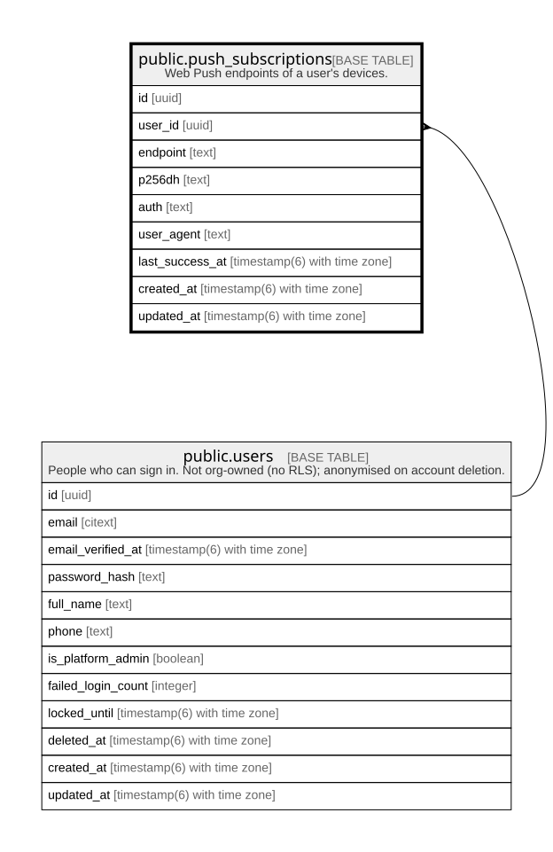

# public.push_subscriptions

## Description

Web Push endpoints of a user's devices.

## Columns

| Name            | Type                        | Default           | Nullable | Children | Parents                         | Comment |
| --------------- | --------------------------- | ----------------- | -------- | -------- | ------------------------------- | ------- |
| id              | uuid                        | gen_random_uuid() | false    |          |                                 |         |
| user_id         | uuid                        |                   | false    |          | [public.users](public.users.md) |         |
| endpoint        | text                        |                   | false    |          |                                 |         |
| p256dh          | text                        |                   | false    |          |                                 |         |
| auth            | text                        |                   | false    |          |                                 |         |
| user_agent      | text                        |                   | true     |          |                                 |         |
| last_success_at | timestamp(6) with time zone |                   | true     |          |                                 |         |
| created_at      | timestamp(6) with time zone | CURRENT_TIMESTAMP | false    |          |                                 |         |
| updated_at      | timestamp(6) with time zone | CURRENT_TIMESTAMP | false    |          |                                 |         |

## Constraints

| Name                            | Type        | Definition                                                                     |
| ------------------------------- | ----------- | ------------------------------------------------------------------------------ |
| push_subscriptions_user_id_fkey | FOREIGN KEY | FOREIGN KEY (user_id) REFERENCES users(id) ON UPDATE CASCADE ON DELETE CASCADE |
| push_subscriptions_pkey         | PRIMARY KEY | PRIMARY KEY (id)                                                               |

## Indexes

| Name                            | Definition                                                                                              |
| ------------------------------- | ------------------------------------------------------------------------------------------------------- |
| push_subscriptions_pkey         | CREATE UNIQUE INDEX push_subscriptions_pkey ON public.push_subscriptions USING btree (id)               |
| push_subscriptions_endpoint_key | CREATE UNIQUE INDEX push_subscriptions_endpoint_key ON public.push_subscriptions USING btree (endpoint) |
| push_subscriptions_user_id_idx  | CREATE INDEX push_subscriptions_user_id_idx ON public.push_subscriptions USING btree (user_id)          |

## Relations

---

> Generated by [tbls](https://github.com/k1LoW/tbls)
