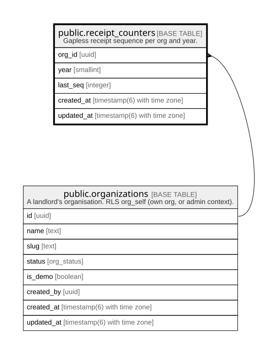

# public.receipt_counters

## Description

Gapless receipt sequence per org and year.

## Columns

| Name       | Type                        | Default           | Nullable | Children | Parents                                         | Comment |
| ---------- | --------------------------- | ----------------- | -------- | -------- | ----------------------------------------------- | ------- |
| org_id     | uuid                        |                   | false    |          | [public.organizations](public.organizations.md) |         |
| year       | smallint                    |                   | false    |          |                                                 |         |
| last_seq   | integer                     | 0                 | false    |          |                                                 |         |
| created_at | timestamp(6) with time zone | CURRENT_TIMESTAMP | false    |          |                                                 |         |
| updated_at | timestamp(6) with time zone | CURRENT_TIMESTAMP | false    |          |                                                 |         |

## Constraints

| Name                            | Type        | Definition                                                                             |
| ------------------------------- | ----------- | -------------------------------------------------------------------------------------- |
| receipt_counters_last_seq_check | CHECK       | CHECK ((last_seq >= 0))                                                                |
| receipt_counters_org_id_fkey    | FOREIGN KEY | FOREIGN KEY (org_id) REFERENCES organizations(id) ON UPDATE CASCADE ON DELETE RESTRICT |
| receipt_counters_pkey           | PRIMARY KEY | PRIMARY KEY (org_id, year)                                                             |

## Indexes

| Name                  | Definition                                                                                      |
| --------------------- | ----------------------------------------------------------------------------------------------- |
| receipt_counters_pkey | CREATE UNIQUE INDEX receipt_counters_pkey ON public.receipt_counters USING btree (org_id, year) |

## Relations

---

> Generated by [tbls](https://github.com/k1LoW/tbls)
