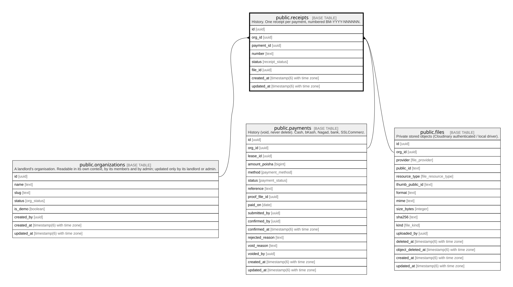

# public.receipts

## Description

History. One receipt per payment, numbered BM-YYYY-NNNNNN.

## Columns

| Name       | Type                        | Default                 | Nullable | Children | Parents                                         | Comment |
| ---------- | --------------------------- | ----------------------- | -------- | -------- | ----------------------------------------------- | ------- |
| id         | uuid                        | gen_random_uuid()       | false    |          |                                                 |         |
| org_id     | uuid                        |                         | false    |          | [public.organizations](public.organizations.md) |         |
| payment_id | uuid                        |                         | false    |          | [public.payments](public.payments.md)           |         |
| number     | text                        |                         | false    |          |                                                 |         |
| status     | receipt_status              | 'valid'::receipt_status | false    |          |                                                 |         |
| file_id    | uuid                        |                         | true     |          | [public.files](public.files.md)                 |         |
| created_at | timestamp(6) with time zone | CURRENT_TIMESTAMP       | false    |          |                                                 |         |
| updated_at | timestamp(6) with time zone | CURRENT_TIMESTAMP       | false    |          |                                                 |         |

## Constraints

| Name                     | Type        | Definition                                                                             |
| ------------------------ | ----------- | -------------------------------------------------------------------------------------- |
| receipts_org_id_fkey     | FOREIGN KEY | FOREIGN KEY (org_id) REFERENCES organizations(id) ON UPDATE CASCADE ON DELETE RESTRICT |
| receipts_payment_id_fkey | FOREIGN KEY | FOREIGN KEY (payment_id) REFERENCES payments(id) ON UPDATE CASCADE ON DELETE RESTRICT  |
| receipts_pkey            | PRIMARY KEY | PRIMARY KEY (id)                                                                       |
| receipts_file_id_fkey    | FOREIGN KEY | FOREIGN KEY (file_id) REFERENCES files(id) ON UPDATE CASCADE ON DELETE SET NULL        |

## Indexes

| Name                       | Definition                                                                                     |
| -------------------------- | ---------------------------------------------------------------------------------------------- |
| receipts_pkey              | CREATE UNIQUE INDEX receipts_pkey ON public.receipts USING btree (id)                          |
| receipts_payment_id_key    | CREATE UNIQUE INDEX receipts_payment_id_key ON public.receipts USING btree (payment_id)        |
| receipts_file_id_idx       | CREATE INDEX receipts_file_id_idx ON public.receipts USING btree (file_id)                     |
| receipts_org_id_number_key | CREATE UNIQUE INDEX receipts_org_id_number_key ON public.receipts USING btree (org_id, number) |

## Relations

---

> Generated by [tbls](https://github.com/k1LoW/tbls)
