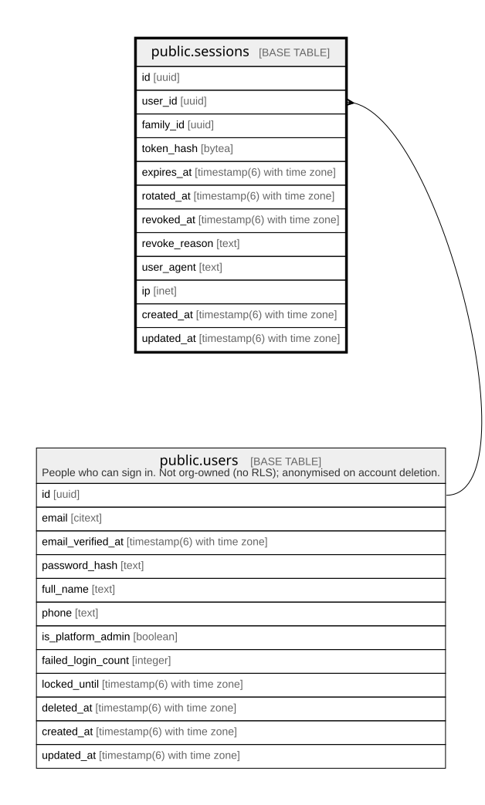

# public.sessions

## Columns

| Name          | Type                        | Default           | Nullable | Children | Parents                         | Comment |
| ------------- | --------------------------- | ----------------- | -------- | -------- | ------------------------------- | ------- |
| id            | uuid                        | gen_random_uuid() | false    |          |                                 |         |
| user_id       | uuid                        |                   | false    |          | [public.users](public.users.md) |         |
| family_id     | uuid                        |                   | false    |          |                                 |         |
| token_hash    | bytea                       |                   | false    |          |                                 |         |
| expires_at    | timestamp(6) with time zone |                   | false    |          |                                 |         |
| rotated_at    | timestamp(6) with time zone |                   | true     |          |                                 |         |
| revoked_at    | timestamp(6) with time zone |                   | true     |          |                                 |         |
| revoke_reason | text                        |                   | true     |          |                                 |         |
| user_agent    | text                        |                   | true     |          |                                 |         |
| ip            | inet                        |                   | true     |          |                                 |         |
| created_at    | timestamp(6) with time zone | CURRENT_TIMESTAMP | false    |          |                                 |         |
| updated_at    | timestamp(6) with time zone | CURRENT_TIMESTAMP | false    |          |                                 |         |

## Constraints

| Name                  | Type        | Definition                                                                     |
| --------------------- | ----------- | ------------------------------------------------------------------------------ |
| sessions_user_id_fkey | FOREIGN KEY | FOREIGN KEY (user_id) REFERENCES users(id) ON UPDATE CASCADE ON DELETE CASCADE |
| sessions_pkey         | PRIMARY KEY | PRIMARY KEY (id)                                                               |

## Indexes

| Name                      | Definition                                                                                                 |
| ------------------------- | ---------------------------------------------------------------------------------------------------------- |
| sessions_pkey             | CREATE UNIQUE INDEX sessions_pkey ON public.sessions USING btree (id)                                      |
| sessions_token_hash_key   | CREATE UNIQUE INDEX sessions_token_hash_key ON public.sessions USING btree (token_hash)                    |
| sessions_user_id_live_idx | CREATE INDEX sessions_user_id_live_idx ON public.sessions USING btree (user_id) WHERE (revoked_at IS NULL) |
| sessions_family_id_idx    | CREATE INDEX sessions_family_id_idx ON public.sessions USING btree (family_id)                             |

## Relations

---

> Generated by [tbls](https://github.com/k1LoW/tbls)
