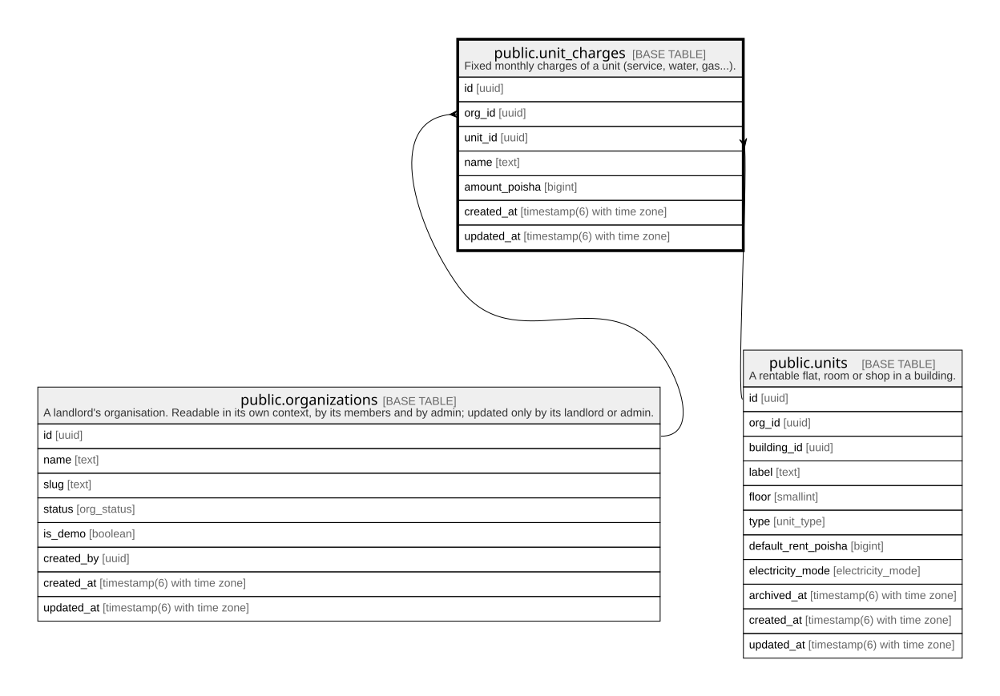

# public.unit_charges

## Description

Fixed monthly charges of a unit (service, water, gas...).

## Columns

| Name          | Type                        | Default           | Nullable | Children | Parents                                         | Comment |
| ------------- | --------------------------- | ----------------- | -------- | -------- | ----------------------------------------------- | ------- |
| id            | uuid                        | gen_random_uuid() | false    |          |                                                 |         |
| org_id        | uuid                        |                   | false    |          | [public.organizations](public.organizations.md) |         |
| unit_id       | uuid                        |                   | false    |          | [public.units](public.units.md)                 |         |
| name          | text                        |                   | false    |          |                                                 |         |
| amount_poisha | bigint                      |                   | false    |          |                                                 |         |
| created_at    | timestamp(6) with time zone | CURRENT_TIMESTAMP | false    |          |                                                 |         |
| updated_at    | timestamp(6) with time zone | CURRENT_TIMESTAMP | false    |          |                                                 |         |

## Constraints

| Name                      | Type        | Definition                                                                             |
| ------------------------- | ----------- | -------------------------------------------------------------------------------------- |
| unit_charges_amount_check | CHECK       | CHECK ((amount_poisha >= 0))                                                           |
| unit_charges_org_id_fkey  | FOREIGN KEY | FOREIGN KEY (org_id) REFERENCES organizations(id) ON UPDATE CASCADE ON DELETE RESTRICT |
| unit_charges_unit_id_fkey | FOREIGN KEY | FOREIGN KEY (unit_id) REFERENCES units(id) ON UPDATE CASCADE ON DELETE CASCADE         |
| unit_charges_pkey         | PRIMARY KEY | PRIMARY KEY (id)                                                                       |

## Indexes

| Name                          | Definition                                                                                           |
| ----------------------------- | ---------------------------------------------------------------------------------------------------- |
| unit_charges_pkey             | CREATE UNIQUE INDEX unit_charges_pkey ON public.unit_charges USING btree (id)                        |
| unit_charges_org_id_idx       | CREATE INDEX unit_charges_org_id_idx ON public.unit_charges USING btree (org_id)                     |
| unit_charges_unit_id_name_key | CREATE UNIQUE INDEX unit_charges_unit_id_name_key ON public.unit_charges USING btree (unit_id, name) |

## Relations

---

> Generated by [tbls](https://github.com/k1LoW/tbls)
