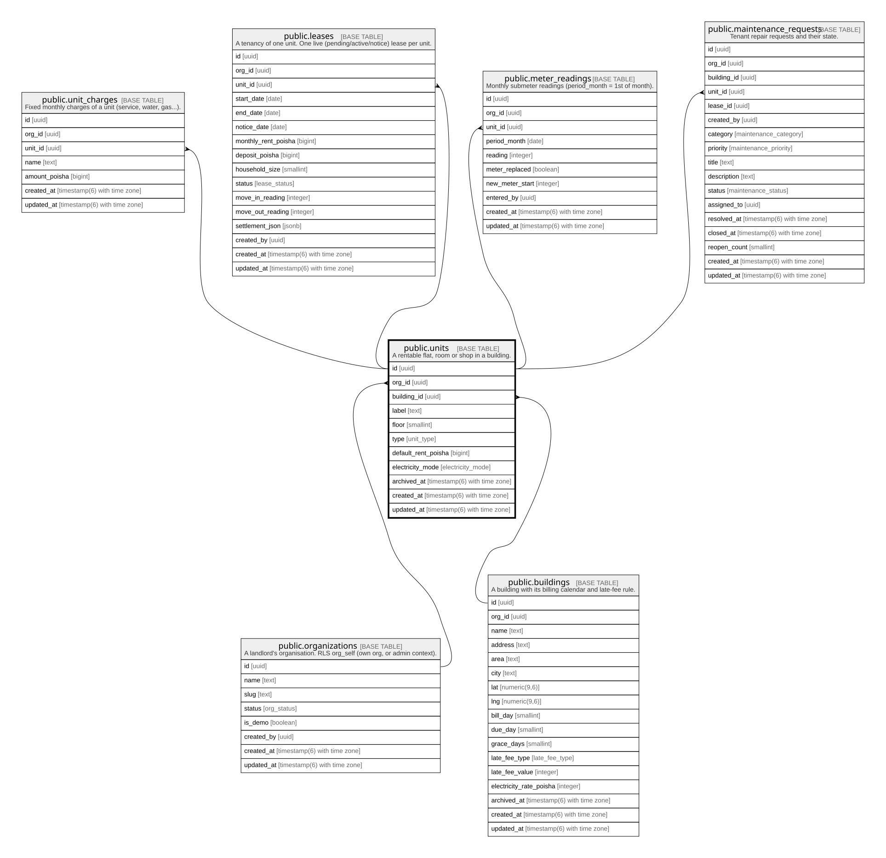

# public.units

## Description

A rentable flat, room or shop in a building.

## Columns

| Name                | Type                        | Default           | Nullable | Children                                                                                                                                                                                        | Parents                                         | Comment |
| ------------------- | --------------------------- | ----------------- | -------- | ----------------------------------------------------------------------------------------------------------------------------------------------------------------------------------------------- | ----------------------------------------------- | ------- |
| id                  | uuid                        | gen_random_uuid() | false    | [public.unit_charges](public.unit_charges.md) [public.leases](public.leases.md) [public.meter_readings](public.meter_readings.md) [public.maintenance_requests](public.maintenance_requests.md) |                                                 |         |
| org_id              | uuid                        |                   | false    |                                                                                                                                                                                                 | [public.organizations](public.organizations.md) |         |
| building_id         | uuid                        |                   | false    |                                                                                                                                                                                                 | [public.buildings](public.buildings.md)         |         |
| label               | text                        |                   | false    |                                                                                                                                                                                                 |                                                 |         |
| floor               | smallint                    |                   | false    |                                                                                                                                                                                                 |                                                 |         |
| type                | unit_type                   |                   | false    |                                                                                                                                                                                                 |                                                 |         |
| default_rent_poisha | bigint                      |                   | false    |                                                                                                                                                                                                 |                                                 |         |
| electricity_mode    | electricity_mode            |                   | false    |                                                                                                                                                                                                 |                                                 |         |
| archived_at         | timestamp(6) with time zone |                   | true     |                                                                                                                                                                                                 |                                                 |         |
| created_at          | timestamp(6) with time zone | CURRENT_TIMESTAMP | false    |                                                                                                                                                                                                 |                                                 |         |
| updated_at          | timestamp(6) with time zone | CURRENT_TIMESTAMP | false    |                                                                                                                                                                                                 |                                                 |         |

## Constraints

| Name                     | Type        | Definition                                                                              |
| ------------------------ | ----------- | --------------------------------------------------------------------------------------- |
| units_default_rent_check | CHECK       | CHECK ((default_rent_poisha >= 0))                                                      |
| units_org_id_fkey        | FOREIGN KEY | FOREIGN KEY (org_id) REFERENCES organizations(id) ON UPDATE CASCADE ON DELETE RESTRICT  |
| units_building_id_fkey   | FOREIGN KEY | FOREIGN KEY (building_id) REFERENCES buildings(id) ON UPDATE CASCADE ON DELETE RESTRICT |
| units_pkey               | PRIMARY KEY | PRIMARY KEY (id)                                                                        |

## Indexes

| Name                        | Definition                                                                                       |
| --------------------------- | ------------------------------------------------------------------------------------------------ |
| units_pkey                  | CREATE UNIQUE INDEX units_pkey ON public.units USING btree (id)                                  |
| units_org_id_idx            | CREATE INDEX units_org_id_idx ON public.units USING btree (org_id)                               |
| units_building_id_label_key | CREATE UNIQUE INDEX units_building_id_label_key ON public.units USING btree (building_id, label) |

## Relations

---

> Generated by [tbls](https://github.com/k1LoW/tbls)
