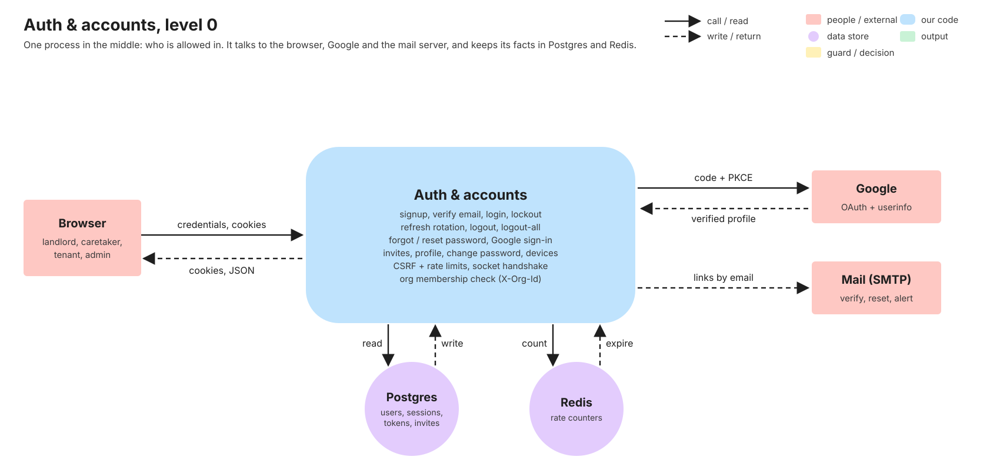
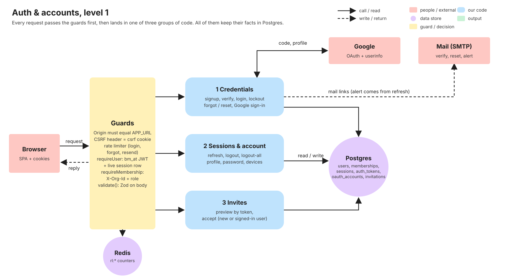
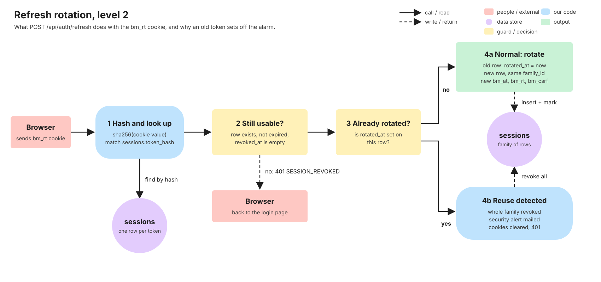
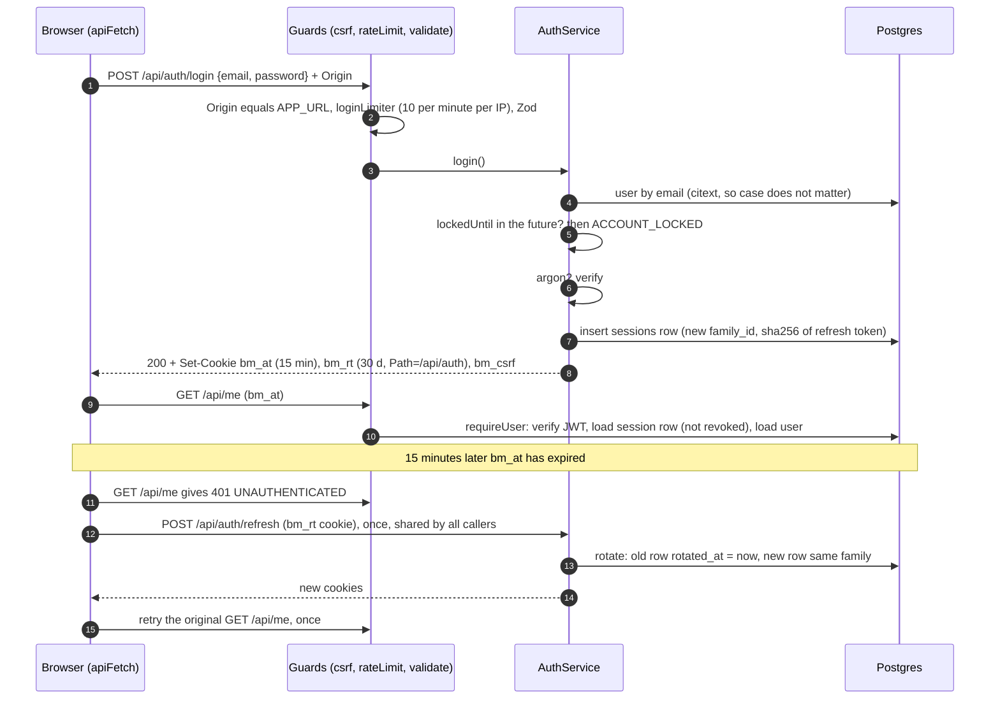
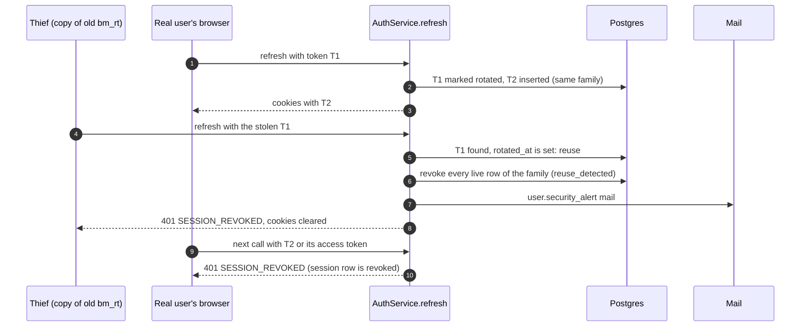
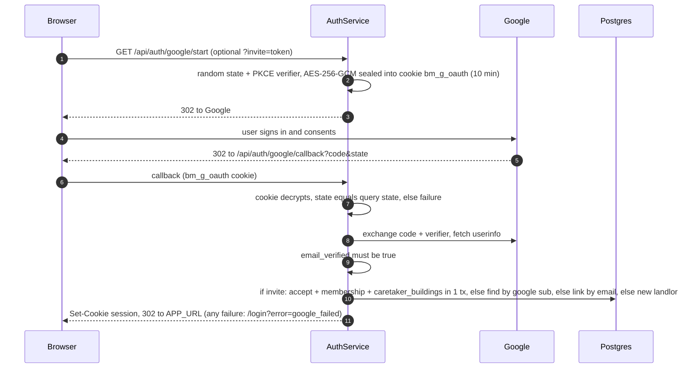
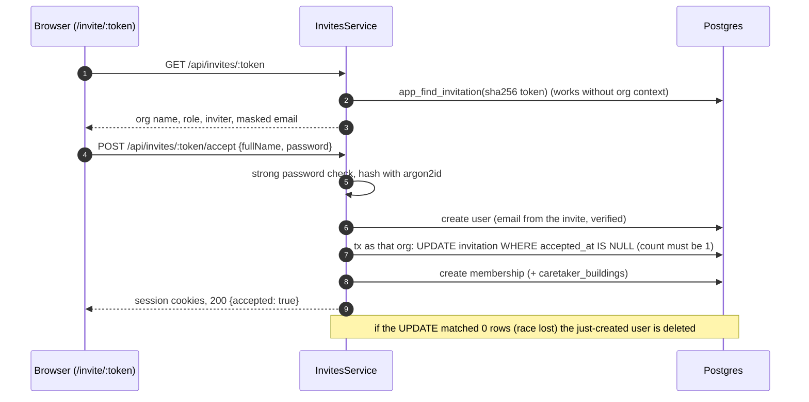

# Auth & accounts

> **The flagship page.** Everything else in BasaManager trusts the answer this feature gives: "who is this,
> and are they still allowed in?". Written in task V5 from the merged code and its tests. If this page and the
> code disagree, the code wins: fix the page.

## 1. What it does

Auth lets people get in and stay in safely: a landlord signs up (or uses Google), caretakers and tenants join
only through an invite link, everyone can reset a forgotten password, stay signed in for 30 days per device,
see their devices on the account page and sign out of one or all of them. It also protects against password
guessing and tells the rest of the API who the caller is and which organisation they are acting in.

Stories from `.agent/01-PRODUCT.md`: **A1** sign up and verify email, **A2** Google sign-in, **A3** invite-only
join for caretakers and tenants, **A4** password reset, **A5** 30-day sessions and sign out everywhere, **A6**
protection from password guessing, **A7** switch between organisations. **A8** (delete my account) is built in
task V15: the delete section exists on the account page, but `DELETE /api/me` does not exist yet.

## 2. Explain it in 2 minutes

> "Logging in gives the browser three cookies. One is a short-lived JWT, an access token that lasts 15
> minutes. One is a long-lived random refresh token that lasts 30 days. One is a CSRF token the page copies
> into a header. The access token proves who you are on each call, but we also check its session row in the
> database on every request, so signing out is instant, not 'in up to 15 minutes'.
>
> When the access token expires the browser quietly asks `/api/auth/refresh`. The server does not reuse the
> refresh token: it marks it as used and hands out a brand-new one, in the same 'family'. If someone ever
> presents a token that was already used, that means two parties hold the same token, so one of them is a
> thief. We cannot tell which, so we revoke the whole family, mail the owner a security alert and sign
> everyone in that family out.
>
> Passwords are hashed with argon2id. Five wrong guesses lock the account for 15 minutes and there is a
> per-IP rate limit in Redis. Messages never reveal whether an email has an account. Reset and verify links
> are random tokens stored only as hashes, single-use, and consumed with one atomic SQL statement so two
> clicks cannot both win. Caretakers and tenants cannot sign up: they accept a single-use invite bound to
> their email. Google sign-in uses PKCE and a state cookie, and only trusts Google emails that Google has
> verified. Every mutation also needs the right Origin and a matching CSRF header."

## 3. Level 0 diagram

Data in: credentials, cookies, Google's `code`. Data out: cookies, JSON, mail, a redirect. Postgres holds the
durable facts (users, memberships, sessions, tokens, invites). Redis holds only the rate-limit counters.

## 4. Level 1 diagram

Every request goes through the **guards** in [app.ts](https://github.com/RHRONY05/BasaManager/blob/main/apps/api/src/app.ts) and the route files: request
id, logging, helmet, JSON parsing, cookie parsing, then the CSRF check on unsafe methods. Per route come the
rate limiter, `requireUser` (checks the `bm_at` JWT and its live session row), `requireMembership` (checks
`X-Org-Id`) and `validate()` (Zod). Then the code runs in one of three groups:

1. **Credentials**: signup, verify email, login, forgot and reset password, Google sign-in.
2. **Sessions and account**: refresh, logout, logout-all, `/api/me`, devices, change password.
3. **Invites**: preview and accept.

## 5. Level 2 diagram

The most delicate part is the refresh token: how it rotates and how a replay is caught.

Think of the refresh token as a **single-use train ticket that is swapped at every gate**. Each swap hands you
a new ticket from the same book (the family) and punches the old one. A punched ticket shown again means a
photocopy exists, so the whole book is cancelled.

## 6. Sequence diagrams

### 6.1 Login, an ordinary call, and a silent refresh (main path)

### 6.2 Failure path: an old refresh token is replayed

### 6.3 Google sign-in

### 6.4 Invite accept by a brand-new caretaker

## 7. Code walk

### Request in (every request)

1. [requestId.ts](https://github.com/RHRONY05/BasaManager/blob/main/apps/api/src/middleware/requestId.ts) and [logger.ts](https://github.com/RHRONY05/BasaManager/blob/main/apps/api/src/middleware/logger.ts):
   id and a structured log line. Cookies, `Authorization`, `X-CSRF-Token` and secret keys are redacted
   (`REDACT_PATHS` in `apps/api/src/lib/logger.ts`); URLs have `token`, `code`, `state` masked and
   `/api/invites/<token>` is rewritten.
2. [csrf.ts](https://github.com/RHRONY05/BasaManager/blob/main/apps/api/src/middleware/csrf.ts) `createCsrfMiddleware`: safe methods pass. Unsafe methods
   need `Origin === APP_URL`; and if any of `bm_at`, `bm_rt` or `bm_csrf` is present, header `X-CSRF-Token`
   must equal the `bm_csrf` cookie. Only the SSLCommerz IPN path is exempt.
3. [app.ts](https://github.com/RHRONY05/BasaManager/blob/main/apps/api/src/app.ts) mounts `/api/auth`, `/api/me`, `/api/invites`, `/api/org`.
   `trust proxy` is 1 so `req.ip` is the real client behind Caddy.

### Routes, validation, controllers

- [auth.routes.ts](https://github.com/RHRONY05/BasaManager/blob/main/apps/api/src/modules/auth/auth.routes.ts): wiring and order per route. Example:
  `login` = `loginLimiter`, then `validate({ body })`, then the controller.
- Zod schemas live in `packages/shared/src/api/auth.ts` (shared with the web forms).
- [auth.controller.ts](https://github.com/RHRONY05/BasaManager/blob/main/apps/api/src/modules/auth/auth.controller.ts): thin. Reads the validated body,
  calls the service, wraps in `{ data }`, forwards errors with `next(err)`.

### Services (the logic)

- [auth.service.ts](https://github.com/RHRONY05/BasaManager/blob/main/apps/api/src/modules/auth/auth.service.ts) `AuthService`:
  - `signup`: validates the password (10+ chars, not in the common list, not only digits), lowercases the
    email. If the email exists it returns the **same** message and does nothing. Otherwise creates the user
    (unverified), then one `$tx` creating the organisation, the `landlord` membership, an `email_verify` token
    (hash only, 24 h) and an outbox row, sends the mail, creates a session family and sets cookies.
  - `verifyEmail`: one `UPDATE auth_tokens SET used_at = now WHERE token_hash = ... AND used_at IS NULL AND
expires_at > now RETURNING user_id`. No row back means `TOKEN_INVALID` (unknown, used and expired look the
    same). Then sets `users.email_verified_at`.
  - `resendVerification`: new token, outbox, mail. Limited to 3 per hour per user.
  - `login`: unknown or deleted email runs a dummy argon2 verify (so timing is similar) and answers
    `INVALID_CREDENTIALS`; a locked account answers `ACCOUNT_LOCKED` before checking the password; a wrong
    password increments `failed_login_count` and at 5 sets `locked_until = now + 15 min`; success resets both
    and creates a new session family.
  - `refresh`: the logic of the level 2 diagram.
  - `logout` revokes the current session row; `logoutAll` revokes every live row of the user and calls
    `emitSessionRevoked`.
  - `forgotPassword`: always the same 200 body; token generation, DB write, and mail dispatch are executed in the background off the critical path, so response timing does not leak account existence.
  - `resetPassword`: validates the new password first (a weak password does not burn the token), consumes the
    token atomically, writes the new hash, revokes **all** sessions, kicks sockets, then signs in this device.
  - `googleStart` and `googleCallback`: see 6.3 and [google.ts](https://github.com/RHRONY05/BasaManager/blob/main/apps/api/src/modules/auth/google.ts)
    (`encryptOAuthState`, `decryptOAuthState`, `getGoogleClient` built on `arctic`).
- [users.service.ts](https://github.com/RHRONY05/BasaManager/blob/main/apps/api/src/modules/users/users.service.ts) `UsersService`: `getMe` (profile plus
  memberships across orgs, read with a user-scoped transaction), `updateMe`, `changePassword` (verifies the
  current password, revokes every _other_ family), `listSessions` (live rows not yet rotated, revoked, or expired where `expires_at > now()`, so one per
  device, marking the current one, never returning token material), `revokeSession` (family of a session that
  belongs to you; anything else is 404).
- [invites.service.ts](https://github.com/RHRONY05/BasaManager/blob/main/apps/api/src/modules/invites/invites.service.ts) `InvitesService`: `preview`
  (masked email, no login) and `accept` (see 6.4; a signed-in user must have the invited email exactly).
  Invites are **created** in V6 and V7; this task only reads and accepts them.
- [orgs.service.ts](https://github.com/RHRONY05/BasaManager/blob/main/apps/api/src/modules/orgs/orgs.service.ts): `GET`/`PATCH /api/org` run inside the
  caller's tenant context (row-level security applies). Landlord only for the patch.

### Who is calling

- [auth.ts](https://github.com/RHRONY05/BasaManager/blob/main/apps/api/src/middleware/auth.ts) `createRequireUser`: reads `bm_at`, verifies the HS256 JWT
  (`verifyAccessToken` in `apps/api/src/lib/tokens.ts`), **loads the session row** (must exist and not be
  revoked), loads the user (must not be deleted) and sets `req.user`. `createOptionalUser` does the same but
  never fails (used by invite accept).
- [org.ts](https://github.com/RHRONY05/BasaManager/blob/main/apps/api/src/middleware/org.ts) `createRequireMembership`: requires a UUID `X-Org-Id`, finds an
  **active** membership of this user in it, else `404 NOT_FOUND` (never "forbidden", so existence does not
  leak), then builds `req.tenantCtx` for the row-level-security transaction. `requireRole(...)` compares the
  role.
- [rateLimit.ts](https://github.com/RHRONY05/BasaManager/blob/main/apps/api/src/middleware/rateLimit.ts): see section 11 and the concept page.

### Cookies and tokens

- [cookies.ts](https://github.com/RHRONY05/BasaManager/blob/main/apps/api/src/lib/cookies.ts) `setAuthCookies`, `clearAuthCookies`;
  [tokens.ts](https://github.com/RHRONY05/BasaManager/blob/main/apps/api/src/lib/tokens.ts) `sha256`, `generateRandomToken`, `signAccessToken`;
  [passwords.ts](https://github.com/RHRONY05/BasaManager/blob/main/apps/api/src/lib/passwords.ts) `hashPassword` (argon2id, m=19456, t=2, p=1),
  `validatePassword`.

### Mail

`deliverOutboxNow` in [mailer.ts](https://github.com/RHRONY05/BasaManager/blob/main/apps/api/src/config/mailer.ts) renders
[templates.ts](https://github.com/RHRONY05/BasaManager/blob/main/apps/api/src/emails/templates.ts) (`user.verify_email`, `user.password_reset`,
`user.security_alert`) and sends over SMTP in-process. The same facts are also written to the `outbox_messages`
table in the transaction; the worker that takes over delivery (with retries) arrives in V11. A mail failure
never fails the request.

### Real time

[io.ts](https://github.com/RHRONY05/BasaManager/blob/main/apps/api/src/realtime/io.ts) `attachRealtime`: the Socket.io handshake reads `bm_at` from the
cookie header, verifies the JWT, stores `userId` and `sessionId` on the socket and joins room `user:<id>`.
[emit.ts](https://github.com/RHRONY05/BasaManager/blob/main/apps/api/src/realtime/emit.ts) `emitSessionRevoked(userId)` emits `session:revoked` to that room
and disconnects those sockets. It is called by `logoutAll` and `resetPassword`.

### Web

- [client.ts](https://github.com/RHRONY05/BasaManager/blob/main/apps/web/src/lib/api/client.ts) `apiFetch`: adds `X-CSRF-Token` (from the `bm_csrf` cookie)
  on unsafe methods and `X-Org-Id` (active org). On `401 UNAUTHENTICATED` it runs **one** shared refresh
  (`runSingleFlightRefresh`) and retries the request once. `SESSION_REVOKED` is not retried. If the refresh
  fails it clears the active org and navigates to `/login`.
- [AuthContext.tsx](https://github.com/RHRONY05/BasaManager/blob/main/apps/web/src/app/auth/AuthContext.tsx) `AuthProvider`: asks `/api/me`, exposes
  `status` (loading, signedOut, signedIn), `activeOrg`, `role`, `switchOrg` (clears the query cache) and
  `signOut`. It also listens for `session:revoked` on a socket if one exists (the web socket client itself
  arrives in V11).
- [guards.tsx](https://github.com/RHRONY05/BasaManager/blob/main/apps/web/src/app/auth/guards.tsx): `RequireAuth`, `RequireRole`, `RedirectIfSignedIn`,
  `homeFor(role)` and `sanitizeNext` (only same-origin paths like `/l/billing`; rejects `//host`, backslashes,
  control characters).
- Pages in `apps/web/src/pages/auth/` ([LandingPage](https://github.com/RHRONY05/BasaManager/blob/main/apps/web/src/pages/auth/LandingPage.tsx),
  [LoginPage](https://github.com/RHRONY05/BasaManager/blob/main/apps/web/src/pages/auth/LoginPage.tsx),
  [SignupPage](https://github.com/RHRONY05/BasaManager/blob/main/apps/web/src/pages/auth/SignupPage.tsx),
  [VerifyEmailPage](https://github.com/RHRONY05/BasaManager/blob/main/apps/web/src/pages/auth/VerifyEmailPage.tsx),
  [ForgotPasswordPage](https://github.com/RHRONY05/BasaManager/blob/main/apps/web/src/pages/auth/ForgotPasswordPage.tsx),
  [ResetPasswordPage](https://github.com/RHRONY05/BasaManager/blob/main/apps/web/src/pages/auth/ResetPasswordPage.tsx),
  [InvitePage](https://github.com/RHRONY05/BasaManager/blob/main/apps/web/src/pages/auth/InvitePage.tsx)) and the
  [AccountPage](https://github.com/RHRONY05/BasaManager/blob/main/apps/web/src/pages/shared/AccountPage.tsx) (profile, change password, devices).
- [AuthLayout.tsx](https://github.com/RHRONY05/BasaManager/blob/main/apps/web/src/app/layouts/AuthLayout.tsx) wraps every auth page:
  on screens from 768 px wide a left panel (sky, brand, headline, a sample bill, and from 1024 px the drawn
  building) sits beside the form. The drawings are plain SVG/HTML in
  [components/illustrations/](https://github.com/RHRONY05/BasaManager/tree/main/apps/web/src/components/illustrations), coloured only by
  `--illo-*` tokens, so dark mode works without extra code. The landing page's building is interactive: each flat
  is a `button`; tapping it swaps the sample bill shown beside it (static sample data, nothing is fetched).

## 8. Where the data lives

| Data                              | Store                                                                                          | Who can read / write                                                        | How it is protected                                                                 |
| --------------------------------- | ---------------------------------------------------------------------------------------------- | --------------------------------------------------------------------------- | ----------------------------------------------------------------------------------- |
| Email, name, phone, password hash | Postgres `users` (`password_hash` null for Google-only)                                        | Auth/users services; the owner via `/api/me`                                | argon2id; never returned by any route or logged                                     |
| Failed-login counter and lock     | Postgres `users.failed_login_count`, `locked_until`                                            | Auth service                                                                | Server-side only                                                                    |
| Refresh tokens and devices        | Postgres `sessions` (`token_hash`, `family_id`, `rotated_at`, `revoked_at`, ua, ip)            | Auth service; owner sees id, device string, ip, date via `/api/me/sessions` | Only the SHA-256 hash is stored; no RLS (no org), reached only through the service  |
| Verify and reset tokens           | Postgres `auth_tokens` (`kind`, `token_hash`, `expires_at`, `used_at`)                         | Auth service                                                                | Hash only; single-use; short expiry                                                 |
| Google link                       | Postgres `oauth_accounts` (`provider`, Google `sub`)                                           | Auth service                                                                | Unique on provider + sub                                                            |
| Memberships (user, org, role)     | Postgres `memberships` (RLS)                                                                   | Services; user-scoped reads for `/api/me` and `requireMembership`           | Row-level security; 404 for non-members                                             |
| Invitations                       | Postgres `invitations` (RLS; token hash)                                                       | Org members; lookup by hash through `app_find_invitation`                   | Hash only; single-use; revocable                                                    |
| Outgoing mail facts               | Postgres `outbox_messages`                                                                     | Worker (V11)                                                                | Contains the raw token until delivered; table is internal                           |
| Access token `bm_at`              | Browser cookie: HttpOnly, SameSite=Lax, `Path=/`, 15 min                                       | Browser sends it; JS cannot read it                                         | HS256 JWT `{sub, sid, adm}` signed with `JWT_SECRET`; `Secure` when `COOKIE_SECURE` |
| Refresh token `bm_rt`             | Browser cookie: HttpOnly, SameSite=Strict, `Path=/api/auth`, 30 days                           | Sent only to `/api/auth/*`                                                  | Opaque random 32 bytes; rotated each use                                            |
| CSRF token `bm_csrf`              | Browser cookie, **not** HttpOnly, SameSite=Lax, `Path=/`, 30 days                              | JS reads it to copy into `X-CSRF-Token`                                     | An attacker site cannot read it (cross-origin)                                      |
| OAuth state `bm_g_oauth`          | Browser cookie, HttpOnly, `Path=/api/auth/google`, 10 min                                      | Server                                                                      | AES-256-GCM sealed `{state, codeVerifier, invite?}`                                 |
| Active organisation               | Browser `localStorage` key `bm.activeOrg`, sent as `X-Org-Id`                                  | The user                                                                    | Not trusted: the server re-checks membership on every request                       |
| Rate-limit counters               | Redis `rl:login:*`, `rl:forgot:*`, `rl:resend_verify:*`, `rl:auth_sensitive:*`, `rl:general:*` | The limiter                                                                 | Expire with the window                                                              |
| Live sockets                      | Socket.io rooms `user:<id>` (Redis adapter)                                                    | Server                                                                      | Cookie-authenticated handshake                                                      |

The cross-system view is in [data-map](../overview/data-map.md) and the table definitions are in
[03-DATABASE](https://github.com/RHRONY05/BasaManager/blob/main/.agent/03-DATABASE.md).

## 9. Data lifecycle

| Event                        | What happens                                                                                                                                                                                                                                                         |
| ---------------------------- | -------------------------------------------------------------------------------------------------------------------------------------------------------------------------------------------------------------------------------------------------------------------- |
| Sign up                      | `users`, `organizations`, `memberships` (landlord, active), an `email_verify` token, an outbox row and a session family are created.                                                                                                                                 |
| Verify email                 | `auth_tokens.used_at` set, `users.email_verified_at` set. The token row stays (used).                                                                                                                                                                                |
| Log in                       | A new family: one `sessions` row. Failed counter reset.                                                                                                                                                                                                              |
| Refresh                      | Old row gets `rotated_at`; a new row joins the family. Old rows are never edited again (they are the evidence for reuse detection).                                                                                                                                  |
| Log out                      | Current row `revoked_at`, reason `logout`; cookies cleared. Other devices untouched.                                                                                                                                                                                 |
| Log out all / reset password | Every live row revoked (`logout_all` or `password_reset`); sockets get `session:revoked` and are disconnected.                                                                                                                                                       |
| Change password              | Hash replaced; every other family revoked (`password_changed`); the current one stays.                                                                                                                                                                               |
| Revoke a device              | Its whole family revoked (`revoked_by_user`).                                                                                                                                                                                                                        |
| Reuse detected               | Whole family revoked (`reuse_detected`), alert mail.                                                                                                                                                                                                                 |
| Invite accepted              | `invitations.accepted_at` set, membership created, caretaker building links created. For a new user the account is created verified.                                                                                                                                 |
| Expiry and cleanup           | Tokens and sessions just stop working at `expires_at`. The retention job that deletes sessions 60 days after expiry and expired tokens and invites **is not built yet** (the worker job list is empty), so those rows accumulate until it is.                        |
| Delete account (A8)          | **Not built in V5.** Planned in V15: anonymise the user, delete sessions, OAuth links and tokens, remove memberships, keep financial records (see 03-DATABASE). Deleted users are already refused by `login`, `requireUser` and `refresh` (they check `deleted_at`). |
| Delete a user row            | `sessions`, `auth_tokens`, `oauth_accounts` cascade (`ON DELETE CASCADE`).                                                                                                                                                                                           |

## 10. Edge cases & failure modes

| Case                                                                | What happens                                                                                                                                                                                                                                                                                                                  | Where                                           | Test                                                                                                   |
| ------------------------------------------------------------------- | ----------------------------------------------------------------------------------------------------------------------------------------------------------------------------------------------------------------------------------------------------------------------------------------------------------------------------- | ----------------------------------------------- | ------------------------------------------------------------------------------------------------------ |
| Signup with an email that already has an account                    | Identical success answer, no mail, no cookies, nothing created (no enumeration)                                                                                                                                                                                                                                               | `AuthService.signup`                            | `signup.int.test.ts` "answers exactly like a fresh signup"                                             |
| Two signups with the same email at the same instant                 | The unique index stops duplicate user creation; P2002 on users_email is caught and returns the standard "Check your email" response without leaking registration state                                                                                                                                                        | `AuthService.signup`                            | `signup.int.test.ts` "two concurrent signups with the same email"                                      |
| Two signups generate identical org slug (e.g. non-Latin name)       | P2002 on organization slug triggers automatic regeneration and retry (up to 3 attempts)                                                                                                                                                                                                                                       | `AuthService.signup`                            | `signup.int.test.ts` "slug collision on signup retries with fresh slug and creates the account"        |
| Wrong password, unknown email, deleted user                         | Same `INVALID_CREDENTIALS`; unknown email still pays an argon2 verify                                                                                                                                                                                                                                                         | `AuthService.login`                             | `login.int.test.ts` "wrong password and unknown email give the same answer"                            |
| Email in different case                                             | Matches (citext, and the code lowercases)                                                                                                                                                                                                                                                                                     | `login`, `signup`                               | `login.int.test.ts` "email matching is case-insensitive"                                               |
| 5 wrong passwords                                                   | `ACCOUNT_LOCKED` (423) for 15 minutes, even for the right password                                                                                                                                                                                                                                                            | `login`                                         | "5 wrong passwords lock the account for 15 minutes"                                                    |
| Lock expires                                                        | Counter restarts from zero; a success clears it                                                                                                                                                                                                                                                                               | `login`                                         | "the lock ends after 15 minutes", "a successful login resets the failure counter"                      |
| 11th login from one IP within a minute                              | `RATE_LIMITED` (429) from Redis counter                                                                                                                                                                                                                                                                                       | `loginLimiter`                                  | "the 11th login attempt within a minute from one IP is RATE_LIMITED"                                   |
| Google-only account tries a password                                | `INVALID_CREDENTIALS` (no hash); "forgot password" can set one                                                                                                                                                                                                                                                                | `login`                                         | `auth.service.test.ts` login cases                                                                     |
| Verify or reset link clicked twice                                  | Second click is `TOKEN_INVALID`: the atomic `UPDATE ... WHERE used_at IS NULL` lets only one request win                                                                                                                                                                                                                      | `verifyEmail`, `resetPassword`                  | `signup.int.test.ts` "a verify token works once"; `password.int.test.ts` "a reset token is single-use" |
| Link expired (24 h verify, 30 min reset)                            | `TOKEN_INVALID`                                                                                                                                                                                                                                                                                                               | same                                            | "TOKEN_INVALID after it expires"; "a reset token expires after 30 minutes" (clock moved)               |
| Weak new password on reset                                          | Validation error and the token is **not** consumed                                                                                                                                                                                                                                                                            | `resetPassword` validates first                 | "a weak new password does not consume a valid token"                                                   |
| Forgot password for an unknown email                                | Same 200 body, no mail                                                                                                                                                                                                                                                                                                        | `forgotPassword`                                | "forgot-password is 200 with an identical body"; e2e "same answer (no account enumeration)"            |
| Resend verification more than 3 times in an hour                    | `RATE_LIMITED`                                                                                                                                                                                                                                                                                                                | `resendVerificationLimiter` (keyed by user id)  | `signup.int.test.ts` resend case                                                                       |
| Refresh cookie missing                                              | `401 UNAUTHENTICATED`                                                                                                                                                                                                                                                                                                         | `refresh`                                       | `sessions.int.test.ts` "refresh without a refresh cookie"                                              |
| Old refresh token replayed                                          | Family revoked (including the newest token), alert mail, cookies cleared, `SESSION_REVOKED`                                                                                                                                                                                                                                   | `refresh`                                       | "reusing a rotated refresh token is SESSION_REVOKED"; e2e "replaying an old refresh cookie"            |
| Refresh token expired or already logged out                         | `SESSION_REVOKED`                                                                                                                                                                                                                                                                                                             | `refresh`                                       | "an expired refresh token cannot be used", "a revoked-by-logout refresh token is SESSION_REVOKED"      |
| Two tabs refresh with the same token at the same time               | Coordinated in browser via `navigator.locks` and enforced atomically on the server via conditional `UPDATE sessions SET rotated_at = now WHERE id = ... AND rotated_at IS NULL AND revoked_at IS NULL RETURNING id`. Exactly one wins; concurrent replays detect reuse, revoke the token family, and return `SESSION_REVOKED` | `runSingleFlightRefresh`, `AuthService.refresh` | `client.test.ts` single-flight test; `sessions.int.test.ts` 5-way concurrent refresh test              |
| Access token still valid but the session was revoked                | Rejected at once: `requireUser` loads the session row every request                                                                                                                                                                                                                                                           | `createRequireUser`                             | `sessions.int.test.ts` revoke cases; `middleware/auth.test.ts`                                         |
| Revoked user opens a **new** socket within 15 minutes               | Rejected: the Socket.io handshake queries Postgres to verify that the session row exists and has `revoked_at IS NULL`. HTTP calls and new socket connections are both rejected immediately                                                                                                                                    | `attachRealtime`                                | `io.ts` session check during handshake                                                                 |
| Logout-all while another device has a socket open                   | That socket receives `session:revoked` and is disconnected; other users' sockets are not                                                                                                                                                                                                                                      | `emitSessionRevoked`                            | `realtime.int.test.ts` "logout-all emits session:revoked ... not other users"                          |
| Missing or wrong `X-CSRF-Token`, foreign or missing Origin          | `403 FORBIDDEN`, nothing changes. Login and signup also need the right Origin (login CSRF)                                                                                                                                                                                                                                    | `createCsrfMiddleware`                          | `csrf-me.int.test.ts` (7 cases)                                                                        |
| Revoke a device that is not yours or does not exist                 | `404`                                                                                                                                                                                                                                                                                                                         | `UsersService.revokeSession`                    | `sessions.int.test.ts` "unknown or foreign ids are 404"                                                |
| `X-Org-Id` of an org you are not in, or after being removed         | `404 NOT_FOUND`, same as a random id                                                                                                                                                                                                                                                                                          | `createRequireMembership`                       | `csrf-me.int.test.ts` "never leaks existence", "a removed membership is 404 too"                       |
| Google: wrong or missing state, failed code exchange                | Redirect to `/login?error=google_failed`, no account change                                                                                                                                                                                                                                                                   | `googleCallback`                                | `google.int.test.ts` "a wrong state, a missing state cookie ..."                                       |
| Google email not verified                                           | Failure redirect; never links and never creates                                                                                                                                                                                                                                                                               | `googleCallback`                                | "an UNVERIFIED Google email matching an account is never linked", "never creates an account either"    |
| Same Google person, changed email                                   | Found by Google `sub`, not by email                                                                                                                                                                                                                                                                                           | `googleCallback`                                | "later sign-ins are matched by the Google subject id"                                                  |
| Google down                                                         | The profile fetch throws, caught: redirect to login with the error banner                                                                                                                                                                                                                                                     | `googleCallback`                                | `auth.service.google.test.ts` "fails when the profile fetch throws"                                    |
| Invite used twice, or two people accept at once                     | Exactly one wins (conditional `UPDATE ... WHERE accepted_at IS NULL` must change 1 row); the loser gets `TOKEN_INVALID`, and a user created in the lost race is deleted                                                                                                                                                       | `InvitesService.accept`                         | `invites.int.test.ts` "two concurrent accepts of one token: exactly one wins"                          |
| Invite expired (7 days), revoked or unknown                         | `TOKEN_INVALID`                                                                                                                                                                                                                                                                                                               | `preview`, `accept`                             | "expires 7 days after creation", "revoked and unknown tokens are TOKEN_INVALID"                        |
| Signed-in user opens an invite for a different email                | `INVITE_EMAIL_MISMATCH` (403), nothing created                                                                                                                                                                                                                                                                                | `accept`                                        | "a signed-in user with a different email is INVITE_EMAIL_MISMATCH"                                     |
| Invite for an email that already has an account, user not signed in | The invite accept endpoint validates the existing account password with full lockout protection and joins the organisation seamlessly                                                                                                                                                                                         | `accept`                                        | `invites.service.flows.test.ts` "accepts invite with existing account password"                        |
| Mail server down                                                    | The request still succeeds; the outbox row is saved for the worker (V11)                                                                                                                                                                                                                                                      | `deliverOutboxNow`                              | covered by mailer unit tests                                                                           |
| Secrets in logs                                                     | None: bodies are never logged, headers and URLs are redacted                                                                                                                                                                                                                                                                  | logger                                          | `logging.int.test.ts`                                                                                  |
| Redirect after login pointing at another site (`?next=//evil.com`)  | Ignored; falls back to the role home                                                                                                                                                                                                                                                                                          | `sanitizeNext`                                  | `guards.test.tsx`                                                                                      |

## 11. Security

| Threat                             | How it is stopped                                                                                                                                                                                                                                                                                                                              |
| ---------------------------------- | ---------------------------------------------------------------------------------------------------------------------------------------------------------------------------------------------------------------------------------------------------------------------------------------------------------------------------------------------- |
| Stolen database                    | Passwords are argon2id; refresh, verify, reset and invite tokens are stored as SHA-256 hashes, so a leak gives no usable token.                                                                                                                                                                                                                |
| Password guessing                  | argon2 is slow on purpose, 5-failure lockout for 15 minutes, per-IP limiter (10 login attempts per minute), 10-character minimum and a common-password check.                                                                                                                                                                                  |
| Account enumeration                | Same answers for signup, forgot-password and wrong credentials. Honest limits: a locked account says so, and the Google flow and invite flow reveal nothing extra.                                                                                                                                                                             |
| XSS stealing tokens                | `bm_at` and `bm_rt` are HttpOnly, so JavaScript cannot read them. `helmet` sets security headers.                                                                                                                                                                                                                                              |
| CSRF                               | `SameSite` cookies plus the Origin check plus the double-submit header. Refresh is `SameSite=Strict` and path-limited.                                                                                                                                                                                                                         |
| Token theft and replay             | Rotation with reuse detection, 15-minute access tokens, session row checked on every request, devices list with revoke, security alert mail.                                                                                                                                                                                                   |
| Forged or leaked reset/verify link | Random 32 bytes, single-use via atomic consume, 30 minute (reset) and 24 hour (verify) expiry.                                                                                                                                                                                                                                                 |
| OAuth CSRF and code theft          | `state` compared to a sealed cookie, PKCE verifier, `email_verified` required, linking only by verified email.                                                                                                                                                                                                                                 |
| Open redirect after login          | `sanitizeNext` accepts only same-origin paths.                                                                                                                                                                                                                                                                                                 |
| Privilege confusion                | The role comes from the server-side membership found with `X-Org-Id`, never from the client. Non-members get 404. Row-level security is the second lock.                                                                                                                                                                                       |
| Secrets in logs                    | Redaction list plus a test that greps captured logs after every auth flow.                                                                                                                                                                                                                                                                     |
| Not covered here                   | Reset and verify tokens are 256-bit random, so guessing is not feasible; `signup`, `verify-email`, `reset-password` and `refresh` share a per-IP `authSensitiveLimiter` (30/min), and logout, Google, `/me`, `/org` and invite routes a per-IP `generalLimiter` (300/min), both Redis-backed. Socket handshake does not check the session row. |

## 12. Concepts used

- [Authentication & sessions](../concepts/authentication-and-sessions.md) (**new to you: JWT, rotating refresh, reuse detection, cookies, CSRF, OAuth with PKCE**)
- [Authorization](../concepts/authorization.md) (roles, membership, resource checks)
- [Validation with Zod](../concepts/validation-with-zod.md)
- [Caching & rate limiting with Redis](../concepts/caching-and-rate-limiting.md) (**new to you**: limiter and lockout)
- [Multi-tenancy & row-level security](../concepts/multi-tenancy-and-rls.md) (why `/api/me` reads memberships with a user-scoped transaction)
- [Real-time with Socket.io](../concepts/realtime-socketio.md) (full page in V11; the handshake is covered here and in section 7)
- [Idempotency & unique constraints](../concepts/idempotency.md) (atomic single-use tokens)

## 13. Tests

| Layer       | Files                                                                                                                                                                                                                                                                                                                                                                                                                                     |
| ----------- | ----------------------------------------------------------------------------------------------------------------------------------------------------------------------------------------------------------------------------------------------------------------------------------------------------------------------------------------------------------------------------------------------------------------------------------------- |
| Unit (API)  | `apps/api/src/modules/auth/*.test.ts` (service, controller, Google), `modules/users`, `modules/invites`, `modules/orgs`, `middleware/{auth,csrf,rateLimit,org}.test.ts`, `realtime/*.test.ts`, `lib/{passwords,tokens,cookies}.test.ts`                                                                                                                                                                                                   |
| Unit (web)  | `apps/web/src/app/auth/{AuthContext,guards}.test.tsx`, `lib/api/client.test.ts`, page tests in `pages/auth/` and `pages/shared/AccountPage.test.tsx`                                                                                                                                                                                                                                                                                      |
| Integration | `apps/api/test/auth/`: `signup`, `login`, `password`, `sessions`, `google`, `invites`, `csrf-me`, `realtime`, `logging` (`*.int.test.ts`, real Postgres and Redis, Mailpit mail)                                                                                                                                                                                                                                                          |
| End to end  | [auth.spec.ts](https://github.com/RHRONY05/BasaManager/blob/main/tests/e2e/auth.spec.ts): signup to verified login, validation, wrong password, forgot/reset (single-use, no enumeration), invite accept, logout, deep-link return, change password, devices (revoke signs the other browser out), refresh reuse detection. Layout checks in [layout.spec.ts](https://github.com/RHRONY05/BasaManager/blob/main/tests/e2e/layout.spec.ts) |

Run them (from the repo root, with the dev containers up): `pnpm test` (unit), `pnpm test:int` (integration),
`pnpm test:e2e` (Playwright, desktop and mobile). See [Testing strategy](../concepts/testing-strategy.md).

## 14. Try it yourself

1. Start the stack, open Mailpit, and sign up on `/signup`. Open the verification mail, click the link, then
   log in. In your browser's dev tools, Application tab, look at the three cookies and their flags.
2. On `/account`, open **Devices**. Log in from a private window, refresh the list, revoke that device and
   watch the private window land on the login page at its next request.
3. In `psql`, run `select id, family_id, rotated_at, revoked_at, revoke_reason from sessions order by
created_at;` before and after a refresh to see old rows marked `rotated_at` and new rows appear.
4. Request a password reset twice, use the older link once, then try it again: `TOKEN_INVALID`.

**Break it.** In [auth.service.ts](https://github.com/RHRONY05/BasaManager/blob/main/apps/api/src/modules/auth/auth.service.ts) `refresh`, delete the
`if (session.rotatedAt !== null) { ... }` block, then run `pnpm test:int sessions`. The
test "reusing a rotated refresh token is SESSION_REVOKED" fails: a replayed token is now accepted and rotates
again, silently handing a thief a fresh session. Put it back.

## 15. Self-check

1. Why do we store `sha256(token)` for refresh, reset, verify and invite tokens instead of the token?
   

Answer
A database leak (or a SQL-reading bug) would otherwise hand out working tokens. The tokens are random and long, so a fast hash is enough: nobody can brute force 256 bits. Passwords are different (short, guessable), so they use slow argon2id.

2. The access JWT is valid for 15 minutes, yet logout takes effect immediately. How?
   

Answer
`requireUser` also loads the <code>sessions</code> row named by the token's <code>sid</code> on every request and rejects it if <code>revoked_at</code> is set. The JWT only says "this was issued"; the database says "is it still allowed".

3. **What happens if** an attacker replays a refresh token the real user already used?
   

Answer
The row has <code>rotated_at</code>, so <code>refresh</code> revokes every live row of the family (<code>reuse_detected</code>), mails a security alert and clears cookies. The real user's newer token dies too and they must log in again. That is the price of not knowing which holder is the thief.

4. Why is `bm_rt` `SameSite=Strict` with `Path=/api/auth` while `bm_at` is `Lax` with `Path=/`?
   

Answer
The refresh token is powerful and needed only by the auth endpoints, so it is never sent anywhere else and never on cross-site navigations. The access token must ride along on normal navigations (for example following a link into the app), so it is Lax.

5. **What happens if** two people click the same password-reset link at the same moment?
   

Answer
The consume is one SQL <code>UPDATE ... WHERE used_at IS NULL ... RETURNING</code>. Postgres lets exactly one statement update the row; the other returns zero rows and gets <code>TOKEN_INVALID</code>. There is no "check then update" gap.

6. Why does `POST /api/auth/signup` for an existing email return success?
   

Answer
So an attacker cannot learn which emails have accounts. The real owner simply never receives a verification mail. The same reasoning applies to forgot-password and to wrong-credential errors.

7. A caretaker was removed from an org but their browser still sends that `X-Org-Id`. What do they get?
   

Answer
<code>404 NOT_FOUND</code> from <code>createRequireMembership</code>, because only <code>active</code> memberships match, and 404 (not 403) hides that the org exists. The header is a hint; membership is re-checked every request.

8. **What happens if** the user's password is changed on the account page while their phone is signed in?
   

Answer
<code>changePassword</code> revokes every other family (<code>password_changed</code>) and emits <code>session:revoked</code> to cut realtime sockets. The phone's active connection is disconnected, its next API call is <code>SESSION_REVOKED</code>, and it lands on login. The device doing the change stays signed in.

9. Why must the Google callback require `email_verified`, and why does the second login use Google's `sub`?
   

Answer
Linking by an unverified email would let anyone claim a victim's account by creating a Google identity with that address. The <code>sub</code> is Google's permanent id for the person; emails can change.

10. Name two things this feature deliberately does not do yet.
    

Answer
Account deletion (A8, V15) and the cleanup job for old sessions and tokens (V11 worker); also the full web socket client integration in UI (V11).

