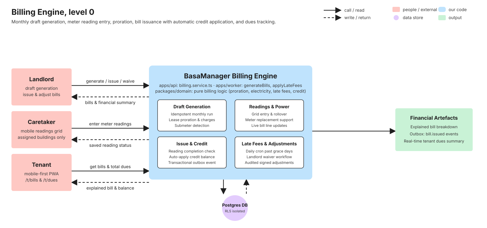
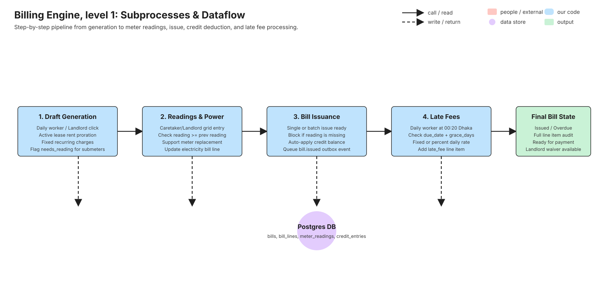
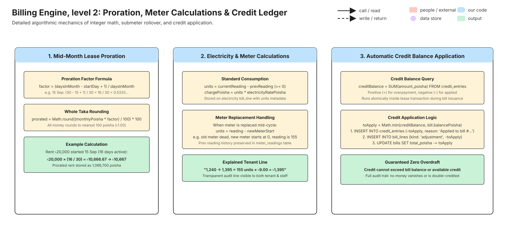
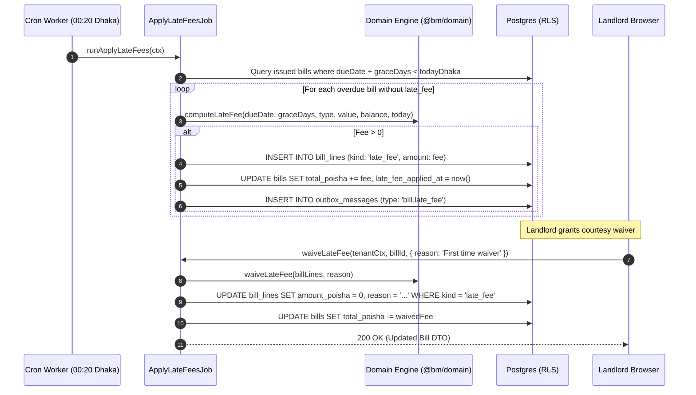

# Billing

> Monthly draft generation, submeter electricity readings, proration, bill issuance with automatic credit application, adjustments, late fees, and tenant dues tracking. Written in task V8 (stories B1, B2, B3, B4, B6, B7, B8) from the merged code and its tests. If this page and the code disagree, the code wins: fix the page.

## 1. What it does

The BasaManager Billing Engine turns active leases, recurring charges, and metered utility consumption into auditable, itemized monthly bills for Bangladeshi apartment tenants.

Every month, either automatically via the worker cron (`apps/worker/src/jobs/generateBills.ts`) on the building's billing day or on-demand when a landlord triggers generation (`POST /api/billing/generate`), the system generates draft bills for all active leases. If a lease starts mid-month, its rent and recurring charges are prorated by active days in the month and rounded to whole Taka. If a unit has an electric submeter, the draft bill is flagged `needs_reading: true` and cannot be issued until a reading is provided.

Caretakers and landlords record electricity meter readings through a dedicated mobile-friendly grid (`apps/web/src/pages/landlord/BillingPage.tsx` and `PUT /api/readings`). The engine verifies consumption, supports meter replacements mid-cycle, and updates the electricity charge on the draft bill. Once readings are entered, bills can be issued individually or in bulk (`POST /api/billing/issue-ready`). Upon issuance, any unapplied credit on the lease is automatically applied to reduce the total due, and a `bill.issued` event is queued in the transactional outbox (`outbox_messages`).

When bills remain unpaid after their due date plus the building's configured grace period, the daily late fee worker (`apps/worker/src/jobs/applyLateFees.ts`) applies a flat or percentage late fee. Landlords can add signed adjustments, waive late fees with a documented reason, or void unpaid bills. Tenants track their outstanding balance in real time via the tenant portal (`apps/web/src/pages/tenant/BillsPage.tsx` and `GET /api/dues`).

Stories from `.agent/01-PRODUCT.md`:

- **B1**: Draft generation on the building's billing day (idempotent, mid-month proration, recurring charges, submeter detection).
- **B2**: Electricity meter reading entry (caretaker mobile grid, rollover/replacement validation, electricity charge computation).
- **B3**: Bill issuance and auto-credit application (single/batch issuance, lease credit ledger deduction, outbox event).
- **B4**: Tenant bill view with transparent explanations (rent, fixed charges, submeter calculation `1,240 → 1,395 = 155 units × ৳9.00`).
- **B6**: Scheduled worker jobs (`generateBillsJob` at 00:10 Dhaka, `applyLateFeesJob` at 00:20 Dhaka, Redis locks).
- **B7**: Landlord adjustments, late fee waiver, and bill voiding.
- **B8**: Big Due Card on tenant home and `/t/dues` breakdown.

## 2. Explain it in 2 minutes

> "In Bangladeshi apartments, calculating monthly rent is traditionally a mess of handwritten khatas, calculator slips, and disputes over electricity units. BasaManager automates this entire process with integer precision.
>
> On the building's configured billing day—say the 1st of every month—our background worker runs at 00:10 Asia/Dhaka time. It inspects all active leases and generates draft bills. If a tenant moved in on September 15th, the system prorates their rent for the remaining 16 days of September and rounds to whole Taka.
>
> If a flat has its own electric submeter, the draft bill is marked 'Needs reading'. The caretaker takes their phone, walks the building, and enters each meter reading into a simple grid. The system verifies that the reading hasn't gone backwards, handles meter replacements if one was swapped out, and immediately calculates the electricity cost using the building's rate per unit.
>
> Once readings are in, the landlord clicks 'Issue bills'. Here's the smart part: if the tenant previously overpaid and had credit on their ledger, the system automatically applies that credit right on the bill to reduce what they owe today. The bill status changes to 'Issued', and a notification event is saved in the outbox.
>
> When the tenant opens their app, they see an crystal-clear breakdown: their rent, any service charges, and an exact explanation of their power bill—for example, '1,240 to 1,395 = 155 units at ৳9.00 = ৳1,395'. If they don't pay past the due date and grace period, our late fee job adds a late fee line. If the landlord decides to be generous, they can waive the late fee with one click, preserving a full audit trail of who waived it and why."

## 3. Level 0 diagram



Data in: Billing triggers, meter readings (prev/current/replacement), bill issuance commands, adjustments, waivers.  
Data out: Draft & issued bills, line items with math metadata, tenant dues summary, outbox notification events.  
Postgres stores `bills`, `bill_lines`, `meter_readings`, `credit_entries`, and `outbox_messages` under strict RLS isolation.

## 4. Level 1 diagram



The billing lifecycle moves through four ordered stages:

1. **Generation**: `generateBillsJob` or `POST /api/billing/generate` checks the building's billing day, prorates rent/charges for new leases, and creates draft bills.
2. **Readings**: `PUT /api/readings` accepts caretaker meter readings, verifies non-decreasing units or replacement start, and creates/updates the `electricity` bill line.
3. **Issuance**: `POST /api/bills/:id/issue` or `POST /api/billing/issue-ready` verifies that readings are complete, checks `credit_entries` for any overpayment balance, automatically applies credit, transitions status to `issued`, and writes `bill.issued` to `outbox_messages`.
4. **Late Fees**: `applyLateFeesJob` evaluates issued bills past `dueDate + graceDays` and adds a `late_fee` line.

## 5. Level 2 diagram



Detailed algorithmic mechanics:

1. **Mid-Month Proration**: `prorationFactor = (daysInMonth - startDay + 1) / daysInMonth`. Prorated rent is `Math.round((rentPoisha * factor) / 100) * 100`. Whole Taka rounding is strictly preserved.
2. **Meter Consumption**: Standard units: `reading - prevReading`. Meter replacement: `reading - newMeterStart`. Electricity charge: `units * electricityRatePoisha`.
3. **Credit Application**: Available credit is `SUM(amount_poisha)` from `credit_entries`. Applied amount is `Math.min(creditBalance, bill.balancePoisha)`. The system writes a negative credit entry and a negative adjustment line on the bill in the same database transaction.

## 6. Sequence diagrams

### 6.1 Draft generation to meter reading and bill issue

```mermaid
sequenceDiagram
  autonumber
  participant W as Background Worker / Landlord
  participant S as BillingService
  participant D as Domain Engine (@bm/domain)
  participant DB as Postgres (RLS)
  participant OB as Outbox Table

  W->>S: runGeneration(tenantCtx, { buildingId, month })
  S->>DB: Query building, settings, active leases, existing bills
  loop For each active lease without a bill
    S->>D: prorate(rentPoisha, startDate, month)
    S->>DB: INSERT INTO bills (status: 'draft', needs_reading)
    S->>DB: INSERT INTO bill_lines (rent, fixed charges)
  end
  Note over S,DB: Drafts created; bills with submeters flagged needs_reading

  Note over W,S: Caretaker enters meter reading
  W->>S: enterReading(tenantCtx, { unitId, month, reading })
  S->>D: electricityCharge(prevReading, reading, ratePoisha)
  S->>DB: UPSERT meter_readings
  S->>DB: UPDATE bill_lines (kind: 'electricity', amount, meta)
  S->>DB: UPDATE bills (needs_reading: false, total_poisha)

  Note over W,S: Landlord issues bill
  W->>S: issueBill(tenantCtx, billId)
  S->>DB: SELECT SUM(amount_poisha) FROM credit_entries WHERE lease_id = ...
  opt Credit balance > 0
    S->>D: applyCreditToBill(billBalance, creditBalance)
    S->>DB: INSERT INTO credit_entries (-applied, 'Applied to bill #...')
    S->>DB: INSERT INTO bill_lines (kind: 'adjustment', -applied)
  end
  S->>DB: UPDATE bills SET status = 'issued', issued_at = now()
  S->>OB: INSERT INTO outbox_messages (type: 'bill.issued', payload)
  S-->>W: 200 OK (Issued Bill DTO)
```

### 6.2 Late fee application and landlord waiver



## 7. Code walk

- `packages/domain/src/billing/index.ts`: Pure billing domain logic (zero dependencies, no clock, no network, no database). Contains `roundTaka`, `prorationFactor`, `prorate`, `electricityCharge`, `computeLateFee`, `waiveLateFee`, `allocatePayment`, `applyCreditToBill`, `voidPayment`, and `computeSettlement`.
- `packages/shared/src/api/billing.ts`: Shared Zod validation schemas and DTO types (`runBillingSchema`, `listBillsQuerySchema`, `billResponseSchema`, `issueReadyBillsSchema`, `meterReadingInputSchema`, `duesResponseSchema`, etc.).
- `apps/api/src/modules/billing/billing.service.ts`: Backend service orchestration. Enforces RLS context, transactional integrity, submeter checks, credit auto-application, line adjustments, and outbox event publishing.
- `apps/api/src/modules/billing/billing.controller.ts`: Express 5 route handlers mapping HTTP requests to service methods and wrapping responses in standard `ApiResponse` envelopes.
- `apps/api/src/modules/billing/billing.routes.ts`: Route definitions with authentication and role guards (`requireUser`, `requireMembership`, `requireRole`).
- `apps/worker/src/jobs/generateBills.ts`: Background scheduled job running daily at 00:10 Asia/Dhaka with Redis distributed locking.
- `apps/worker/src/jobs/applyLateFees.ts`: Background scheduled job running daily at 00:20 Asia/Dhaka with Redis distributed locking.
- `apps/web/src/lib/api/billing.ts`: TanStack Query hooks (`useBills`, `useBill`, `useReadings`, `useRunBilling`, `useEnterReading`, `useIssueBill`, `useIssueReadyBills`, `useAddAdjustment`, `useWaiveLateFee`, `useVoidBill`, `useDues`).
- `apps/web/src/pages/landlord/BillingPage.tsx`: Landlord billing dashboard with Drafts, Issued, and Readings tabs, live filtering, and reading entry.
- `apps/web/src/pages/landlord/BillDetailPage.tsx`: Detailed bill breakdown, financial KPI summary, adjustment and late fee waiver dialogs.
- `apps/web/src/pages/tenant/BillsPage.tsx`: Tenant list of past and current bills.
- `apps/web/src/pages/tenant/TenantBillDetailPage.tsx`: Transparent tenant view with formatted electricity explanations.

## 8. Where the data lives

| Data Item           | Store    | Columns / Keys                                                                                                             | Access / Permissions                                                                | Retention                          |
| ------------------- | -------- | -------------------------------------------------------------------------------------------------------------------------- | ----------------------------------------------------------------------------------- | ---------------------------------- |
| Monthly Bill Header | Postgres | `bills` (`id`, `org_id`, `lease_id`, `period_month`, `due_date`, `status`, `total_poisha`, `paid_poisha`, `needs_reading`) | Landlord/Caretaker (assigned buildings), Tenant (own lease only). RLS enforced.     | Indefinite (financial record)      |
| Bill Line Items     | Postgres | `bill_lines` (`id`, `org_id`, `bill_id`, `kind`, `label`, `amount_poisha`, `meta`, `reason`)                               | Landlord/Caretaker/Tenant via bill. `bm_app` has **NO DELETE** grant on this table. | Indefinite (audit trail)           |
| Meter Readings      | Postgres | `meter_readings` (`id`, `org_id`, `unit_id`, `period_month`, `reading`, `prev_reading`, `meter_replaced`)                  | Landlord and assigned Caretaker. RLS enforced.                                      | Indefinite                         |
| Lease Credit Ledger | Postgres | `credit_entries` (`id`, `org_id`, `lease_id`, `amount_poisha`, `reason`, `source_payment_id`)                              | Landlord, Tenant (own lease). Immutable append-only.                                | Indefinite                         |
| Scheduled Job Locks | Redis    | `job:lock:generateBills`, `job:lock:applyLateFees`                                                                         | Worker instances only. Distributed lock with 10-minute TTL.                         | Ephemeral (TTL 600s)               |
| Outbox Events       | Postgres | `outbox_messages` (`type: 'bill.issued'`, `payload`)                                                                       | Worker delivery pipeline. Written in same transaction as bill issue.                | Deleted or archived after delivery |

## 9. Data lifecycle

1. **Creation**:
   - Draft bills are created by `runGeneration` or `generateBillsJob`.
   - Idempotency is enforced by a PostgreSQL session advisory lock on the building and period date, serializing concurrent runs, followed by an existence check on existing bills. The composite unique constraint on `(lease_id, period_month)` acts as the last-resort guard. Re-running generation returns existing bills as skipped without error.
2. **Update**:
   - Meter reading entry updates the `electricity` line item and sets `needs_reading: false`.
   - Issuing a bill updates `status: 'issued'`, sets `issued_at`, and decrements `total_poisha` if credit was applied.
   - Adjustments add signed `bill_line` records and adjust `total_poisha`.
   - Late fee waiver sets `amount_poisha = 0` on the `late_fee` line and decrements `total_poisha`.
3. **Deletion**:
   - `bm_app` and `bm_worker` database roles have **NO DELETE grant** on `bill_lines` (`schema.prisma:733`). Line items cannot be deleted.
   - Bills cannot be deleted; they can only be transitioned to `void` status (`POST /api/bills/:id/void`), and only if no payments have been applied (`paid_poisha === 0`).
   - If an entire organization is deleted (V15), financial audit records are anonymized per Bangladeshi tax and accounting regulations.

## 10. Edge cases & failure modes

| Case                               | What happens                                                                                                                                  | Where it's handled                                                                    | Test proving it                                                                                                                                                          |
| ---------------------------------- | --------------------------------------------------------------------------------------------------------------------------------------------- | ------------------------------------------------------------------------------------- | ------------------------------------------------------------------------------------------------------------------------------------------------------------------------ |
| Generation run twice               | Second run serialized by Postgres advisory transaction lock and detects existing bill via existence check; returns 0 new drafts without error | `apps/api/src/modules/billing/billing.service.ts` (`runGeneration`)                   | `apps/api/test/billing/billing.int.test.ts` ("generation idempotent")                                                                                                    |
| Mid-month lease start              | Calculates remaining days in month, rounds prorated rent to whole Taka                                                                        | `packages/domain/src/billing/index.ts` (`prorate`)                                    | `packages/domain/src/billing/billing.test.ts` (worked examples 2a & 2b)                                                                                                  |
| Lease starts after bill day (#30)  | Immediate prorated draft bill created at lease activation (invite accept or midnight cron) per Rule 2                                         | `apps/api/src/modules/billing/billing.service.ts` (`generateFirstBillIfAfterBillDay`) | `apps/api/test/leases/leases.int.test.ts` ("#30: activating a lease starting after bill day creates its first prorated draft bill" [:803] and invite accept path [:541]) |
| Lease activated 2+ months late     | Only the start-month draft bill is created at activation; intervening months generate during the next scheduled cycle or on-demand run        | `apps/api/src/modules/billing/billing.service.ts` (`generateFirstBillIfAfterBillDay`) | `apps/api/src/modules/billing/billing.service.test.ts` ("activated in a later month generates start month bill")                                                         |
| Lease starts in future month (#31) | Proration factor evaluates to 0; generation skips the lease without generating empty ৳0 draft bill                                            | `packages/domain/src/billing/index.ts` (`prorationFactor`)                            | `apps/api/test/billing/billing.int.test.ts` ("skips leases whose start date is in future month")                                                                         |
| Consecutive submeter tenants (#28) | Prior readings before lease start are ignored; first bill calculates units strictly from `moveInReading` to avoid cross-tenant charging       | `apps/api/src/modules/billing/billing.service.ts` (`resolvePreviousReading`)          | `apps/api/test/billing/billing.int.test.ts` ("new tenant uses moveInReading, not previous tenant reading")                                                               |
| Leap-year February proration       | Uses 29 days in leap year, 28 days otherwise                                                                                                  | `packages/domain/src/billing/index.ts` (`prorationFactor`)                            | `packages/domain/src/billing/billing.test.ts` ("Feb leap year")                                                                                                          |
| Tie rounding at ৳x.50              | `Math.round(x / 100) * 100` rounds half-up to nearest whole Taka                                                                              | `packages/domain/src/billing/index.ts` (`roundTaka`)                                  | `packages/domain/src/billing/billing.test.ts` ("tie rounding at ৳x.50")                                                                                                  |
| Meter reading less than previous   | Throws `DomainError` / 400 Bad Request unless `meterReplaced: true`                                                                           | `packages/domain/src/billing/index.ts` (`electricityCharge`)                          | `packages/domain/src/billing/billing.test.ts` ("reading decreased throws")                                                                                               |
| Meter replacement mid-cycle        | Uses `reading - newMeterStart` to calculate valid consumption                                                                                 | `packages/domain/src/billing/index.ts` (`electricityCharge`)                          | `packages/domain/src/billing/billing.test.ts` ("meter replacement")                                                                                                      |
| Issuing bill without meter reading | Rejects with 400 Bad Request (`READING_REQUIRED`)                                                                                             | `apps/api/src/modules/billing/billing.service.ts` (`issueBill`)                       | `apps/api/test/billing/billing.int.test.ts` ("issue requires reading")                                                                                                   |
| Tenant has credit on issuance      | Creates negative `credit_entries` row, applies credit to `paid_poisha`, recomputes status                                                     | `apps/api/src/modules/billing/billing.service.ts` (`issueBill`)                       | `apps/api/test/billing/billing.int.test.ts` ("issue auto-applies credit")                                                                                                |
| Voiding bill with payments/credit  | Rejects with 409 Conflict (`CONFLICT`) if `paid_poisha > 0` or payments allocated                                                             | `apps/api/src/modules/billing/billing.service.ts` (`voidBill`)                        | `apps/api/test/billing/billing.int.test.ts` ("void with payments fails")                                                                                                 |
| Concurrent worker execution        | Redis distributed lock (`job:lock:generateBills`) ensures only one node runs                                                                  | `apps/worker/src/lib/jobLock.ts` (`withJobLock`)                                      | `apps/worker/src/jobs/billingJobs.test.ts` ("lock prevents double run")                                                                                                  |
| Caretaker accesses other building  | RLS policy and caretaker building check block query (returns 403 or empty)                                                                    | `apps/api/src/modules/billing/billing.service.ts`                                     | `apps/api/test/billing/billing.int.test.ts` ("caretaker building scoping")                                                                                               |

## 11. Security

1. **Two-Tier Multi-Tenancy Enforcement**:
   - The application layer sets `app.org_id` and `app.user_id` inside every transaction (`db.$tx(ctx)`).
   - PostgreSQL Row-Level Security (RLS) policies enforce that cross-tenant access is physically impossible at the database engine layer.
2. **Database Permissions Defense in Depth**:
   - Application roles (`bm_app`, `bm_worker`) do not possess `DELETE` privileges on `bill_lines`. Even an SQL injection vulnerability cannot wipe financial history.
3. **Role Scoping**:
   - Only landlords can trigger generation, batch issue, add adjustments, waive late fees, or void bills.
   - Caretakers are restricted to reading entry and viewing bills strictly within their assigned buildings (`caretaker_buildings`).
   - Tenants can only view bills associated with their active tenancy.
4. **Integer Financial Arithmetic**:
   - Floating-point representations are strictly banned. All monetary values are integer poisha (`100 poisha = ৳1`).

## 12. Concepts used

- [Money as integers & rounding](../concepts/money-and-rounding.md) (Poisha, rounding to whole Taka).
- [Dates & time zones](../concepts/dates-and-timezones.md) (Asia/Dhaka calendar time for billing days and grace periods).
- [Idempotency & unique constraints](../concepts/idempotency.md) (Safe retry of monthly generation).
- [Background jobs & cron](../concepts/background-jobs.md) (Redis-locked scheduled jobs).
- [Multi-tenancy & Postgres row-level security](../concepts/multi-tenancy-and-rls.md) (Strict cross-org isolation).
- [Database transactions, locking & isolation](../concepts/transactions-and-locking.md) (Atomic credit deduction and bill issuance).

## 13. Tests

- **Unit tests**: `packages/domain/src/billing/billing.test.ts` (44 tests covering every formula, proration, leap years, rounding, meter replacements, payment allocation, and settlement).
  ```bash
  pnpm --filter @bm/domain test
  ```
- **Integration tests**: `apps/api/test/billing/billing.int.test.ts` (37 tests covering generation, reading entry, issuance, ready batching, adjustments, waivers, voiding, dues, and role scoping).
  ```bash
  pnpm test:int apps/api/test/billing/billing.int.test.ts
  ```
- **Worker tests**: `apps/worker/src/jobs/billingJobs.test.ts` (4 tests verifying `generateBillsJob` and `applyLateFeesJob` execution and Redis locking).
  ```bash
  pnpm --filter @bm/worker test
  ```
- **E2E tests**:
  - `tests/e2e/billing.spec.ts`: Full end-to-end lifecycle (clock to bill day → drafts → caretaker enters readings → landlord issues → tenant sees explained bill `1,240 → 1,395 = 155 units × ৳9.00`).
  - `tests/e2e/late-fee.spec.ts`: Overdue bill → late fee line → landlord waives.
  ```bash
  pnpm test:e2e tests/e2e/billing.spec.ts tests/e2e/late-fee.spec.ts
  ```

## 14. Try it yourself

1. **Start the local environment**:
   ```bash
   pnpm dev
   ```
2. **Run billing draft generation**:
   - Log in as a landlord at `http://localhost:4173/login`.
   - Navigate to `/l/billing`.
   - Select your building and the current month, then click **Generate Drafts**.
   - Observe the draft bills created with rent and fixed charges.
3. **Enter a meter reading as a caretaker**:
   - Open an incognito browser window, log in as the assigned caretaker, and open `/c/billing`.
   - Click the **Readings** tab.
   - Enter `1395` for unit 4A (where previous reading was `1240`) and click **Save**.
4. **Issue the bill as landlord**:
   - Switch back to the landlord window and reload `/l/billing`.
   - The badge will switch from "Needs reading" to "Reading entered".
   - Click into the bill, review the breakdown (`1,240 → 1,395 = 155 units × ৳9.00`), and click **Issue bill**.
5. **View the explained bill as tenant**:
   - Log in as the tenant and open `/t/bills`.
   - Click the bill to open `/t/bills/:id` and review the line explanation.
6. **Break it exercise**:
   - Open `packages/domain/src/billing/index.ts` and modify `roundTaka` to use `Math.floor` instead of `Math.round`.
   - Run `pnpm --filter @bm/domain test`.
   - Notice that test "tie rounding at ৳x.50" immediately fails because Bangladeshi accounting requires half-up rounding to the nearest Taka. Revert the change.

## 15. Self-check

<details>
<summary>1. Why does BasaManager use integer poisha instead of floating-point numbers?</summary>
Floating-point math in computers suffers from IEEE 754 precision issues (e.g. <code>0.1 + 0.2 = 0.30000000000000004</code>). Over thousands of rent and electricity transactions, fractional rounding errors accumulate into unaccountable discrepancies. Using integer poisha (100 poisha = ৳1.00) makes every addition, subtraction, and comparison exact.
</details>

<details>
<summary>2. How does the billing engine ensure that running bill generation multiple times doesn't create duplicate bills?</summary>
Bill generation serializes on a PostgreSQL transaction advisory lock hashed from the building ID and period month. The service checks for existing bills for that month and returns them as skipped without error. Even if two concurrent requests run, the advisory lock serializes execution, while the composite unique constraint on <code>bills(lease_id, period_month)</code> provides a last-resort constraint guard.
</details>

<details>
<summary>3. What happens if a tenant moves in on September 15th with a monthly rent of ৳20,000?</summary>
September has 30 days. The lease is active for 16 days (from the 15th through the 30th inclusive). The proration factor is <code>16 / 30 = 0.5333...</code>. The unrounded rent is <code>৳10,666.666...</code>. The engine applies whole Taka rounding: <code>Math.round(10666.666... / 100) * 100 = 1066700 poisha (৳10,667)</code>.
</details>

<details>
<summary>4. Why does the database disallow DELETE operations on the <code>bill_lines</code> table?</summary>
Financial auditability requires an indelible record. If meter readings are updated or errors are adjusted, lines must be updated or added as explicit adjustment records with reasons, rather than deleting rows. The <code>bm_app</code> database user has grants only for SELECT, INSERT, and UPDATE on <code>bill_lines</code>.
</details>

<details>
<summary>5. How does credit auto-application work when a bill is issued?</summary>
When a bill is issued, the service sums all rows in <code>credit_entries</code> for the lease under a transaction lock. If a positive credit balance exists, the system takes <code>Math.min(creditBalance, bill.balancePoisha)</code>, creates a negative <code>credit_entry</code> row (kind: 'applied', with <code>bill_id</code>), increments <code>bill.paid_poisha</code> by the applied credit, and recomputes the bill's status (<code>paid</code> or <code>partially_paid</code>), all within a single database transaction. No <code>payment_allocations</code> row is created; the accounting invariant across the system is <code>paid_poisha = Σ allocations + Σ (-applied_credit)</code>.
</details>

<details>
<summary>6. What happens if a caretaker enters a meter reading that is lower than the previous month's reading?</summary>
The domain engine throws a <code>DomainError</code> ("Reading cannot decrease without meter replacement"), and the API returns a 400 Bad Request. If the physical meter was replaced, the caretaker must check "Meter replaced" and enter the <code>newMeterStart</code> value.
</details>

<details>
<summary>7. What happens if an issued bill is overdue and a late fee is applied, but the landlord later agrees to forgive it?</summary>
The landlord clicks "Waive late fee" and provides an audit reason. The service verifies the bill has not already been paid beyond the late fee amount (if <code>newTotal < paid_poisha</code>, the API rejects with 409 Conflict). It sets the existing <code>late_fee</code> line item amount to 0 poisha, saves the reason in the line metadata, decrements the bill's total, and recomputes status dynamically.
</details>

<details>
<summary>8. Can an issued bill with payments or applied credit be voided?</summary>
No. Once a payment or credit allocation has been applied to a bill (<code>paid_poisha > 0</code> or allocation count > 0), voiding is strictly rejected with 409 Conflict (<code>CONFLICT</code>). This protects tenant money and maintains financial integrity.
</details>
