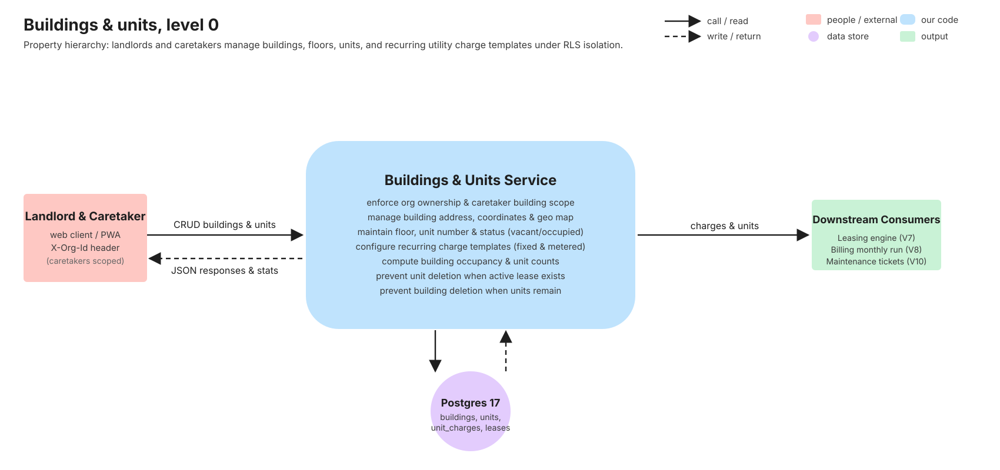
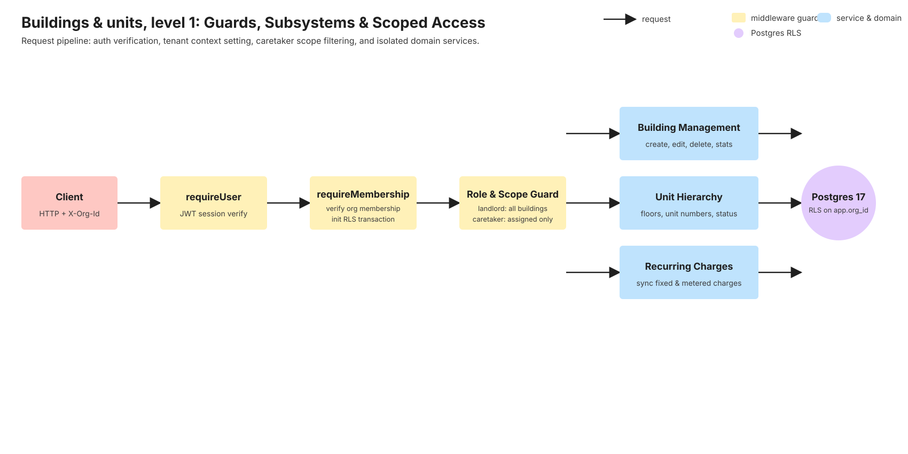
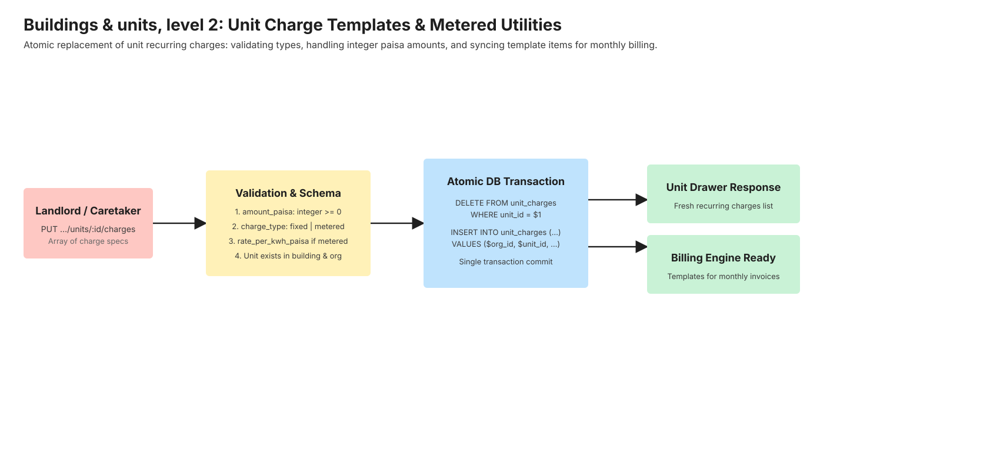
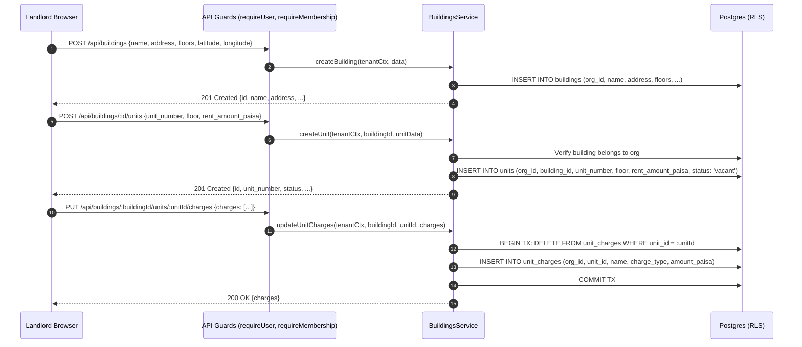
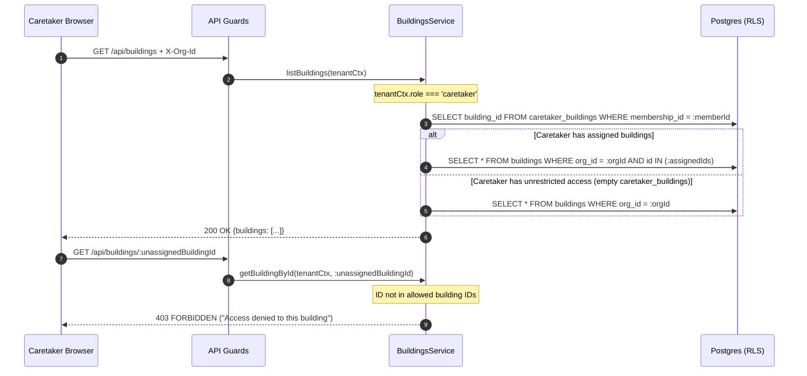

# Buildings & units

> Property hierarchy and unit recurring charge management. Written in task V6 (stories O2, O3)
> from the merged code and its tests. If this page and the code disagree, the code wins: fix the page.

## 1. What it does

Buildings and units form the core real estate hierarchy in BasaManager. Landlords configure their property
portfolio by creating buildings with physical addresses, floor counts, and optional GPS coordinates that render
on an interactive OpenStreetMap view.

Inside each building, units are organized by floor and identifier (e.g. "Flat 2A", "Shop 1"). Each unit defines
its base rent in integer poisha and maintains an occupancy state (`vacant`, `occupied`, `maintenance`). Units
also hold recurring charge templates (such as fixed water, fixed security/trash, and metered electricity with
a rate per kWh and last meter reading). These templates feed directly into the monthly billing engine.

Stories from `.agent/01-PRODUCT.md`:

- **O2**: Create and manage buildings (name, address, GPS coordinates, floor count, notes, interactive map).
- **O3**: Manage units within a building (floor, unit identifier, base rent, recurring charge templates, occupancy status, meter tracking).

## 2. Explain it in 2 minutes

> "Everything a landlord owns starts with a Building. A building has a name, an address, a floor count, and
> optional latitude and longitude coordinates. If coordinates are provided, the building appears on an
> interactive Leaflet map right on the building details screen.
>
> Inside each building are Units. A unit represents a rentable space—an apartment or commercial shop. Each
> unit has a unit number, a floor, and a default base rent amount stored in poisha (1 BDT = 100 poisha). Units
> also specify an occupancy status: vacant, occupied, or maintenance.
>
> The most critical part of unit setup is Recurring Charges. In Bangladesh, apartment rent rarely stands alone;
> tenants pay fixed service charges, fixed water fees, and metered electricity. A landlord or caretaker can
> attach recurring charge templates to each unit. When metered electricity is specified, the unit records the
> electric meter number, the current meter reading, and the rate per kilowatt-hour.
>
> When the monthly billing job runs, it reads the unit's base rent and these recurring charge templates to
> automatically assemble each tenant's invoice.
>
> Integrity is strictly protected: you cannot delete a unit that has an active lease, and you cannot delete a
> building that still has units inside it. Furthermore, caretakers only see the buildings they are explicitly
> assigned to."

## 3. Level 0 diagram



Data in: Building profiles (name, address, GPS, floors), Unit configurations (unit number, floor, rent), Recurring charge items (fixed fees, metered electricity).
Data out: Building statistics (total units, occupied count, occupancy rate), Unit details drawer, Billing templates.
Postgres stores `buildings`, `units`, `unit_charges`, and enforces tenant isolation via RLS.

## 4. Level 1 diagram



All building and unit operations pass through the security perimeter:

1. `requireUser` and `requireMembership` establish identity and tenant context (`app.org_id`).
2. If the user is a `caretaker`, the service checks `caretaker_buildings` to filter building lists and reject requests targeting unassigned properties with `403 FORBIDDEN`.
3. Dedicated domain services handle building calculations (unit counts, occupancy rates) and atomic unit charge synchronization.

## 5. Level 2 diagram



When modifying recurring charges for a unit:

1. Payloads are validated via Zod (`charges: [{ name, charge_type, amount_paisa, rate_per_kwh_paisa }]`).
2. Amounts are verified to be non-negative integers.
3. In a single database transaction, existing `unit_charges` rows for the unit are deleted and the new set is inserted.
4. Downstream, the billing engine (V8) uses these rows to produce line items on the tenant's monthly bill.

## 6. Sequence diagrams

### 6.1 Creating a building and adding a unit with charges



### 6.2 Caretaker accessing building list with scope enforcement



## 7. Code walk

### Request pipeline & validation

1. [buildings.routes.ts](https://github.com/RHRONY05/BasaManager/blob/main/apps/api/src/modules/buildings/buildings.routes.ts):
   - Mounts building CRUD: `GET /api/buildings`, `POST /api/buildings`, `GET /api/buildings/:id`, `PATCH /api/buildings/:id`, `DELETE /api/buildings/:id`.
   - Mounts unit CRUD: `GET /api/buildings/:buildingId/units`, `POST /api/buildings/:buildingId/units`, `GET /api/buildings/:buildingId/units/:unitId`, `PATCH /api/buildings/:buildingId/units/:unitId`, `DELETE /api/buildings/:buildingId/units/:unitId`.
   - Mounts charge sync: `PUT /api/buildings/:buildingId/units/:unitId/charges`.
   - Uses `validate()` with shared Zod schemas (`packages/shared/src/api/buildings.ts`).

### Controllers & services

1. [buildings.controller.ts](https://github.com/RHRONY05/BasaManager/blob/main/apps/api/src/modules/buildings/buildings.controller.ts):
   - Extracts validated parameters and tenant context, invoking `BuildingsService`.
2. [buildings.service.ts](https://github.com/RHRONY05/BasaManager/blob/main/apps/api/src/modules/buildings/buildings.service.ts):
   - `listBuildings`: Computes aggregated metrics for each building (`totalUnits`, `occupiedUnits`, `vacantUnits`, `occupancyRate`). Applies caretaker scope filtering.
   - `getBuildingById`: Retrieves building record and validates caretaker permission.
   - `createBuilding` / `updateBuilding`: Manages building metadata.
   - `deleteBuilding`: Enforces referential guard: rejects deletion if `units.count > 0` with `400 BAD_REQUEST`.
   - `listUnits` / `getUnitById`: Returns unit records, floor sorting, and includes attached `charges`.
   - `createUnit` / `updateUnit`: Updates unit parameters and status.
   - `deleteUnit`: Enforces lease guard: checks for active leases before allowing deletion.
   - `updateUnitCharges`: Executes transactional replace (`deleteMany` followed by `createMany`) of unit recurring charge templates.

### Frontend UI implementation

1. [BuildingsPage.tsx](https://github.com/RHRONY05/BasaManager/blob/main/apps/web/src/pages/landlord/BuildingsPage.tsx):
   - Displays property portfolio cards with occupancy badges, unit counts, address, and interactive map preview.
   - Features "Add Building" modal dialog (`AddBuildingDialog.tsx`).
2. [BuildingDetailPage.tsx](https://github.com/RHRONY05/BasaManager/blob/main/apps/web/src/pages/landlord/BuildingDetailPage.tsx):
   - Tabbed layout: "Units", "Overview & Map", and "Building Settings".
   - Grouped unit list ordered by floor.
   - Clicking a unit opens `UnitDrawer.tsx` to view/edit rent and configure recurring utility charges.
   - Features `BuildingMap.tsx` rendering OpenStreetMap tiles centered on building latitude/longitude.

## 8. Where the data lives

| Data         | Store    | Table & Column                                                                                                          | Who can read                                    | Who can write       | Retention                                            |
| :----------- | :------- | :---------------------------------------------------------------------------------------------------------------------- | :---------------------------------------------- | :------------------ | :--------------------------------------------------- |
| Building     | Postgres | `buildings` (`id`, `org_id`, `name`, `address`, `latitude`, `longitude`, `floors`)                                      | Org members (caretaker scoped)                  | Landlord            | Permanent until explicitly deleted                   |
| Unit         | Postgres | `units` (`id`, `org_id`, `building_id`, `unit_number`, `floor`, `rent_amount_paisa`, `status`, `electricity_meter_num`) | Org members (caretaker scoped); Tenant of lease | Landlord, Caretaker | Permanent until deleted (no active lease)            |
| Unit Charges | Postgres | `unit_charges` (`id`, `org_id`, `unit_id`, `name`, `charge_type`, `amount_paisa`, `rate_per_kwh_paisa`)                 | Org members; Tenant                             | Landlord, Caretaker | Replaced on charge update; cascaded on unit deletion |

## 9. Data lifecycle

1. **Creation**:
   - Landlord creates a building (`POST /api/buildings`).
   - Landlord or authorized caretaker adds units (`POST /api/buildings/:id/units`).
   - Recurring charge templates are configured via `PUT /api/buildings/:id/units/:unitId/charges`.
2. **Update**:
   - Building address, name, or GPS coordinates updated via `PATCH /api/buildings/:id`.
   - Unit rent, status, or meter number updated via `PATCH /api/buildings/:id/units/:unitId`.
3. **Deletion Safeguards**:
   - **Units with active leases**: Cannot be deleted. `BuildingsService.deleteUnit` queries for active leases and throws `400 BAD_REQUEST` ("Cannot delete unit with active leases").
   - **Buildings with units**: Cannot be deleted. `BuildingsService.deleteBuilding` checks if any units exist and throws `400 BAD_REQUEST` ("Cannot delete building with existing units"). All units must be removed or transferred first.
   - When an unleased unit is deleted, its `unit_charges` rows are deleted via database foreign key cascade.

## 10. Edge cases & failure modes

| Case                                            | What happens                                                             | Where handled                           | Test that proves it           |
| :---------------------------------------------- | :----------------------------------------------------------------------- | :-------------------------------------- | :---------------------------- |
| Deleting a building with existing units         | Returns `400 BAD_REQUEST` ("Cannot delete building with existing units") | `BuildingsService.deleteBuilding`       | `buildings-units.int.test.ts` |
| Deleting a unit with an active lease            | Returns `400 BAD_REQUEST` ("Cannot delete unit with active leases")      | `BuildingsService.deleteUnit`           | `buildings-units.int.test.ts` |
| Negative rent amount provided                   | Zod schema validation fails with `422 UNPROCESSABLE_ENTITY`              | `packages/shared/src/api/buildings.ts`  | `buildings-units.int.test.ts` |
| Metered charge without electricity meter number | Allowed as template; meter number required when finalizing lease in V7   | `BuildingsService.updateUnitCharges`    | `buildings-units.int.test.ts` |
| Caretaker accesses unassigned building          | Returns `403 FORBIDDEN` ("Access denied to this building")               | `BuildingsService.assertBuildingAccess` | `caretaker-scope.int.test.ts` |
| Invalid latitude/longitude format               | Zod rejects non-numeric or out-of-range coordinates                      | `packages/shared/src/api/buildings.ts`  | `buildings-units.int.test.ts` |

## 11. Security

1. **Row-Level Security**: All queries run in a transaction where `app.org_id` is set to the caller's organization. No organization can query another organization's buildings or units.
2. **Caretaker Scoping Enforcement**: Caretakers are restricted in application code via `assertBuildingAccess`. Unassigned building IDs are rejected before any database mutation occurs.
3. **Integer Money Representation**: All rent amounts, fee amounts, and kilowatt-hour rates are handled exclusively as integer poisha (`rent_amount_paisa`), completely eliminating floating-point rounding errors.

## 12. Concepts used

- [Multi-tenancy & Postgres row-level security](../concepts/multi-tenancy-and-rls.md)
- [Money as integers & rounding](../concepts/money-and-rounding.md)
- [Authorization & RBAC](../concepts/authorization.md)
- [Validation at boundaries (Zod)](../concepts/validation-with-zod.md)

## 13. Tests

### Integration tests

- `apps/api/test/buildings/buildings-units.int.test.ts`: 46 tests covering building CRUD, unit CRUD, charge replacement, floor sorting, delete guards, and edge cases.
- `apps/api/test/buildings/caretaker-scope.int.test.ts`: 9 tests verifying caretaker building scoping rules.

### E2E Playwright tests

- `tests/e2e/buildings-units.spec.ts`: Full end-to-end journey: onboarding checklist, building creation, navigation, unit creation, charge setup, and drawer verification on both desktop and mobile.

Run all tests:

```bash
pnpm test
pnpm test:int
pnpm test:e2e
```

## 14. Try it yourself

1. Start the stack with `pnpm dev`.
2. Visit `http://localhost:5173/l/buildings`.
3. Click **Add Building**, enter name "Green Villa", address "House 12, Road 5, Dhanmondi, Dhaka", latitude `23.7461`, longitude `90.3742`, and click **Create**.
4. Open the created building. Click **Add Unit**, enter floor `2`, unit `2A`, rent `৳25,000`.
5. Click on unit `2A` to open the drawer. Add recurring charges: "Water" (fixed, ৳1,000) and "Electricity" (metered, ৳12/kWh). Save charges.
6. **Break it exercise**: Try deleting the building immediately from the building settings tab. Observe the error toast: "Cannot delete building with existing units". Delete unit `2A` first, then observe that building deletion succeeds.

## 15. Self-check

<details>
<summary>1. How is rent stored in the database to prevent rounding discrepancies?</summary>
Rent is stored as integer poisha (1 BDT = 100 poisha) in the <code>rent_amount_paisa</code> column. Floating-point numbers are never used for currency.
</details>

<details>
<summary>2. Why are GPS coordinates optional on buildings?</summary>
Some buildings in rural or semi-urban areas in Bangladesh may not have precise GPS coordinates readily available. If omitted, the building functions normally without rendering the OpenStreetMap widget.
</details>

<details>
<summary>3. What prevents a landlord from accidentally deleting a building with tenants?</summary>
<code>BuildingsService.deleteBuilding</code> performs an explicit check on unit counts. If any units exist, the operation is aborted with a 400 Bad Request error. Furthermore, units with active leases cannot be deleted.
</details>

<details>
<summary>4. What happens to existing unit charges when a landlord updates a unit's charges?</summary>
The endpoint performs an atomic replace inside a transaction: it deletes all current charges for that unit ID and inserts the new list.
</details>

<details>
<summary>5. How does the frontend handle map rendering without third-party API keys?</summary>
The frontend uses Leaflet with OpenStreetMap tile servers (<code>https://{s}.tile.openstreetmap.org/{z}/{x}/{y}.png</code>), requiring zero API keys or external billing.
</details>

<details>
<summary>6. How are units ordered when listed for a building?</summary>
Units are sorted primarily by <code>floor ASC</code>, and secondarily by <code>unit_number ASC</code>.
</details>
