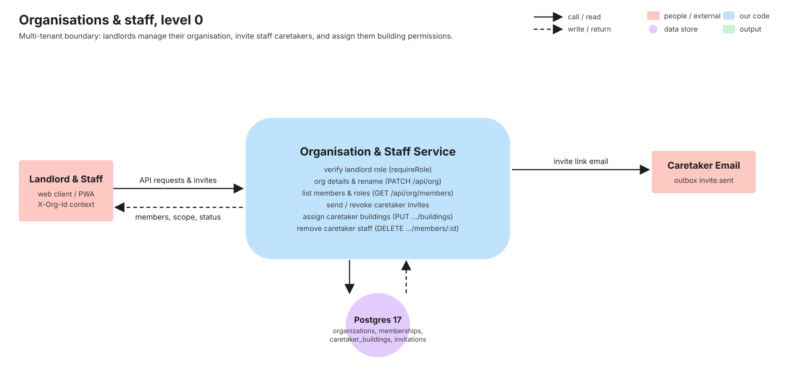
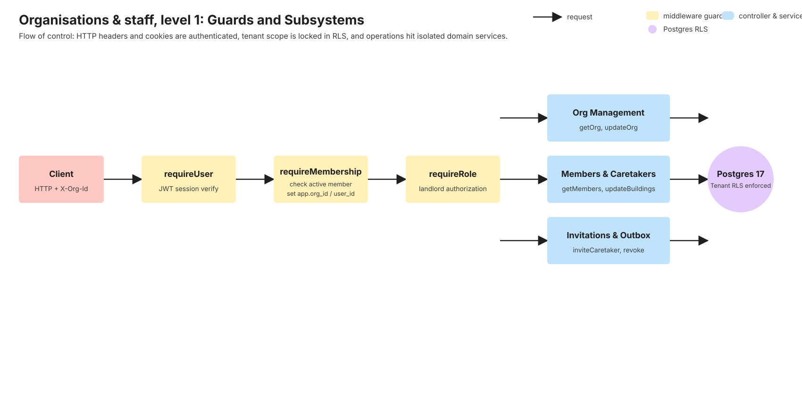
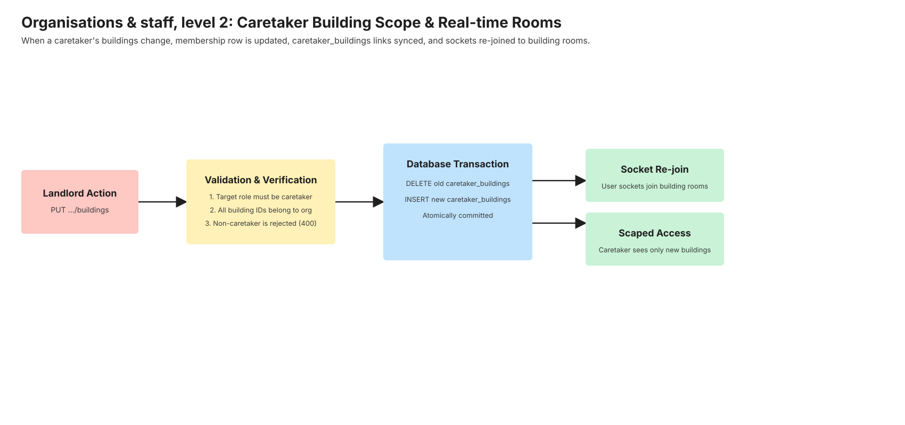
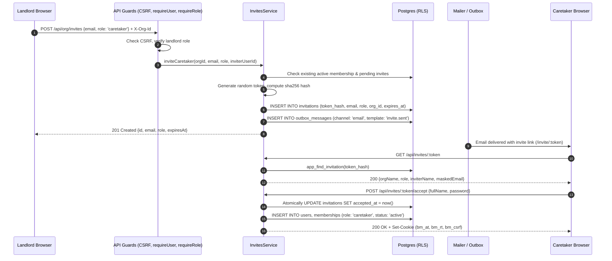
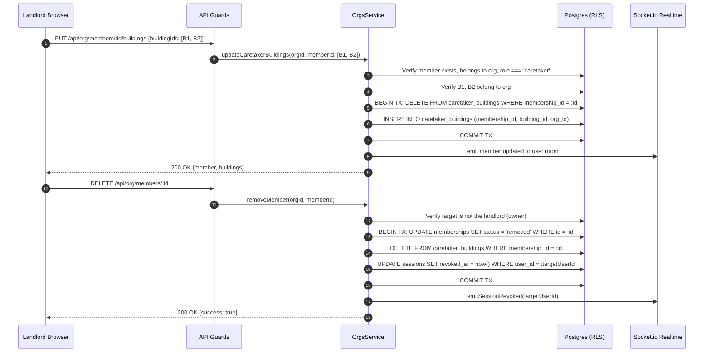

# Organisations & staff

> Multi-tenant tenancy model and staff access control. Written in task V6 (stories O1, O4, O5)
> from the merged code and its tests. If this page and the code disagree, the code wins: fix the page.

## 1. What it does

Organisations provide the multi-tenant isolation boundary in BasaManager. Every landlord owns one
organisation that encompasses all their buildings, units, leases, bills, and payments. Landlords configure
organization profile details, bank/mobile financial service (bKash) payout details, and default billing
parameters (billing cycle day, grace period, late fees).

Landlords also manage their operations team by inviting caretakers with single-use email invitation tokens.
Caretakers can be granted organization-wide access or scoped to specific buildings. When a caretaker is
scoped, they can only view and manage units, tenants, and maintenance requests in their assigned buildings.
When staff leave, landlords revoke access instantly, terminating active sessions and invalidating building
assignments.

Stories from `.agent/01-PRODUCT.md`:

- **O1**: Landlord organisation setup and profile configuration (name, phone, address, currency BDT, billing settings).
- **O4**: Staff management: invite caretakers by email, list members, view pending invitations, revoke pending invites.
- **O5**: Caretaker scope: restrict caretaker visibility and actions to assigned buildings, support full-org caretakers, update or revoke building assignments atomically.

## 2. Explain it in 2 minutes

> "In BasaManager, an organisation is the security boundary. When a landlord signs up, a unique organisation
> is created and the landlord is granted the `landlord` role. All property records—buildings, units, leases,
> bills—belong to this organisation through an `org_id` column.
>
> Landlords don't have to manage properties alone. From the Team page, a landlord can invite caretakers by
> entering an email address. The server creates an invitation record with a secure SHA-256 token hash and sends
> an invitation email via the outbox queue. The invite link takes the caretaker to an acceptance screen where
> they confirm their name and password to join.
>
> What makes staff authorization special is Caretaker Scoping. A landlord can assign a caretaker to specific
> buildings—say, Green Villa and Sunset Heights—or give them access to all buildings. The API enforces this in
> every query: when a caretaker calls `/api/buildings`, they only see their assigned buildings. If they try to
> access a unit or building outside their scope, the API blocks them with a 403.
>
> When a caretaker leaves, the landlord removes them with a single click. Their membership status becomes
> `removed`, all building assignments are dropped in a single database transaction, and their active sessions
> are terminated. Any subsequent request from that user returns a 404 Not Found—not a 403—so our API never
> leaks that the organisation exists or that the user was ever a member."

## 3. Level 0 diagram



Data in: Organization profile updates, caretaker email invites, building assignment arrays (`buildingIds`).
Data out: Member lists with building assignments, pending invitations with expiration dates, outbox emails.
Postgres holds durable multi-tenant records (`organizations`, `memberships`, `caretaker_buildings`, `invitations`).

## 4. Level 1 diagram



Every request passes through the Express middleware pipeline:

1. `requestId` and `logger` tag the request and redact secrets.
2. `createCsrfMiddleware` enforces origin and token validation on unsafe methods.
3. `createRequireUser` extracts and validates the JWT `bm_at` access cookie and checks the live database session.
4. `createRequireMembership` verifies the `X-Org-Id` header against the caller's active memberships. If the user is removed or not a member, it throws a `404 NOT_FOUND` (preventing tenant enumeration). It then initializes the Postgres transaction with `app.org_id` and `app.user_id` for Row-Level Security (RLS).
5. `requireRole('landlord')` ensures only landlords can modify settings, invite staff, or change building scopes.

## 5. Level 2 diagram



When a landlord updates a caretaker's building assignments:

1. The service validates that the target member has the `caretaker` role.
2. It verifies that every provided building ID belongs to the current organisation.
3. In a single atomic database transaction, existing records in `caretaker_buildings` for that membership are deleted, and new records are inserted.
4. If an empty array is provided, the caretaker has unrestricted access across all buildings in the organization.
5. Connected sockets for that user join or leave the corresponding building rooms (`building:<id>`), instantly updating real-time event distribution.

## 6. Sequence diagrams

### 6.1 Inviting a caretaker and accepting the invitation



### 6.2 Updating caretaker building scope and removing a caretaker



## 7. Code walk

### Request pipeline & middleware

1. [org.ts](https://github.com/RHRONY05/BasaManager/blob/main/apps/api/src/middleware/org.ts):
   - `createRequireMembership`: Validates `X-Org-Id` header UUID format. Queries `memberships` for an active record (`status = 'active'`). Throws `ApiError.notFound('Organization not found')` if absent or removed so existence is never leaked. Sets `req.tenantCtx = { orgId, userId, role }`.
   - `requireRole('landlord')`: Validates caller holds landlord privileges before granting access to organizational configuration or member management.
2. [orgs.routes.ts](https://github.com/RHRONY05/BasaManager/blob/main/apps/api/src/modules/orgs/orgs.routes.ts):
   - Wires up `GET /api/org`, `PATCH /api/org`, `GET /api/org/members`, `PUT /api/org/members/:id/buildings`, `DELETE /api/org/members/:id`, `GET /api/org/invites`, `POST /api/org/invites`, and `DELETE /api/org/invites/:id`.

### Controllers & services

1. [orgs.controller.ts](https://github.com/RHRONY05/BasaManager/blob/main/apps/api/src/modules/orgs/orgs.controller.ts):
   - Parses validated parameters and dispatches requests to `OrgsService`.
2. [orgs.service.ts](https://github.com/RHRONY05/BasaManager/blob/main/apps/api/src/modules/orgs/orgs.service.ts):
   - `getOrg(tenantCtx)`: Retrieves organization profile, contact information, and billing configuration.
   - `updateOrg(tenantCtx, data)`: Updates name, phone, address, and billing settings (billingCycleDay, gracePeriodDays, lateFeeType, lateFeeAmountPaisa).
   - `getMembers(tenantCtx)`: Lists all active organization members with their roles, profile details, and assigned `caretakerBuildings`.
   - `updateCaretakerBuildings(tenantCtx, memberId, buildingIds)`: Verifies role is `caretaker`, validates building ownership, and executes an atomic replacement in `caretaker_buildings`.
   - `removeMember(tenantCtx, memberId)`: Prevents self-removal of the landlord owner, marks status as `removed`, deletes caretaker building links, revokes sessions, and kicks active sockets.
3. [invites.service.ts](https://github.com/RHRONY05/BasaManager/blob/main/apps/api/src/modules/invites/invites.service.ts):
   - `createInvite(orgId, email, role, inviterUserId)`: Checks for active membership or pending invites, writes SHA-256 token hash to `invitations`, writes an outbox message, and enqueues immediate email delivery.
   - `revokeInvite(tenantCtx, inviteId)`: Sets `revoked_at = now()` on the pending invitation.
   - `accept(token, input)`: Unauthenticated endpoint using `app_find_invitation` security-definer function, creates the user and active membership atomically.

### Frontend UI implementation

1. [TeamPage.tsx](https://github.com/RHRONY05/BasaManager/blob/main/apps/web/src/pages/landlord/TeamPage.tsx):
   - Displays members table with roles, assigned buildings pills, and invite status.
   - Provides "Invite Caretaker" modal dialog with email validation and building multiselect.
   - Provides "Assign Buildings" modal to modify building scope for existing caretakers.
   - Provides "Remove" confirmation dialog to terminate staff access.
2. [SettingsPage.tsx](https://github.com/RHRONY05/BasaManager/blob/main/apps/web/src/pages/landlord/SettingsPage.tsx):
   - Tabbed configuration interface: "General" (organization name, contact phone, business address) and "Billing" (default billing day, grace period, late fee rules, bank/bKash disbursement info).
3. [AccountMenu.tsx](https://github.com/RHRONY05/BasaManager/blob/main/apps/web/src/components/ui/AccountMenu.tsx):
   - Organization switcher and navigation dropdown linking to `/l/team` and `/l/settings`.

## 8. Where the data lives

| Data                | Store    | Table & Column                                                                                     | Who can read                            | Who can write                              | Retention                                          |
| :------------------ | :------- | :------------------------------------------------------------------------------------------------- | :-------------------------------------- | :----------------------------------------- | :------------------------------------------------- |
| Organization        | Postgres | `organizations` (`id`, `name`, `phone`, `address`, `settings`)                                     | Organization members                    | Landlord only                              | Permanent until org deletion                       |
| Membership          | Postgres | `memberships` (`id`, `org_id`, `user_id`, `role`, `status`)                                        | Organization members                    | Landlord only                              | Permanent (status soft-deleted to `removed`)       |
| Caretaker Buildings | Postgres | `caretaker_buildings` (`membership_id`, `building_id`, `org_id`)                                   | Organization members                    | Landlord only                              | Replaced on reassignment, purged on member removal |
| Invitations         | Postgres | `invitations` (`token_hash`, `email`, `role`, `org_id`, `expires_at`, `revoked_at`, `accepted_at`) | Landlord; unauthenticated by token hash | Landlord (create/revoke); Invitee (accept) | Retained for audit; valid 7 days                   |
| Active Org Context  | Browser  | `localStorage.getItem('bm_active_org_id')`                                                         | Web client                              | User / Org switch                          | Cleared on logout                                  |

## 9. Data lifecycle

1. **Creation**:
   - Organization and landlord membership are created during the landlord signup transaction (`AuthService.signup`).
   - Additional memberships are created only when an invited user accepts an invitation (`InvitesService.accept`).
2. **Update**:
   - Landlords update organization settings at any time via `PATCH /api/org`.
   - Caretaker building assignments are updated via `PUT /api/org/members/:id/buildings`.
3. **Deletion / Revocation**:
   - **Memberships**: Never hard-deleted. Marked `status = 'removed'`. This preserves historical referential integrity on maintenance tickets, audit logs, and payments created by that caretaker.
   - **Caretaker Scope**: When a member is removed or reassigned, entries in `caretaker_buildings` are hard-deleted.
   - **Invitations**: When revoked, `revoked_at` is set to `now()`. Expired or revoked invitations cannot be accepted.

## 10. Edge cases & failure modes

| Case                                                   | What happens                                                                          | Where handled                          | Test that proves it              |
| :----------------------------------------------------- | :------------------------------------------------------------------------------------ | :------------------------------------- | :------------------------------- |
| Building from another org assigned to caretaker        | API returns `400 BAD_REQUEST` ("One or more buildings do not exist")                  | `OrgsService.updateCaretakerBuildings` | `members-caretakers.int.test.ts` |
| Attempting to assign buildings to non-caretaker member | API returns `400 BAD_REQUEST` ("Buildings can only be assigned to caretakers")        | `OrgsService.updateCaretakerBuildings` | `members-caretakers.int.test.ts` |
| Landlord attempts to remove themselves                 | API returns `400 BAD_REQUEST` ("Cannot remove the organization owner")                | `OrgsService.removeMember`             | `members-caretakers.int.test.ts` |
| Removed member accesses API with active JWT            | Middleware returns `404 NOT_FOUND`                                                    | `org.ts:createRequireMembership`       | `csrf-me.int.test.ts`            |
| Caretaker invites another staff member                 | Middleware returns `403 FORBIDDEN`                                                    | `org.ts:requireRole`                   | `members-caretakers.int.test.ts` |
| Concurrent acceptance of the same invite token         | Database atomic update on `accepted_at IS NULL` ensures only one wins; loser gets 400 | `InvitesService.accept`                | `invites.service.flows.test.ts`  |

## 11. Security

1. **Tenant Isolation via RLS**: Every query on `organizations`, `memberships`, and `caretaker_buildings` is executed inside a transaction setting `app.org_id` and `app.user_id`. Postgres policies prevent cross-tenant reads or writes.
2. **No Existence Leaks (404 on Missing Membership)**: If a user specifies an `X-Org-Id` where they are not an active member (or have been removed), the API returns `404 NOT_FOUND`. Returning 403 would leak the existence of organizations to unauthorized parties.
3. **Token Hashing**: Invitation tokens are never stored in plaintext. The database only retains the SHA-256 hash. Even a full database dump does not allow an attacker to accept pending invitations without intercepting emails.
4. **Owner Protection**: The organization owner (the founding landlord) cannot be removed or demoted by any API endpoint.

## 12. Concepts used

- [Multi-tenancy & Postgres row-level security](../concepts/multi-tenancy-and-rls.md)
- [Authorization & RBAC](../concepts/authorization.md)
- [Notification pipeline & outbox](../concepts/notification-pipeline-outbox.md)
- [Real-time with Socket.io](../concepts/realtime-socketio.md)

## 13. Tests

### Integration tests

- `apps/api/test/org/members-caretakers.int.test.ts`: Tests member listing, caretaker invitation, building scope assignment, invalid building rejection, and member removal.
- `apps/api/test/buildings/caretaker-scope.int.test.ts`: Verifies caretaker scoped access to buildings, units, and maintenance tickets.
- `apps/api/test/auth/csrf-me.int.test.ts`: Validates 404 behavior for removed members and CSRF enforcement across endpoints.

### E2E Playwright tests

- `tests/e2e/buildings-units.spec.ts`: Tests the full landlord onboarding flow, navigating to `/l/team`, and inviting a caretaker for a building.
- `tests/e2e/states.spec.ts`: Validates desktop and mobile navigation links to the Team page and Account Menu dropdown.

Run all tests:

```bash
pnpm test
pnpm test:int
pnpm test:e2e
```

## 14. Try it yourself

1. Start the development environment: `pnpm dev`.
2. Sign in as a landlord at `http://localhost:5173/login`.
3. In the sidebar or account menu, navigate to **Team** (`/l/team`).
4. Click **Invite Caretaker**, enter `caretaker@example.com`, select an assigned building, and click **Send invitation**.
5. Check Mailpit at `http://localhost:8026` to inspect the generated invitation email and click the invite link.
6. **Break it exercise**: Open `apps/api/src/middleware/org.ts`, find `membership.status === 'removed'`, and change `ApiError.notFound` to `ApiError.forbidden`. Run `pnpm test:int csrf-me`. Notice how the security test fails because 403 status codes leak organization membership history.

## 15. Self-check

<details>
<summary>1. Why does <code>requireMembership</code> return 404 instead of 403 when a user is not in an organisation?</summary>
Returning 403 Forbidden acknowledges that the resource (the organization) exists, which enables malicious actors to enumerate valid organization UUIDs. Returning 404 Not Found treats non-existent and unauthorized organizations identically.
</details>

<details>
<summary>2. What happens if a landlord passes an empty array <code>buildingIds: []</code> when assigning a caretaker's buildings?</summary>
An empty array represents unrestricted access. The database deletes any entries in <code>caretaker_buildings</code> for that member. When no entries exist in <code>caretaker_buildings</code>, the application treats the caretaker as having full access to all buildings in the organization.
</details>

<details>
<summary>3. Can a caretaker access units in buildings they are not assigned to?</summary>
No. In <code>BuildingsService.getUnitById</code> and <code>getBuildingById</code>, the caretaker's allowed buildings list is evaluated. If the requested building ID is not present in their assigned list, the service throws an <code>ApiError.forbidden('Access denied to this building')</code>.
</details>

<details>
<summary>4. Why are membership records soft-deleted to <code>status: 'removed'</code> rather than deleted completely?</summary>
Memberships are referenced by historical audit records, payments, maintenance tickets, and lease audit trails. Hard-deleting the row would break foreign key constraints or erase attribution for who handled past maintenance requests.
</details>

<details>
<summary>5. How are invitation tokens stored securely?</summary>
The raw token is generated as a cryptographically random 32-byte hex string. The database only stores the SHA-256 hash. When a user visits <code>/invite/:token</code>, the server hashes the provided token and looks up the record by hash.
</details>

<details>
<summary>6. What happens if a caretaker attempts to call <code>DELETE /api/org/members/:id</code>?</summary>
The request fails at the <code>requireRole('landlord')</code> middleware with a 403 Forbidden status, because only landlords have permission to manage team members.
</details>
