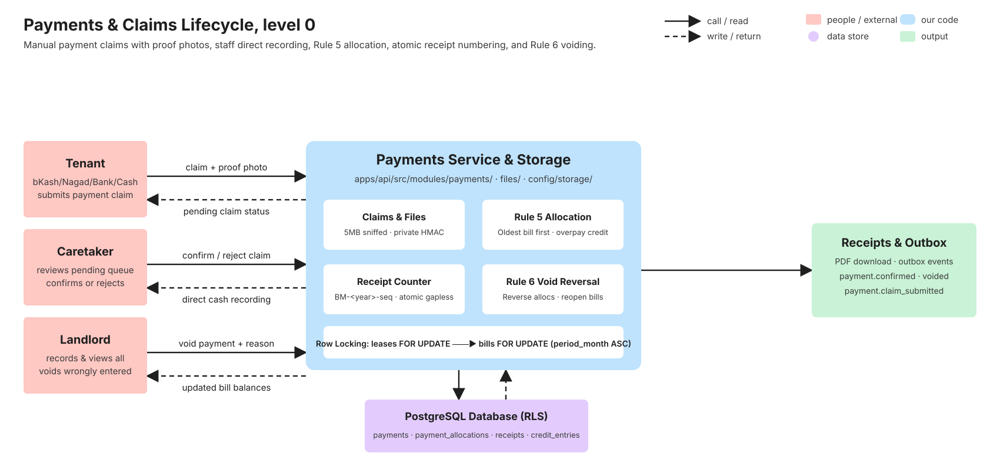
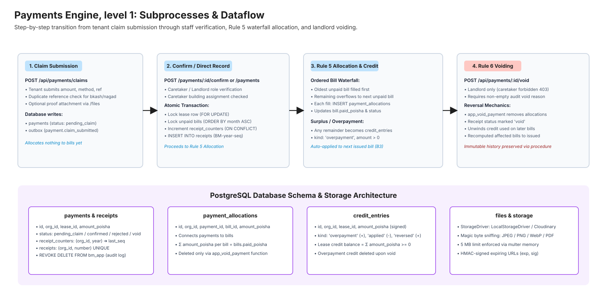
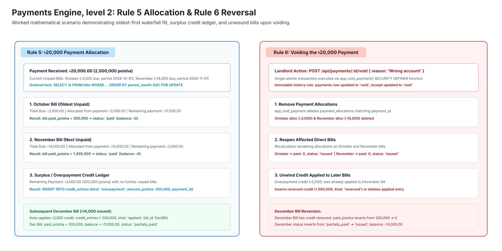
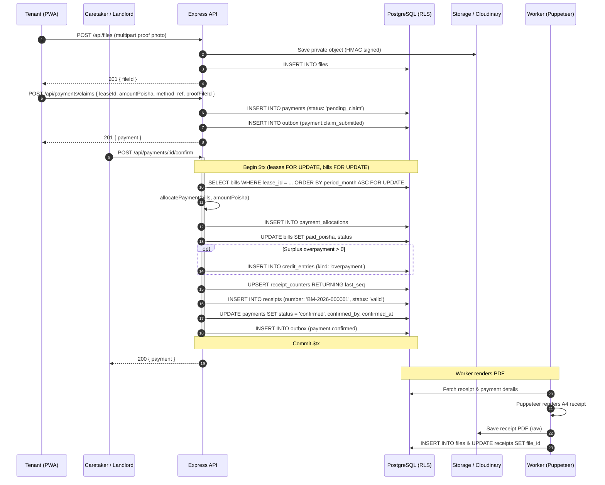
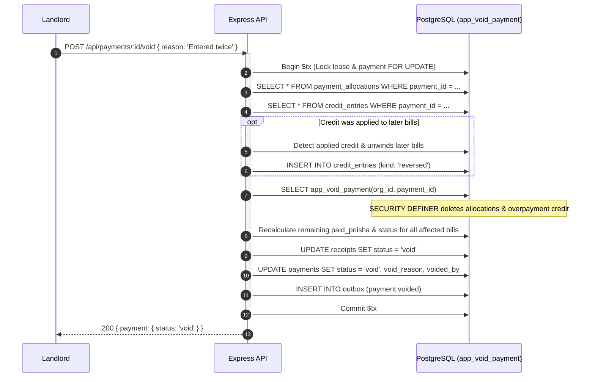
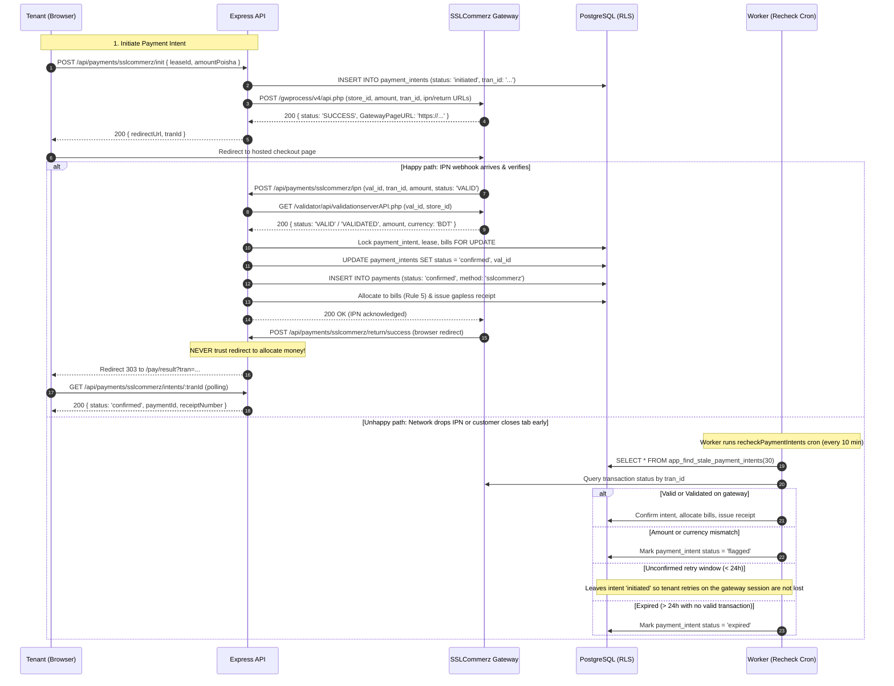

# Payments (manual + SSLCommerz)

> Tenant payment claims, caretaker verification, direct staff collection, Rule 5 oldest-first allocation, gapless receipt numbering, Rule 6 voiding, and SSLCommerz online payments. Written in task V9 (stories P2 to P6) and task V10 (online SSLCommerz P1) from the merged code and its tests. If this page and the code disagree, the code wins: fix the page.

## 1. What it does

The BasaManager Payments Engine handles money collection for apartment leases across Bangladesh. Tenants pay their monthly rent and charges either via online payment gateways (SSLCommerz sandbox for bKash, cards, internet banking), mobile financial services (bKash, Nagad), bank transfer, or cash directly to the building caretaker.

### Online Payments (SSLCommerz)

Tenants can pay directly within the application using the "Pay Online" option (`POST /api/payments/sslcommerz/init`). The backend generates a cryptographically unique transaction ID (`tran_id`), creates a `payment_intents` record with status `initiated`, and initializes a payment session with SSLCommerz. The tenant is redirected to the SSLCommerz hosted checkout gateway.

Crucially, **the browser return redirect (`POST /api/payments/sslcommerz/return/:result`) is never trusted to move money or mark a bill as paid**. Payment confirmation and financial allocation happen exclusively through:

1. An asynchronous Server-to-Server Instant Payment Notification (**IPN**) webhook (`POST /api/payments/sslcommerz/ipn`). The API receives the payload, directly contacts the SSLCommerz validation API to verify amount and currency, and if validated, confirms the intent, creates a confirmed `payments` entry, executes Rule 5 waterfall allocation, and issues a gapless receipt.
2. A background reconciliation cron job (`recheckPaymentIntents`) running every 10 minutes in `apps/worker`. It inspects any intent left unfinalized after 30 minutes, verifies its status against the SSLCommerz order query API, and settles it safely.

When the tenant returns to the app (`/pay/result?tran=...`), the frontend polls the intent status (`GET /api/payments/sslcommerz/intents/:tranId`) until the webhook confirms it, giving immediate user feedback without compromising security.

### Manual Payments & Claims

When paying outside the application, a tenant submits a **payment claim** (`POST /api/payments/claims`) specifying the amount, method, paid-on date, optional transaction ID (reference), and an optional proof screenshot. The uploaded proof is stored in private object storage through the files interface (`POST /api/files`) with a 5 MB limit and magic-byte MIME sniffing.

Caretakers and landlords review pending claims in their payments queue (`apps/web/src/pages/landlord/PaymentsPage.tsx`). When staff confirms a claim (`POST /api/payments/:id/confirm`) or records a direct cash collection (`POST /api/payments`), the system executes a single, atomic database transaction:

1. Locks the lease row and all unpaid bills in deterministic month order (`ORDER BY period_month ASC FOR UPDATE`).
2. Allocates money across bills following **Rule 5** (oldest unpaid bill filled first, remaining balance overflowing to the next).
3. If payment exceeds all outstanding dues, the surplus is preserved as a credit ledger entry (`credit_entries`), which automatically offsets subsequent bills.
4. Atomically increments the organisation's gapless receipt sequence (`BM-<year>-<seq 6 digits>`) via an UPSERT on `receipt_counters`.
5. Emits a `payment.confirmed` event to the transactional outbox (`outbox_messages`).

If a payment was recorded erroneously, landlords can void it (`POST /api/payments/:id/void`) with a mandatory explanation. Under **Rule 6**, voiding deletes the payment allocations, reverses any credit created, reopens affected bills to unpaid or partially paid, and marks the receipt as VOID—without violating the immutable database audit trail.

Stories from `.agent/01-PRODUCT.md`:

- **P2**: Tenant submits a payment claim with method, reference/TrxID, and optional photo.
- **P3**: Staff confirms or rejects claims, or records direct cash payments.
- **P4**: Sequential receipt issued per organisation with no gaps (`BM-2026-000001`).
- **P5**: Landlord voids wrongly entered payment; receipt marked VOID, dues recomputed.
- **P6**: Overpayment automatically becomes credit applied to future bills.

## 2. Explain it in 2 minutes

> "In Bangladeshi buildings, rent collection is fraught with confusion: tenants send bKash to the landlord or hand cash to the building guard, and paper chits get lost. BasaManager turns this into an auditable digital pipeline.
>
> When a tenant sends money via bKash, they open BasaManager on their phone, tap 'Submit Payment Claim', type their TrxID, and upload a screenshot of the bKash confirmation SMS. The claim instantly shows up in the caretaker's 'Pending Claims' queue.
>
> The caretaker checks the bank or bKash merchant statement. If it matches, they tap 'Confirm'. Behind the scenes, the system performs a strict financial waterfall called Rule 5: it takes the oldest unpaid bill—say March—and pays it off completely. If there is money left over, it pays April. If the tenant sent more than they owe, the extra amount doesn't vanish—it is logged as advance credit on their lease ledger, ready to discount next month's bill automatically.
>
> At the exact same microsecond, the system assigns a sequential receipt number—like `BM-2026-000042`—that is guaranteed to have no gaps or duplicates across the organisation, even if 20 tenants pay at the same second. A PDF receipt is generated in the background, which the tenant can download at any time.
>
> What if the landlord accidentally typed ৳50,000 instead of ৳5,000 for a cash payment? The landlord taps 'Void', enters an explanation ('Typo in digit'), and the system executes Rule 6: the receipt is stamped VOID, the allocations are removed, and the bills are safely reopened to unpaid. Because our database permissions forbid deleting payment history, everything is transparent and fully auditable."

## 3. Level 0 diagram



Data in: Tenant claims with attachments, staff confirmation/rejection, direct payment recordings, void requests with reasons.  
Data out: Confirmed payments, itemized `payment_allocations`, gapless `receipts`, `credit_entries`, outbox notification events.  
Postgres stores all records with Row-Level Security (RLS) enforcing multi-tenant isolation.

## 4. Level 1 diagram



The payment lifecycle moves through distinct phases:

1. **Claim Submission**: Tenant uploads proof to `/api/files`, then posts to `/api/payments/claims`. Status is `pending_claim`.
2. **Staff Verification**: Caretaker or landlord validates the transaction and triggers `/api/payments/:id/confirm`. Alternatively, staff logs direct payments via `POST /api/payments`.
3. **Waterfall Allocation**: `allocatePayment` applies funds to bills chronologically. Surplus funds become `credit_entries`.
4. **Receipting**: An atomic counter increments `BM-<year>-<seq>` and queues an outbox event.
5. **Reversal / Void**: Landlords invoke `POST /api/payments/:id/void`. A database `SECURITY DEFINER` function clears allocations while preserving the immutable payment audit record.

## 5. Level 2 diagram



Mathematical breakdown of Rule 5 & Rule 6:

1. **Rule 5 Allocation**: A ৳20,000 payment on October (৳3,000 due) and November (৳14,000 due) allocates ৳3,000 to October, ৳14,000 to November, and stores ৳3,000 as overpayment credit. When December (৳14,000) is issued, it auto-applies the ৳3,000 credit, leaving a balance of ৳11,000.
2. **Rule 6 Void Reversal**: Voiding the ৳20,000 payment deletes October and November allocations (returning both to `issued`, balance due). Because the ৳3,000 credit was already used on December, the system unwinds December's credit, reopening December to its full ৳14,000 balance. The lease credit ledger never goes negative.

## 6. Sequence diagrams

### 6.1 Tenant claim to caretaker confirmation and receipt generation



### 6.2 Landlord voiding payment (Rule 6)



### 6.3 SSLCommerz online payments and webhook lifecycle



## 7. Code walk

- `packages/shared/src/api/payments.ts`: Zod validation schemas for claims (`createPaymentClaimSchema`), direct payments (`recordPaymentSchema`), rejections (`rejectPaymentSchema`), voids (`voidPaymentSchema`), online payment initiation (`initOnlinePaymentSchema`), and list filtering (`listPaymentsQuerySchema`).
- `packages/domain/src/billing/index.ts`: Pure domain function `allocatePayment(bills, amountPoisha)` that sorts bills chronologically and computes exact allocation arrays and overpayment credit.
- `apps/api/src/config/storage/index.ts`: Pluggable storage abstraction supporting `LocalStorageDriver` (HMAC-signed expiring URLs) and `CloudinaryStorageDriver` (authenticated private downloads).
- `apps/api/src/modules/files/files.service.ts`: Sniffs file magic bytes to verify genuine JPEG/PNG/WebP/PDF content, enforces a 5 MB payload cap, and stores authenticated private files.
- `apps/api/src/modules/payments/payments.service.ts`:
  - `submitClaim`: Validates tenant lease membership, prevents duplicate references for mobile payments, and records pending claims.
  - `recordPayment` and `confirmPayment`: Enforces strict row-locking order (`leases` row first, then `bills` in ascending month order), runs Rule 5 allocation, generates gapless receipt numbers, and writes outbox notifications.
  - `rejectPayment`: Validates required rejection reason and transitions claim to `rejected`.
  - `voidPayment`: Landlord-only endpoint calling `app_void_payment` to remove allocations, unwind subsequent bill credits, recalculate bill balances, and flag receipts as VOID.
- `apps/api/src/modules/payments/sslcommerz.client.ts`: SSLCommerz HTTP client with retry logic for session initialization (`initPayment`), IPN server validation (`validatePayment`), and order queries (`queryTransaction`).
- `apps/api/src/modules/payments/sslcommerz.service.ts`: Handles payment initiation (`initPayment`), IPN webhook (`handleIpn`), browser returns (`handleReturn`), intent polling (`getIntent`), and background recheck verification (`recheckPaymentIntents`). Enforces zero-trust redirects and sequential lock ordering (`payment_intents` -> `leases` -> `bills`).
- `apps/api/src/modules/payments/sslcommerz.controller.ts`: Express controllers mapping SSLCommerz routes to the service with proper DTO parsing.
- `apps/worker/src/jobs/recheckPaymentIntents.ts`: Scheduled cron job running every 10 minutes with a Redis mutex lock to reconcile unfinalized payment intents older than 30 minutes against the SSLCommerz validation API (marking unverified intents older than 24 hours as `expired`).
- `apps/worker/src/pdf/pdf.service.ts`: Headless Puppeteer engine rendering A4 receipts using `receipt.template.ts`, persisting PDFs to storage, and linking `fileId` to `receipts`.
- `apps/web/src/pages/landlord/PaymentsPage.tsx`: Desktop-first queue for staff to confirm/reject claims, record manual cash, and trigger void operations.
- `apps/web/src/pages/tenant/ClaimPaymentDialog.tsx`: Mobile-first modal for tenants to enter amount, method, TrxID, and upload payment screenshots.
- `apps/web/src/pages/tenant/PayOnlineDialog.tsx`: Dialog for tenants to pay bills online via SSLCommerz sandbox, with BDT conversion and minimum ৳100 constraint.
- `apps/web/src/pages/tenant/PaymentResultPage.tsx`: Tenant polling status screen at `/pay/result?tran=...` showing live transition from initiated to confirmed, failed, cancelled, expired, or still processing, with receipt PDF download trigger.

## 8. Where the data lives

| Table                 | Critical Columns                                                                                                                                  | Invariants & Constraints                                                                                                                                                                               |
| --------------------- | ------------------------------------------------------------------------------------------------------------------------------------------------- | ------------------------------------------------------------------------------------------------------------------------------------------------------------------------------------------------------ |
| `payments`            | `org_id`, `lease_id`, `amount_poisha`, `method`, `status`, `reference`, `proof_file_id`, `paid_on`, `submitted_by`, `confirmed_by`, `void_reason` | Partial unique `(method, reference) WHERE method IN ('bkash','nagad') AND status <> 'rejected'`. History never deleted (`REVOKE DELETE FROM bm_app`).                                                  |
| `payment_intents`     | `id`, `org_id`, `lease_id`, `tran_id`, `amount_poisha`, `status`, `val_id`, `session_key`, `payment_id`                                           | Unique `tran_id`. Status: `initiated`, `confirmed`, `failed`, `cancelled`, `flagged`, `expired`. Multi-tenant RLS `org_isolation` with `app_find_payment_intent_by_tran_id` for cross-tenant webhooks. |
| `payment_allocations` | `org_id`, `payment_id`, `bill_id`, `amount_poisha`                                                                                                | Foreign key to `(org_id, payment_id)` and `(org_id, bill_id)`. Sum per bill equals `bill.paid_poisha`.                                                                                                 |
| `receipt_counters`    | `org_id`, `year`, `last_seq`                                                                                                                      | Primary key `(org_id, year)`. Gapless atomic sequence via `ON CONFLICT DO UPDATE`.                                                                                                                     |
| `receipts`            | `org_id`, `payment_id`, `number`, `status`, `file_id`                                                                                             | Unique `(org_id, payment_id)` and `(org_id, number)`. Status is `'valid'` or `'void'`.                                                                                                                 |
| `credit_entries`      | `org_id`, `lease_id`, `amount_poisha`, `kind`, `payment_id`, `bill_id`                                                                            | Signed integers. Total lease balance `SUM(amount_poisha)` is never negative.                                                                                                                           |
| `files`               | `org_id`, `public_id`, `resource_type`, `mime`, `size_bytes`, `kind`, `uploaded_by`                                                               | Private access only. Max 5 MB limit.                                                                                                                                                                   |

## 9. Data lifecycle

1. **Submission**: Tenant submits claim (`pending_claim`). No money is counted toward bill balances.
2. **Rejection**: If rejected by staff, status transitions to `rejected` with `rejected_reason`. If bKash/Nagad was used, the partial unique constraint releases the reference, allowing re-submission.
3. **Confirmation**: Staff confirms claim or records payment directly. Status becomes `confirmed`. Allocations are inserted, bills updated to `partially_paid` or `paid`, overpayment stored as credit, and a receipt record is created.
4. **Receipt Rendering**: Worker renders receipt HTML into PDF via Puppeteer, stores it in storage, and links `receipt.file_id`.
5. **Voiding**: If landlord voids the payment, status becomes `void` with `void_reason` and `voided_by`. Payment allocations are deleted via `app_void_payment`, credit unwound, affected bills reopened, and receipt status changed to `void`.
6. **Online Payment (SSLCommerz)**: Tenant initiates intent (`initiated`). Tenant completes checkout on gateway. Gateway delivers server-to-server IPN; API calls SSLCommerz validation endpoint. Only on verified response, status transitions to `confirmed`, recording a `payments` entry, allocating bills, and issuing a gapless receipt. If IPN is missed, the background recheck cron reconciles it within 5-10 minutes.

## 10. Edge cases & failure modes

- **20 Concurrent Payments**: Tested in `apps/api/test/payments/payments.int.test.ts`. 20 concurrent transactions run against `receipt_counters`; Postgres serializes the updates, resulting in gapless sequential numbers `000001` through `000020` without duplicate keys or deadlocks.
- **Concurrent Claims on One Lease & Deadlock Prevention (#29)**: Two staff members confirming different claims simultaneously on the same lease acquire a row lock on the `leases` table. Furthermore, all payment and billing operations follow a strict global lock hierarchy (`leases` row FOR UPDATE first, `bills` row FOR UPDATE second), preventing Postgres 40P01 deadlocks between concurrent payment confirmations and bill modifications.
- **Cursor Pagination Boundary Precision (#27)**: Payments listing queries fetch `limit + 1` rows to test for additional pages. When a subsequent page exists, the lookahead item is discarded and `nextCursor` is set to the last retained element (`payments[payments.length - 1].id`), ensuring no items are dropped at page boundaries.
- **Receipt Creation Failure**: If the receipt record insert fails (e.g. disk or trigger error), the entire database transaction rolls back: no payment status is updated, no allocations are saved, no credit is added, and no outbox notification is dispatched.
- **MIME Type Spoofing**: An executable renamed to `.jpg` is detected via file magic byte inspection and rejected with `415 Unsupported Media Type`.
- **Oversized Proof Photo**: Files larger than 5 MB are rejected with `413 Payload Too Large` without storing bytes to disk.
- **Voiding After Credit Was Used**: Handled by Rule 6. If an overpayment credit of ৳2,000 was already applied to pay a subsequent month's bill, voiding the originating payment un-applies that credit, returning the subsequent month's bill to unpaid status.
- **SSLCommerz Amount / Currency Mismatch**: If an attacker attempts to spoof an IPN with an amount or currency that diverges from the recorded intent, the validation check flags the intent as `flagged` and prevents any allocation or receipt issuance.
- **Foreign or Invalid IPN `val_id`**: If an IPN carries a forged, garbage, or foreign `val_id` (where the gateway returns `INVALID_TRANSACTION` or a `tran_id` that does not match our payment intent), the IPN is ignored (`status: 'ignored'`) and the intent remains `initiated` so legitimate payments and the background reconciliation job are never prematurely aborted or compromised.
- **Both VALID and VALIDATED Accepted**: Both `VALID` (first validation) and `VALIDATED` (gateway re-query) are accepted by IPN and recheck routines as confirmed transactions.
- **Recheck Cron Resilience**: The background recheck job scans all transaction attempts returned in `queryRes.element` for a valid payment. If the gateway connection fails (`APIConnect !== 'DONE'`), the job safely skips without modifying intent status. Intents with no gateway record remain `initiated` until 24 hours have elapsed, after which they are marked `expired`.

## 11. Security

- **Multi-Tenant RLS**: Every table carries `org_id`. Transactions run with `app.org_id` and `app.user_id` set via `this.prisma.$tx`.
- **Role Isolation**: Tenants can only view and submit claims for their own active leases (`403` for landlord endpoints, `404` for cross-lease probing). Caretakers can only record and confirm payments for buildings to which they are explicitly assigned (`caretaker_buildings`). Only landlords can void payments (`403` for caretakers and tenants).
- **Immutable Financial History**: PostgreSQL permissions explicitly execute `REVOKE DELETE ON payments, payment_allocations, receipts, credit_entries FROM bm_app`. Deleting allocations during voiding is strictly permitted through a `SECURITY DEFINER` function (`app_void_payment`) owned by `bm_owner`.
- **Private Storage & Expiring HMAC URLs**: Uploaded photos and receipts are never public. URLs expire after 300 seconds and carry an HMAC-SHA256 signature (`STORAGE_URL_SECRET`). Tampered signatures or expired timestamps produce `403 Forbidden`.
- **Zero Trust on Browser Redirects**: Browser return redirects (`POST /api/payments/sslcommerz/return/:result`) never allocate funds or mutate intent status. Funds and state mutations are only performed upon server-to-server validation (IPN or cron recheck).

## 12. Concepts used

- [Payment Gateways and Webhooks](../concepts/payment-gateways-and-webhooks.md): Two-phase commits, idempotency keys, and zero-trust redirect patterns.
- [Transactions and Locking](../concepts/transactions-and-locking.md): `FOR UPDATE` lock hierarchies preventing deadlock.
- [Money and Rounding](../concepts/money-and-rounding.md): All currency stored as integer poisha (৳1 = 100 poisha).
- [File Uploads and Signed URLs](../concepts/file-uploads-and-signed-urls.md): Private storage with expiring HMAC tokens.
- [PDF Generation](../concepts/pdf-generation.md): Headless Puppeteer rendering in the worker.
- [Notification Pipeline Outbox](../concepts/notification-pipeline-outbox.md): Outbox events emitted in the payment transaction.

## 13. Tests

- **Integration tests**:
  - `apps/api/test/payments/payments.int.test.ts`: 33 integration tests covering tenant claims, proof uploads, staff direct entry, confirmation, rejection, Rule 5 oldest-first allocation, Rule 6 voiding, credit creation & reversal, receipt counters, and concurrency.
  - `apps/api/test/payments/sslcommerz.int.test.ts`: 34 integration tests covering session initiation, IPN validation, fake IPN rejection, currency/amount mismatch flagging, replay protection, cross-tenant RLS safety, browser return redirection, and recheck cron.
  ```bash
  pnpm test:int apps/api/test/payments/payments.int.test.ts
  pnpm test:int apps/api/test/payments/sslcommerz.int.test.ts
  ```
- **Role grant & security tests**: `apps/api/test/role-grants.int.test.ts` (14 tests verifying history immutability and `REVOKE DELETE` on payments, payment allocations, and credit entries).
  ```bash
  pnpm test:int apps/api/test/role-grants.int.test.ts
  ```
- **E2E tests**:
  - `tests/e2e/pay-claim.spec.ts`: Full end-to-end lifecycle (tenant submits claim with proof photo -> caretaker confirms -> receipt generated -> tenant views receipt -> landlord direct payment & voiding).
  - `tests/e2e/pay-online.spec.ts`: Online payment flow (tenant opens Pay Online dialog -> initiates SSLCommerz intent -> mock gateway returns -> polling confirms intent and receipt).
  ```bash
  pnpm test:e2e tests/e2e/pay-claim.spec.ts
  pnpm test:e2e tests/e2e/pay-online.spec.ts
  ```

## 14. Try it yourself

1. **Start the local environment**:
   ```bash
   pnpm dev
   ```
2. **Submit a payment claim as tenant**:
   - Log in as a tenant at `http://localhost:4173/login`.
   - Open `/t/bills` and click into an issued bill.
   - Click **Claim payment**, select method "bKash", enter the transaction reference, amount, and attach a screenshot. Click **Submit claim**.
3. **Confirm the payment as caretaker**:
   - In an incognito window, log in as the building caretaker and navigate to `/c/payments`.
   - Review the claim under "Pending Claims", view the attached proof image, and click **Confirm**.
   - Notice the status switches to "Confirmed" and a receipt is assigned.
4. **View and download receipt as tenant**:
   - Switch back to the tenant window and refresh the bill detail page.
   - View the payment listed in the history table and click **Download receipt**.
5. **Break it exercise**:
   - In `apps/api/src/modules/payments/payments.service.ts`, comment out the lease row lock `await tx.$executeRaw` in `confirmPayment`.
   - Run `pnpm test:int apps/api/test/payments/payments.int.test.ts`.
   - Observe how concurrent confirmations can lead to race conditions under load. Revert the change.

## 15. Self-check

<details>
<summary>1. Why does BasaManager disallow hard deletes on the payments table?</summary>
Financial history must remain immutable for landlord accounting and dispute resolution. Mistakes are corrected by voiding, which marks the payment and receipt VOID while logging who voided it and why.
</details>

<details>
<summary>2. How are gapless receipt numbers guaranteed under concurrent payments?</summary>
By executing an atomic <code>INSERT ... ON CONFLICT (org_id, year) DO UPDATE SET next_seq = receipt_counters.next_seq + 1 RETURNING next_seq - 1</code> inside the payment transaction.
</details>

<details>
<summary>3. What happens if a tenant overpays by ৳3,000?</summary>
Rule 5 stores the ৳3,000 as a positive <code>credit_entries</code> row (kind: 'overpayment'). When the next month's bill is issued, the billing engine automatically applies this credit to reduce the amount due.
</details>

<details>
<summary>4. What happens if a landlord voids a payment whose overpayment credit was already applied to pay a subsequent month's bill?</summary>
Rule 6 un-applies that credit, reopens the subsequent month's bill back to unpaid/partially paid status, deletes the overpayment credit entries and payment allocations via <code>app_void_payment</code>, records <code>reversed</code> credit entries for the ledger audit trail, and sets the payment and receipt status to <code>void</code>.
</details>

<details>
<summary>5. How does the system prevent tenants from uploading malicious files disguised as images?</summary>
The API validates MIME types against an explicit whitelist (JPEG, PNG, WebP, PDF), and passes image buffers through Sharp, which decodes and re-encodes the image pixels while stripping all EXIF metadata.
</details>

<details>
<summary>6. Can a caretaker void a confirmed payment?</summary>
No. Payment voiding is strictly restricted to the landlord role. The route enforces <code>requireRole(['landlord'])</code> and returns 403 Forbidden for caretaker attempts.
</details>
