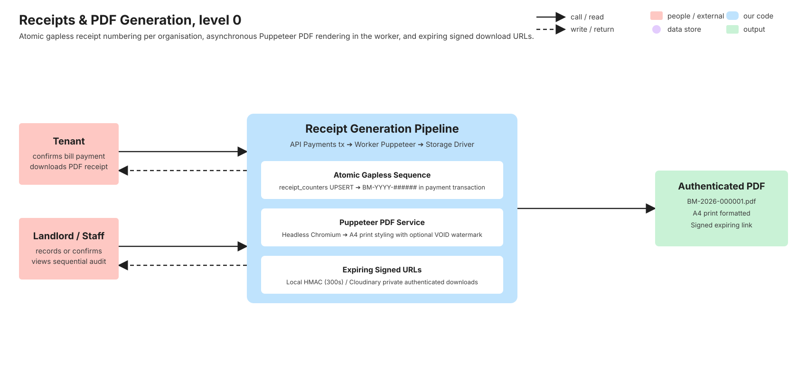
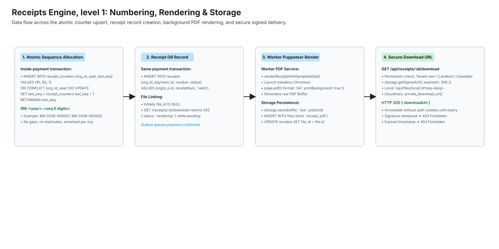
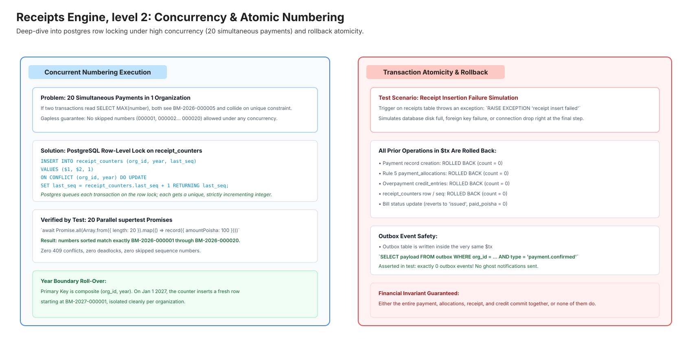
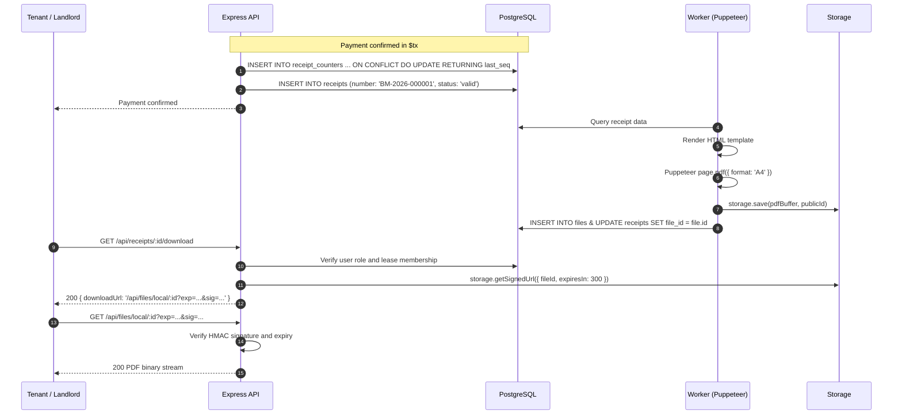

# Receipts & statements (PDF)

> Gapless sequential receipt numbering, Puppeteer PDF rendering in the worker, authenticated private downloads with expiring HMAC signatures, and audit trails. Written in task V9 (stories P4; statements R2 expanded in V14) from the merged code and its tests. If this page and the code disagree, the code wins: fix the page.

## 1. What it does

Every confirmed payment in BasaManager—whether recorded directly by staff or confirmed from a tenant claim—automatically issues an official, sequential receipt.

Receipt numbers follow a strict format: `BM-<year>-<sequence 6 digits>` (for example, `BM-2026-000001`, `BM-2026-000002`). Sequences are tracked per organization and year in the `receipt_counters` table. Sequence numbers are guaranteed to be gapless and duplicate-free, even under extreme concurrency (such as 20 parallel payment requests).

Receipt PDFs are rendered asynchronously by the background worker using headless Puppeteer (`apps/worker/src/pdf/pdf.service.ts`). When a user accesses `GET /api/receipts/:id/download`, the endpoint either returns `HTTP 200 { downloadUrl }` with an expiring signed URL if the PDF is ready, or `HTTP 202 { status: 'rendering' }` while generation is in progress.

Receipt PDFs include the organization name, building and unit label, primary tenant details, payment method, reference note/TrxID, date paid, itemized bill allocations, and any credit created. If a payment is subsequently voided, the receipt status is permanently marked as `void`, and regenerated PDFs feature an unmistakable red diagonal `VOID` watermark.

Stories from `.agent/01-PRODUCT.md`:

- **P4**: Anyone involved can get a PDF receipt for every confirmed payment. Receipt numbers are sequential per organisation with no gaps or duplicates (`BM-2026-000123`).
- **P5**: When a payment is voided, its receipt is marked VOID and dues are recalculated.

## 2. Explain it in 2 minutes

> "In Bangladesh, house rent receipts are usually paper slips torn from a receipt book bought at Nilkhet. Half the time, the carbon paper is faint, numbers are skipped, and when tax season comes, landlords cannot prove what was collected.
>
> In BasaManager, receipt generation is as reliable as a bank ledger.
>
> The moment a caretaker clicks 'Confirm Payment', our database locks a counter row specifically for that building's organisation and the current year. It increments the counter atomically: 1 becomes 2, 2 becomes 3. It is mathematically impossible for two payments to get the same receipt number, and impossible for a number to be skipped.
>
> That receipt number—formatted cleanly as `BM-2026-000042`—is saved immediately with the payment. In the background, our worker process opens a headless Chrome browser, fills in an A4 receipt template with tenant details, flat number, breakdown of bills paid, and bKash TrxID, and renders it to a crisp PDF.
>
> When the tenant or landlord clicks 'Receipt', the system checks permissions: only the tenant living in that flat, the assigned caretaker, or the landlord can access it. If allowed, BasaManager gives them a secure link that expires in 5 minutes. The PDF is stored safely in private storage—nobody without an authenticated, time-limited cryptographic token can ever view it."

## 3. Level 0 diagram



Data in: Payment confirmation trigger, receipt ID download request.  
Data out: `receipts` records with sequential numbers, rendered A4 PDF files, time-limited signed download URLs.  
Postgres stores `receipt_counters` and `receipts` isolated by organisation.

## 4. Level 1 diagram



The receipt generation lifecycle:

1. **Sequence Allocation**: Atomically upserts `receipt_counters` inside the payment transaction.
2. **Receipt Record**: Inserts a `receipts` row (`status: 'valid'`, `file_id: null`).
3. **Puppeteer Render**: Worker renders HTML to A4 PDF, uploads to private storage, and updates `receipts.file_id`.
4. **Secure Delivery**: `GET /api/receipts/:id/download` verifies permissions and returns a 300-second HMAC-signed URL.

## 5. Level 2 diagram



Concurrency and rollback guarantees:

- **20 Concurrent Payments**: Tested with parallel promises in `payments.int.test.ts`. Postgres row-level locks on `receipt_counters` ensure clean serialization: numbers 000001 to 000020 are assigned with zero conflicts and zero gaps.
- **Rollback Atomicity**: If the receipt record fails to insert, the entire payment transaction—including the counter increment, payments row, and bill allocations—is completely rolled back.

## 6. Sequence diagrams

### 6.1 Receipt sequence allocation and download flow



## 7. Code walk

- `packages/shared/src/api/payments.ts`: Schemas for `receiptResponseSchema` and `receiptDownloadResponseSchema`.
- `apps/api/src/modules/payments/payments.service.ts`:
  - `confirmPayment` & `recordPayment`: Calculates year via `new Date(clock.now()).getUTCFullYear()`, executes atomic counter UPSERT, formats `BM-<year>-<paddedSeq>`, and creates receipt row.
  - `getReceiptDownload`: Enforces role-based access control (tenant lease check, caretaker building check), returns `202 { status: 'rendering' }` if `fileId` is missing, or calls `storage.getSignedUrl` to return a 5-minute signed URL.
- `apps/worker/src/pdf/receipt.template.ts`: Pure HTML/CSS template formatted for A4 print with tenant info, payment details, itemized allocations table, and conditional VOID watermark.
- `apps/worker/src/pdf/pdf.service.ts`: Launches headless Chrome with sandbox flags, converts template HTML into a PDF buffer, stores it as `kind: 'receipt_pdf'`, and links `receipt.fileId`.

## 8. Where the data lives

| Table              | Key Columns                                                                                                | Purpose & Invariants                                                                                           |
| ------------------ | ---------------------------------------------------------------------------------------------------------- | -------------------------------------------------------------------------------------------------------------- |
| `receipt_counters` | `org_id`, `year`, `last_seq`                                                                               | Composite PK `(org_id, year)`. Atomic sequence source. `CHECK (last_seq >= 0)`.                                |
| `receipts`         | `org_id`, `payment_id`, `number`, `status`, `file_id`                                                      | Unique `(org_id, payment_id)` (one receipt per payment). Unique `(org_id, number)`. Foreign key to `files.id`. |
| `files`            | `id`, `org_id`, `provider`, `public_id`, `resource_type`, `format`, `mime`, `size_bytes`, `sha256`, `kind` | Private storage file record with `kind = 'receipt_pdf'`.                                                       |

## 9. Data lifecycle

1. **Reservation**: Sequence number is allocated and receipt row inserted at payment confirmation time.
2. **Pending PDF**: `receipt.file_id` is null; `/download` returns 202.
3. **Rendered**: Worker generates PDF, writes file row, and sets `receipt.file_id`. `/download` returns 200 with signed link.
4. **Voided**: If payment is voided, `receipt.status` is set to `'void'`, any attached PDF is unlinked, and the worker re-renders a new PDF copy featuring a prominent red diagonal `VOID` watermark. Because `app_void_payment` deletes allocation and overpayment records to restore original dues and prevent phantom credit, the regenerated VOID receipt retains all payment headers, amounts, dates, and tenant details, but contains an empty allocations breakdown.
5. **Retention**: Receipts are permanent financial records (`REVOKE DELETE FROM bm_app`).

## 10. Edge cases & failure modes

- **Concurrent Counter Increments**: PostgreSQL's `ON CONFLICT (org_id, year) DO UPDATE` acquires an exclusive row lock on the counter row for that org and year. Concurrent requests queue cleanly without race conditions.
- **Year Roll-Over**: On January 1st, a new row is created for the new calendar year, resetting the sequence counter to `000001` for the new year.
- **Worker PDF Generation Delay**: If a user immediately clicks download before the worker completes rendering, the API returns `202 { status: 'rendering' }`, prompting the client to poll or listen for completion.
- **Signature Expiry**: Signed download links expire after 300 seconds. Replay after 5 minutes returns `403 Forbidden`.

## 11. Security

- **Tamper-Proof Signatures**: Signed URLs carry `exp` (UNIX expiry) and `sig` (HMAC-SHA256 signature using `STORAGE_URL_SECRET`).
- **Timing-Safe Verification**: Signature comparison uses `crypto.timingSafeEqual` to prevent timing attacks.
- **Zero Public Access**: Receipts are never uploaded with public permissions. Cloudinary uploads use `type: 'authenticated'`, and local uploads are served exclusively via authenticated or HMAC-verified controllers.
- **Tenant Privacy**: Tenants cannot download receipts belonging to another tenant or another lease (`404 Not Found`).

## 12. Concepts used

- [PDF Generation](../concepts/pdf-generation.md): Headless Chromium rendering in background worker.
- [File Uploads and Signed URLs](../concepts/file-uploads-and-signed-urls.md): Expiring HMAC links for private assets.
- [Transactions and Locking](../concepts/transactions-and-locking.md): Row locks ensuring gapless numbering.

## 13. Tests

- **Worker PDF tests**: `apps/worker` Puppeteer rendering service tests and integration validation.
  ```bash
  pnpm --filter @bm/worker typecheck
  ```
- **Receipt numbering integration tests**: `apps/api/test/payments/payments.int.test.ts` (covers atomic receipt generation, counter sequence `BM-<year>-<seq 6 digits>`, signed download URLs, and void watermark state).
  ```bash
  pnpm test:int apps/api/test/payments/payments.int.test.ts
  ```
- **E2E tests**:
  - `tests/e2e/pay-claim.spec.ts`: Confirms receipt creation, receipt download URL retrieval, and void status rendering.
  ```bash
  pnpm test:e2e tests/e2e/pay-claim.spec.ts
  ```

## 14. Try it yourself

1. **Start the local environment**:
   ```bash
   pnpm dev
   ```
2. **Generate a receipt via payment recording**:
   - Log in as a landlord at `http://localhost:4173/login`.
   - Open `/l/payments` and click **Record Payment**.
   - Select an active lease, enter an amount (e.g. ৳15,000), payment method "cash", and submit.
   - Observe the newly recorded payment appearing in the Payment History table with a receipt badge (e.g. `BM-2026-000001`).
3. **Download the generated receipt**:
   - In the Payment History table, click **Download Receipt**.
   - Inspect the downloaded PDF: verify the landlord heading, tenant details, bill breakdown, and crisp A4 styling.
4. **Void payment and inspect voided receipt**:
   - Click **Void** on the payment row and confirm with an audit reason.
   - The status updates to "Voided". Click **Download Receipt** again to verify the prominent VOID watermark.
5. **Break it exercise**:
   - In `apps/worker/src/pdf/receipt.template.ts`, remove the `.watermark-void` CSS block.
   - Re-render a voided payment receipt and observe that the visual watermark disappears. Revert the change.

## 15. Self-check

<details>
<summary>1. Why is the receipt number generated in the payment transaction rather than during PDF rendering?</summary>
Receipt numbering must be synchronous, atomic, and gapless with the payment. If rendering fails or is delayed in background processing, the payment receipt number is already fixed, legal, and indisputable.
</details>

<details>
<summary>2. What format do receipt numbers take in BasaManager?</summary>
<code>BM-&lt;year&gt;-&lt;seq 6 digits&gt;</code>, for example <code>BM-2026-000001</code>.
</details>

<details>
<summary>3. What happens if a tenant requests a download before the worker has finished rendering the receipt PDF?</summary>
The download endpoint returns HTTP <code>202 Accepted</code> with a payload <code>{ data: { status: 'rendering' } }</code>, prompting the client UI to show a "Rendering receipt..." indicator and retry shortly.
</details>

<details>
<summary>4. Why does receipt rendering run in the background worker instead of the API server?</summary>
Puppeteer uses headless Chromium, which consumes substantial CPU and memory (50-150 MB per instance). Offloading rendering to the worker keeps the Express API fast and protects it from event loop blocking and OOM crashes.
</details>

<details>
<summary>5. How does the system ensure voided receipts are never mistaken for valid proof of payment?</summary>
The PDF template conditionally checks if the payment status is voided and renders a large, 45-degree rotated semi-transparent red "VOID" watermark across the center of the A4 page.
</details>

<details>
<summary>6. How does the API authenticate receipt downloads?</summary>
The endpoint <code>GET /receipts/:id/download</code> checks the user session and tenancy boundaries. It then generates a temporary signed URL valid for only 300 seconds (5 minutes), preventing unauthorized direct access.
</details>
