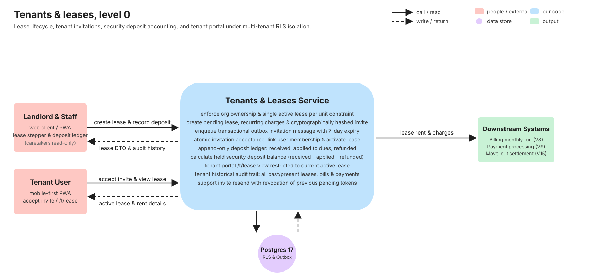
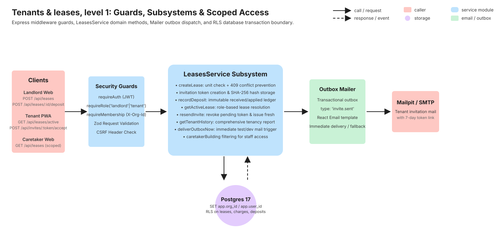
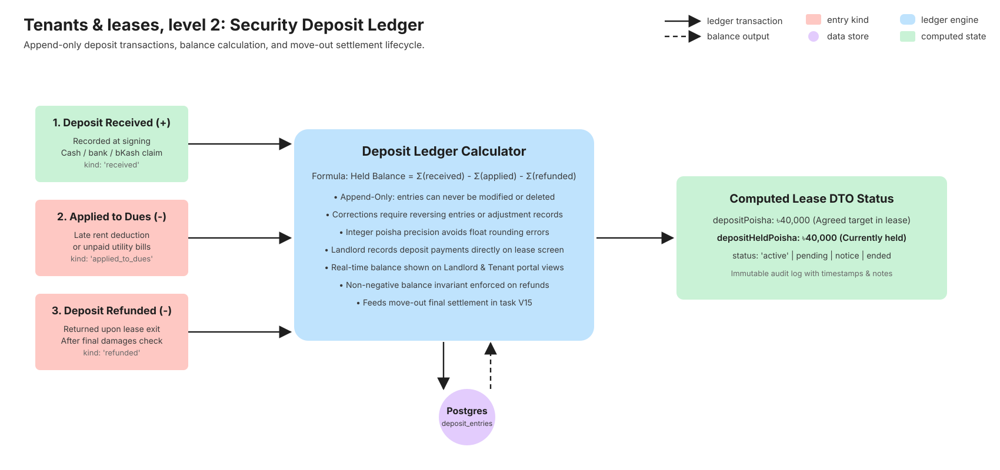
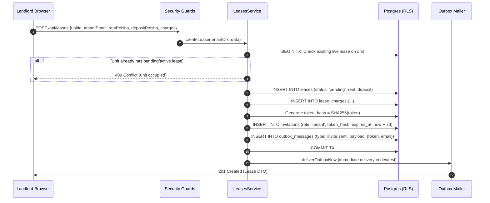
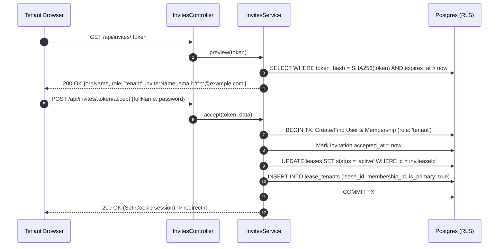
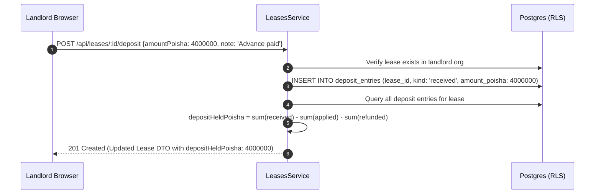

# Tenants & leases

> Tenant onboarding, multi-step lease agreement assembly, deposit ledger accounting, and the tenant portal. Written in task V7 (stories T1, T2, T4, T5) from the merged code and its tests. If this page and the code disagree, the code wins: fix the page.

## 1. What it does

Tenants and leases define the contractual, financial, and access relationships between landlords and the occupants of rental units in BasaManager.

Landlords initiate tenancies through an interactive 4-step stepper dialog: selecting an available unit, specifying the tenant's identity, defining start date, base rent, and agreed security deposit, attaching recurring charges (such as service charges or utilities), and recording initial meter readings. Creating a lease automatically registers a pending lease contract and issues a secure, time-limited invitation token sent to the prospective tenant's email address.

When the tenant follows the invitation link, they can review tenancy terms, provide their name and a secure password (or authenticate with Google OAuth), and accept the invitation. If the lease start date in Asia/Dhaka calendar time has arrived (`startDate <= todayDhaka`), the lease state transitions from `pending` to `active` and marks the unit `occupied`. If the start date is in the future, the lease remains `pending` until its start date arrives, when the activation job activates it.

Security deposits are handled with strict integrity via an immutable append-only ledger (`deposit_entries`) guarded by row-level database locks (`SELECT FOR UPDATE`). Landlords record initial cash or electronic payments, against which future rent deductions or damage offsets may be charged. A tenant portal allows residents to view their active lease details, house rules, rent obligations, and recurring charges at any time. Landlords can view complete historical records of every past and present tenant tenancy.

Stories from `.agent/01-PRODUCT.md`:

- **T1**: Create a lease and invite a tenant (4-step stepper modal, email invitation with 7-day token, outbox dispatch).
- **T2**: Tenant accepts invitation (set password or Google OAuth, activate lease if start date has arrived in Asia/Dhaka, establish unit membership).
- **T4**: Security deposit ledger (append-only ledger tracking received, applied to dues, and refunded amounts).
- **T5**: Tenant portal lease view & landlord tenant history (active lease details for tenant; chronological audit trail for landlord).

## 2. Explain it in 2 minutes

> "A lease in BasaManager is the core agreement tying a tenant to a unit. When a landlord wants to rent out a unit, they open the unit in their dashboard and click 'Create lease'.
>
> This opens a four-step stepper dialog. In Step 1, the landlord enters the tenant's full name, email, and household size. In Step 2, they configure the start date, monthly rent amount in poisha, and required security deposit. In Step 3, they customize any monthly recurring charges like elevator maintenance, security fees, or trash collection. In Step 4, they review the summary and confirm.
>
> Behind the scenes, the API checks that the unit doesn't already have an active or pending lease—if someone tries to double-book a unit, the database rejects it with a 409 Conflict. The server creates the lease with a 'pending' status, hashes a cryptographically secure invitation token, stores the hash in the database, and schedules an invite email through the transactional outbox.
>
> The prospective tenant receives an email with an invite link valid for 7 days. Clicking the link takes them to the onboarding page where they verify their details and choose a password or sign in with Google. Once submitted, their user account joins the organisation as a tenant, and their lease status activates when its start date arrives in Asia/Dhaka calendar time.
>
> Money is never handled casually: security deposits are tracked through an append-only ledger with row-level locks. When the tenant pays their deposit in cash or via mobile money, the landlord records a 'received' deposit entry. The held deposit balance is always the mathematical sum of received funds minus deductions and refunds.
>
> Once moved in, tenants have their own mobile-first portal where they can check their lease start date, monthly charges, and deposit balance without ever having to call the landlord."

## 3. Level 0 diagram



Data in: Lease parameters (unit, tenant email, rent poisha, deposit, household size), Invitation token acceptance, Deposit ledger records.  
Data out: Computed Lease DTOs, Tenant portal active lease state, Landlord tenant tenancy history.  
Postgres stores `leases`, `lease_tenants`, `lease_charges`, `deposit_entries`, `invitations`, and `outbox_messages` under strict RLS isolation.

## 4. Level 1 diagram



All lease operations pass through the security perimeter:

1. `requireUser` and `requireMembership` establish user identity and organisation context (`app.org_id`).
2. `requireRole('landlord')` protects mutating actions: creating leases, recording deposits, resending invites. Caretakers may only read leases in assigned buildings.
3. `leasesService` enforces domain invariants inside Postgres transactions (`$tx`).
4. Emails are written to the `outbox_messages` table within the same transaction to prevent phantom invites or dropped notifications.

## 5. Level 2 diagram



Security deposit accounting uses an immutable, append-only ledger:

1. Entries belong to one of three kinds: `received` (+), `applied_to_dues` (-), or `refunded` (-).
2. The current held deposit is calculated on the fly as `Σ(received) - Σ(applied_to_dues) - Σ(refunded)`.
3. Balance cannot drop below zero; entries cannot be updated or deleted, providing complete audit protection against financial disputes.

## 6. Sequence diagrams

### 6.1 Creating a lease and sending an invitation



### 6.2 Accepting an invitation and activating the lease



### 6.3 Recording a deposit and calculating held balance



## 7. Code walk

- **`packages/shared/src/api/leases.ts`**: Defines Zod validation schemas for `createLeaseSchema`, `recordDepositSchema`, `listLeasesQuerySchema`, and types `LeaseDto`, `DepositEntryDto`, `TenantHistoryDto`.
- **`apps/api/src/modules/leases/leases.routes.ts`**: Configures REST routes with middleware stacks:
  - `POST /api/leases`: Landlords only, validates lease inputs and charges.
  - `GET /api/leases`: Lists leases across organisation, scoped by caretaker building assignments if staff.
  - `GET /api/leases/active`: Returns current active lease for logged-in tenant or specified unit.
  - `GET /api/leases/:id`: Fetches detailed lease representation including charges, deposit balance, and tenants.
  - `POST /api/leases/:id/deposit`: Landlords only, appends deposit ledger transactions.
  - `POST /api/leases/:id/resend-invite`: Revokes pending invite and generates a fresh token.
  - `GET /api/tenants/:id/history`: Landlords only, returns full tenancy timeline.
- **`apps/api/src/modules/leases/leases.controller.ts`**: Extracts tenant context (`req.tenantCtx`), delegates to `leasesService`, and wraps responses in standard `dataEnvelope`.
- **`apps/api/src/modules/leases/leases.service.ts`**: Pure business logic and database transaction manager:
  - Implements concurrency check to prevent overlapping active/pending leases on a single unit.
  - Integrates `deliverOutboxNow` to guarantee outbox dispatch in dev/test workflows.
  - Executes append-only deposit ledger calculations.
- **`apps/web/src/pages/landlord/CreateLeaseDialog.tsx`**: Accessible 4-step dialog modal guiding landlords through lease parameters with validation at every transition.
- **`apps/web/src/pages/landlord/LeaseDetailPage.tsx`**: Administrative hub showing lease status, tenant cards, monthly rent breakdown, deposit held overview, and invite status.
- **`apps/web/src/pages/tenant/TenantLeasePage.tsx`**: Tenant portal interface showing unit details, rent schedule, agreed deposit, and household summary.

## 8. Where the data lives

| Table             | Columns                                                                                                                                 | Purpose                                               | RLS Policy                                                                   |
| ----------------- | --------------------------------------------------------------------------------------------------------------------------------------- | ----------------------------------------------------- | ---------------------------------------------------------------------------- |
| `leases`          | `id`, `org_id`, `unit_id`, `status`, `start_date`, `end_date`, `monthly_rent_poisha`, `deposit_poisha`, `move_in_reading`, `created_by` | Core rental contract record                           | Landlord full access; Caretaker for assigned buildings; Tenant for own lease |
| `lease_tenants`   | `id`, `org_id`, `lease_id`, `membership_id`, `is_primary`, `created_at`                                                                 | Join table associating users/memberships with a lease | Same as `leases`                                                             |
| `lease_charges`   | `id`, `org_id`, `lease_id`, `name`, `amount_poisha`                                                                                     | Recurring monthly charges specific to this tenancy    | Same as `leases`                                                             |
| `deposit_entries` | `id`, `org_id`, `lease_id`, `kind`, `amount_poisha`, `note`, `created_at`                                                               | Append-only security deposit financial ledger         | Landlord manage; Caretaker view assigned; Tenant view own                    |
| `invitations`     | `id`, `org_id`, `email`, `role`, `lease_id`, `token_hash`, `expires_at`, `accepted_at`, `revoked_at`                                    | Tenant and staff invitation tokens                    | Landlord manage; Unauthenticated preview via token hash                      |
| `outbox_messages` | `id`, `org_id`, `type`, `payload`, `status`, `attempts`, `created_at`                                                                   | Transactional email delivery queue                    | Internal system / worker access                                              |

## 9. Data lifecycle

Leases follow a deterministic state machine:

```
[Create Lease] ──> pending ──[Accept Invite]──> active ──[Give Notice]──> notice ──[Move Out]──> ended
                      │
              [Revoke / Cancel]
                      │
                      ▼
                   cancelled
```

1. **Pending**: Created by landlord. Tenant invitation is dispatched. Unit is reserved; another lease cannot be created on this unit.
2. **Active**: Tenant accepts invitation, creates credentials, and is linked to the lease (or midnight cron `activateDueLeases` activates an accepted lease whose start date has arrived). Per Billing Rule 2 (#30), if the lease starts after the building's billing day, its initial prorated draft bill is generated immediately upon activation (`generateFirstBillIfAfterBillDay`), ensuring prompt billing.
3. **Notice**: Tenant or landlord has submitted a move-out notice. Lease remains billable until agreed exit date.
4. **Ended**: Tenant has vacated. Unit returns to `vacant` status. Deposit settlement is executed (V15).

All lifecycle transitions execute within PostgreSQL transactions with `SET LOCAL app.org_id` and `SET LOCAL app.user_id` to guarantee tenant isolation.

## 10. Edge cases & failure modes

| Scenario                                                    | System Behavior                                                       | Error Code / Result                                            |
| ----------------------------------------------------------- | --------------------------------------------------------------------- | -------------------------------------------------------------- |
| Concurrent lease creation on same unit                      | DB unique partial index or transaction check catches conflict         | `409 CONFLICT` ("Unit already has an active or pending lease") |
| Lease starts after building bill day (#30)                  | Prorated initial draft bill created immediately upon lease activation | Bill created in `draft` status with prorated lines             |
| Tenant clicks expired invitation link (> 7 days)            | Preview service checks `expires_at < now`                             | `410 GONE` / `400 BAD_REQUEST` ("Invitation has expired")      |
| Tenant clicks invite link after it was resent               | Previous token was revoked (`revoked_at IS NOT NULL`)                 | `400 BAD_REQUEST` ("Invitation has been revoked")              |
| Landlord attempts to record negative deposit                | Zod schema validation requires positive integer                       | `400 BAD_REQUEST` validation error                             |
| Caretaker attempts to view leases outside assigned property | Leases service filters queries by `caretaker_buildings`               | Returns empty array or `404 NOT_FOUND`                         |
| Tenant tries to view other tenant's lease                   | RLS policy and membership check verify lease assignment               | `404 NOT_FOUND` (no leak of lease existence)                   |
| Cancelling pending lease with held deposit or linked tenant | Checked inside transaction before status update                       | `409 CONFLICT` ("Cannot cancel lease with...")                 |
| Non-landlord attempts to create lease or record deposit     | Role guard checks `ctx.role === 'landlord'`                           | `403 FORBIDDEN`                                                |

## 11. Security

1. **Row-Level Security (RLS)**: Every query runs with organisation and user session context set via Postgres session variables. Even if an API endpoint forgot to add `org_id`, Postgres RLS blocks cross-tenant data access.
2. **Invite Token Hashing**: Plaintext invitation tokens are never stored in the database. Only their SHA-256 digests (`token_hash`) are persisted. If the database is compromised, invitations cannot be intercepted.
3. **Token Expiration & Single-Use**: Tokens expire after 7 days. When accepted, `accepted_at` is stamped in the same transaction as user registration, preventing replay attacks.
4. **Immediate Outbox Processing**: Outbox events are enqueued transactionally with the lease record, preventing state drift where a lease is recorded but no invitation exists.
5. **Strict Locking Hierarchy (Deadlock Prevention)**: Operations that touch both invitations and leases (`InvitesService.accept`, `cancelPendingLease`, `resendInvite`) always acquire row locks in the exact same order: first invitations (`updateMany` or `SELECT ... FOR UPDATE`), then leases (`SELECT ... FOR UPDATE`). This completely eliminates circular-wait deadlocks under concurrent execution.

## 12. Concepts used

- **Double-Entry Deposit Ledger**: Using append-only entries rather than an editable balance field to eliminate balance tampering and accounting discrepancies.
- **Integer Poisha Currency**: All currency values are stored as integers (1 BDT = 100 poisha) to prevent floating-point rounding errors.
- **Transactional Outbox Pattern**: Decoupling database mutation from third-party SMTP calls while guaranteeing delivery via database transactions.
- **Role-Based Portal Views**: Adaptive UI rendering distinct views for Landlords (steppers, ledgers, full history) and Tenants (clean, mobile-first status).

## 13. Tests

- **Unit Tests**:
  - `apps/api/src/modules/leases/leases.service.test.ts`: Verifies lease creation, role checks, duplicate charge detection, deposit calculations, and tenant history generation.
  - `apps/api/src/modules/leases/leases.controller.test.ts`: Controller unit tests ensuring proper payload unpacking and HTTP status codes.
- **Integration Tests**:
  - `apps/api/test/leases/leases.int.test.ts`: 51 integration tests run against real PostgreSQL and Redis containers verifying RLS policies, multi-tenant isolation, unique lease constraints, and concurrent transaction rollbacks.
- **End-to-End Tests**:
  - `tests/e2e/tenant-invite.spec.ts`: Full lifecycle test: landlord creates building & unit -> initiates lease stepper -> Mailpit extracts invite token -> verify 409 conflict on duplicate creation -> tenant accepts invite in incognito context -> tenant inspects `/t/lease` -> landlord records security deposit payment and verifies updated balance.

## 14. Try it yourself

1. Log in as a landlord at `http://localhost:5173/login`.
2. Navigate to **Buildings** -> select a building -> select an available unit.
3. In the unit drawer, click **Create lease**.
4. Fill out the 4-step stepper with tenant name, email, rent amount, and deposit. Submit the form.
5. Open Mailpit at `http://localhost:8026` to see the invitation email. Click the invitation link.
6. Set a password and complete the onboarding flow. You are logged into the tenant portal at `/t`.
7. Navigate to `/t/lease` to see the active lease overview.
8. Switch back to the landlord session, open the lease detail page, and click **Record deposit** to record an advance payment.

## 15. Self-check

<details>
<summary>1. Why does BasaManager disallow having more than one active or pending lease on a unit?</summary>
To prevent double-booking real physical apartments. Both database checks and business logic ensure that until a lease is ended or cancelled, a unit cannot be leased to someone else.
</details>

<details>
<summary>2. How are security deposit amounts stored and tracked?</summary>
As integer poisha in an append-only `deposit_entries` ledger. The held balance is always dynamically computed by subtracting applied dues and refunds from total received deposits.
</details>

<details>
<summary>3. What happens if an invitation link is resent by the landlord?</summary>
The previous invitation is revoked by stamping `revoked_at = clock.now()`, and a fresh 7-day token is generated and delivered. The old token will immediately be rejected with an invalid/revoked error.
</details>

<details>
<summary>4. Why are plaintext invitation tokens never stored in the database?</summary>
Tokens are hashed with SHA-256 before storage. If an unauthorized party gains read access to the database, they cannot forge or use invitation links.
</details>

<details>
<summary>5. What ensures an invite email is not lost if the email server is temporarily down?</summary>
The Transactional Outbox pattern. The `outbox_messages` entry is written in the exact same transaction as the lease. Even if immediate delivery fails, the background worker will retry delivery.
</details>

<details>
<summary>6. How does a tenant access their lease details?</summary>
By navigating to `/t/lease`. The backend `GET /api/leases/active` endpoint verifies the tenant's membership and returns the active lease associated with their user ID.
</details>

<details>
<summary>7. Can caretakers create leases or record deposit payments?</summary>
No. Lease creation and deposit recording require the `landlord` role (`ctx.role === 'landlord'`). Caretakers only have read-only access to leases in buildings they are explicitly assigned to.
</details>

<details>
<summary>8. How is floating-point inaccuracy avoided in financial calculations?</summary>
All currency values (monthly rent, fixed charges, security deposits) are stored and computed strictly as integer poisha (1 BDT = 100 poisha).
</details>
