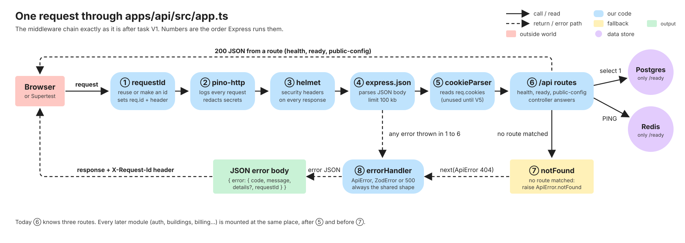
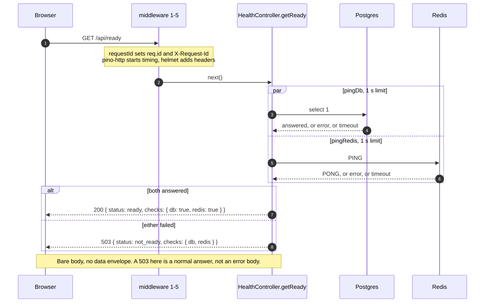
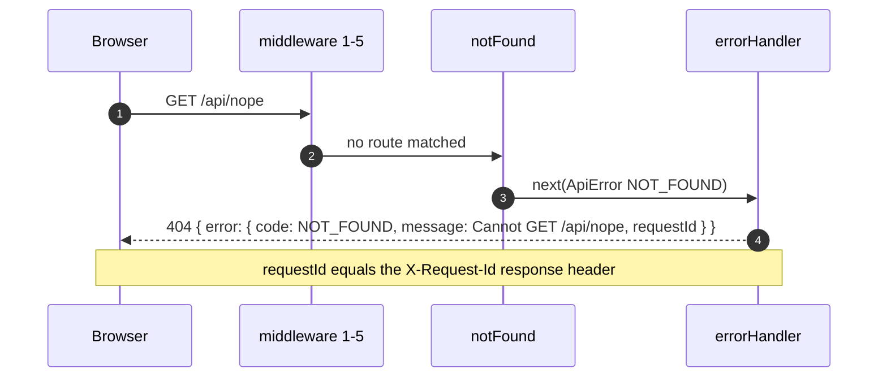

# Request lifecycle

What happens, step by step, between a browser sending a request and the browser getting an answer. This is the
backbone of the API: every feature added later plugs into the same chain, so learn it once here.

**Analogy.** The API is a building with a front desk. Every visitor (request) gets a numbered badge
(`requestId`), a note in the visitor log (`pino-http`), a security check (`helmet`), and has their luggage
unpacked (`express.json`, `cookieParser`) before being sent to the right office (a route). If there is no such
office, or something goes wrong inside, the visitor always gets the **same standard letter** (`errorHandler`),
never a stack trace.

## The path of one request

1. The browser calls a relative URL such as `/api/ready`. In dev and in the e2e preview, Vite proxies `/api` to
   the API (`apps/web/vite.config.ts`). In staging and production a Caddy reverse proxy will do that job and
   terminate TLS (task V3).
2. Express runs the middleware chain below, **in the order they are registered** in `createApp()`.
3. A route's controller answers, or something calls `next(error)` and the chain jumps to `errorHandler`.

Solid arrows are calls, dashed arrows are returns and error paths; pink is the outside world, blue our code,
yellow the fallback, purple data stores, green the output.

## The middleware chain, one step at a time

All of it is wired in `apps/api/src/app.ts`. The order matters, and the reasons are below.

| #   | Middleware                               | What it does                                                                                                                                                                                      |
| --- | ---------------------------------------- | ------------------------------------------------------------------------------------------------------------------------------------------------------------------------------------------------- |
| 1   | `requestId`                              | Reuses the caller's `X-Request-Id` if it is 1 to 64 characters of letters, digits and `-`; otherwise makes a new UUID. Stores it as `req.id` and echoes it in the `X-Request-Id` response header. |
| 2   | `createHttpLogger` (pino-http)           | Writes one JSON log line per finished request, tagged with `req.id`. Redacts secrets. Skips `/api/health`. Never logs bodies.                                                                     |
| 3   | `helmet()`                               | Adds the standard security response headers.                                                                                                                                                      |
| 4   | `express.json({ limit: '100kb' })`       | Parses JSON request bodies; anything bigger than 100 kb is rejected.                                                                                                                              |
| 5   | `cookieParser()`                         | Fills `req.cookies`. Nothing reads it until auth arrives in V5.                                                                                                                                   |
| 6   | `app.use('/api', createHealthRoutes(…))` | The routes. Today: `GET /api/health`, `/api/ready`, `/api/public-config`.                                                                                                                         |
| 7   | `notFound`                               | Reached only if no route answered. Calls `next(ApiError.notFound(...))`.                                                                                                                          |
| 8   | `errorHandler`                           | Four arguments, so Express knows it is the error handler. Turns any error into the shared JSON error body.                                                                                        |

Also set before the chain: `x-powered-by` is disabled (do not advertise "Express"), and `trust proxy` is `1`,
which means "there is exactly one proxy in front of me (Caddy), so believe the client IP it reports". Rate
limiting by IP (V5) depends on that being right.

### Why this order

- **`requestId` first**, so every later step, including the logger and the error handler, can use the id.
- **Logger before `helmet`/`json`**, so a request that is rejected early (for example a body that is too big)
  is still logged.
- **Routes after the parsers**, so a controller sees `req.body` and `req.cookies` already parsed.
- **`notFound` and `errorHandler` last**, because Express only falls through to them when nothing earlier
  answered.

## Sequence: a healthy `GET /api/ready`

`/api/ready` answers "can this API actually serve traffic right now?". Docker and the uptime monitor use it.
It checks both Postgres and Redis **at the same time**, each with a 1-second limit.

`pingDb` and `pingRedis` **never throw**: they race the real call against a timer and resolve to `true` or
`false`. That is what lets the endpoint turn a dead Redis into a clean 503 instead of a crash. The integration
test `apps/api/test/ready.int.test.ts` proves it by pointing the app at a closed Redis port and checking the
answer is a 503 in under 2.5 seconds.

## Sequence: the failure path, an unknown route

### What `errorHandler` does with each kind of error

| What was thrown                          | Response                                                                      | Logged?                                             |
| ---------------------------------------- | ----------------------------------------------------------------------------- | --------------------------------------------------- |
| `ApiError` (our own typed error)         | Its status and code, its message, `details` if any                            | By pino-http as a 4xx `warn`                        |
| `ZodError` (a schema rejected the input) | 400 `VALIDATION_FAILED`, `details` from `toErrorDetails(issues)`              | By pino-http as a 4xx `warn`                        |
| Anything else                            | 500 `INTERNAL`, message "Something went wrong". **No stack trace, no detail** | `req.log.error` with the full error and `requestId` |

Every body has the same shape and a `requestId`. When a user reports "it said something went wrong", the
`requestId` they quote is the key you search the logs for. See [Error codes](/reference/error-codes).

## Code walk

In execution order. Paths are relative to the repo root.

1. [`apps/api/src/server.ts`](https://github.com/RHRONY05/BasaManager/blob/main/apps/api/src/server.ts) `bootstrap()`: `loadEnv()`, build the logger, `createPrisma`, `createRedis`, ping both with a 2-second limit and **exit 1 if either is down** (fail fast: a half-working API that starts anyway is worse than one that refuses), `createApp(...)`, `listen`. On SIGTERM/SIGINT it stops accepting connections, closes idle ones, disconnects Prisma and Redis, and force-exits after 10 seconds if something hangs.
2. [`apps/api/src/app.ts`](https://github.com/RHRONY05/BasaManager/blob/main/apps/api/src/app.ts) `createApp(deps)`: registers the chain above. It takes its dependencies (`env`, `prisma`, `redis`, `logger`) as arguments instead of importing globals, which is what lets tests build an app with a fake Redis.
3. [`apps/api/src/middleware/requestId.ts`](https://github.com/RHRONY05/BasaManager/blob/main/apps/api/src/middleware/requestId.ts) `requestId`: trust-but-verify the incoming id, else `newRequestId()` from `apps/api/src/lib/ids.ts`.
4. [`apps/api/src/middleware/logger.ts`](https://github.com/RHRONY05/BasaManager/blob/main/apps/api/src/middleware/logger.ts) `createHttpLogger`: pino-http with `genReqId` reusing `req.id`, `customLogLevel` (5xx or error = `error`, 4xx = `warn`, else `info`) and the redaction list from `apps/api/src/lib/logger.ts`. See [Logging](/concepts/logging).
5. [`apps/api/src/modules/health/health.routes.ts`](https://github.com/RHRONY05/BasaManager/blob/main/apps/api/src/modules/health/health.routes.ts) `createHealthRoutes`: builds a `Router`, constructs `HealthController`, maps the three GET routes.
6. [`apps/api/src/modules/health/health.controller.ts`](https://github.com/RHRONY05/BasaManager/blob/main/apps/api/src/modules/health/health.controller.ts): `getHealth` (always `{ status: 'ok', release }`), `getReady` (the two pings), `getPublicConfig` (the one enveloped route: `{ data: { appEnv, sentryDsn, vapidPublicKey } }`).
7. [`apps/api/src/config/db.ts`](https://github.com/RHRONY05/BasaManager/blob/main/apps/api/src/config/db.ts) `pingDb` and [`apps/api/src/config/redis.ts`](https://github.com/RHRONY05/BasaManager/blob/main/apps/api/src/config/redis.ts) `pingRedis`: race the real call against a timer.
8. [`apps/api/src/middleware/notFound.ts`](https://github.com/RHRONY05/BasaManager/blob/main/apps/api/src/middleware/notFound.ts), then [`apps/api/src/middleware/errorHandler.ts`](https://github.com/RHRONY05/BasaManager/blob/main/apps/api/src/middleware/errorHandler.ts), using [`apps/api/src/lib/ApiError.ts`](https://github.com/RHRONY05/BasaManager/blob/main/apps/api/src/lib/ApiError.ts) and the shapes in `packages/shared/src/errors.ts`.

`apps/api/src/middleware/validate.ts` exists but no route uses it yet. It is the standard way a route will
say "check my body, query and params against these Zod schemas": parsed values go to `res.locals.validated`
(not `req.query`, which Express 5 makes read-only) and are read back with `getValidated`.

## Edge cases

| Case                                               | What happens                                                                  | Proved by                                      |
| -------------------------------------------------- | ----------------------------------------------------------------------------- | ---------------------------------------------- |
| Caller sends a good `X-Request-Id`                 | It is reused, so a request can be traced across systems                       | `apps/api/src/middleware/requestId.test.ts`    |
| Caller sends a bad or 65+ character `X-Request-Id` | Ignored; a fresh UUID is used (stops log injection and giant ids)             | `apps/api/src/middleware/requestId.test.ts`    |
| Redis is down                                      | `/api/ready` returns 503 `not_ready` with `redis: false`, in about 1 second   | `apps/api/test/ready.int.test.ts`              |
| Postgres is down                                   | Same, with `db: false`                                                        | `apps/api/src/modules/health/health.test.ts`   |
| Unknown route                                      | 404 `NOT_FOUND` in the shared error shape, `requestId` equals the header      | `apps/api/test/ready.int.test.ts`              |
| A handler throws an ordinary `Error`               | 500 `INTERNAL`, generic message, the real error text never reaches the client | `apps/api/src/middleware/errorHandler.test.ts` |
| A Zod schema rejects input                         | 400 `VALIDATION_FAILED` with `details`                                        | `apps/api/src/middleware/errorHandler.test.ts` |
| Startup with Postgres or Redis unreachable         | Logs `fatal`, exits 1 before binding the port                                 | `server.ts` (no automated test yet)            |
| **Malformed JSON body, or a body over 100 kb**     | **Today this returns 500 `INTERNAL`**, see the gotcha below                   | Checked by hand, no test                       |

## Gotchas

- **A known gap.** The JSON parser (`express.json`) throws its own errors for bad JSON (status 400) and
  oversized bodies (status 413). `errorHandler` only recognises `ApiError` and `ZodError`, so these fall into
  the "anything else" branch and are answered as `500 INTERNAL` and logged as errors. A client that sends
  `{bad` should get a 400 `VALIDATION_FAILED`, and an oversized body should get 413. This is not fixed yet;
  when it is, update this page and add a test.
- `/api/health` is deliberately **not logged** (it is polled constantly); `/api/ready` **is** logged on every
  call, so a probe that hits it every few seconds will fill the logs with `info` lines.
- Two kinds of success body exist: the probe endpoints are bare; everything else is `{ data }`. The web
  client's `apiFetch` copes with both by unwrapping `data` only when it is present.

## Self-check

1. Why does `requestId` come before the logger? 

Answer
The logger tags each line with <code>req.id</code>. If the id did not exist yet, the first log line of every request would have no id, and the error body could not quote it.

2. A tenant sends a request to `/api/leases/123` and the lease belongs to another landlord. Which error code does the API use, and why that one? 

Answer
<code>NOT_FOUND</code>, never <code>FORBIDDEN</code>. A 403 would confirm that the lease exists. (The rule is in <code>.agent/rules/basamanager.md</code>; the code arrives in V7.)

3. What happens if Redis dies while the API is running? 

Answer
Requests that do not need Redis keep working. <code>/api/ready</code> starts returning 503 with <code>redis: false</code>, so the proxy or monitor can take the instance out of rotation. Nothing crashes, because <code>pingRedis</code> never throws and the Redis client has an error handler attached.

4. What happens if Redis is down when you **start** the API? 

Answer
It logs a fatal message and exits with code 1 before opening the port. Failing at start is intentional: a deploy with a broken dependency should fail loudly and roll back.

5. Where would a stack trace go if a controller crashes? 

Answer
Into the log, via <code>req.log.error</code> in <code>errorHandler</code>, tagged with the request id. The HTTP body only says "Something went wrong" plus the <code>requestId</code>.

6. What happens if a client POSTs `{bad` as JSON today? 

Answer
The JSON parser throws a 400-status error that <code>errorHandler</code> does not recognise, so the client gets 500 <code>INTERNAL</code>. This is the known gap above.

